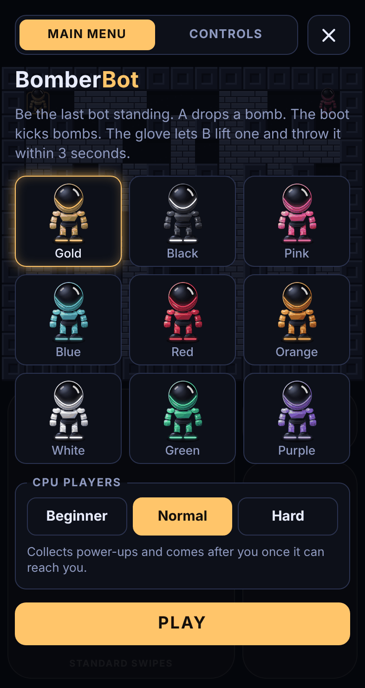
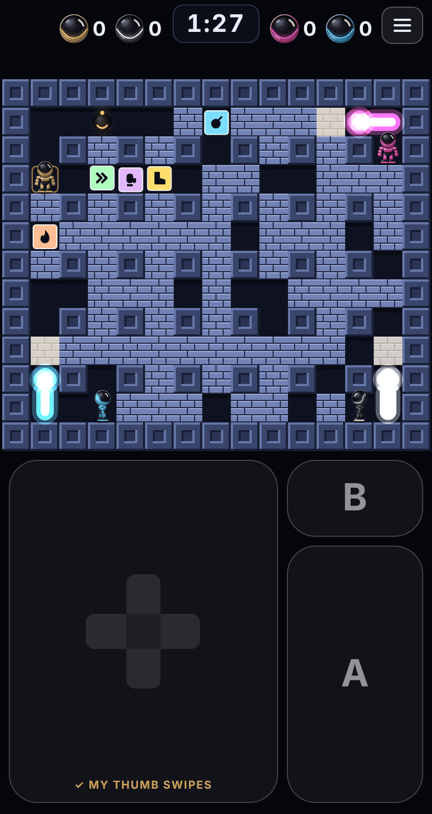
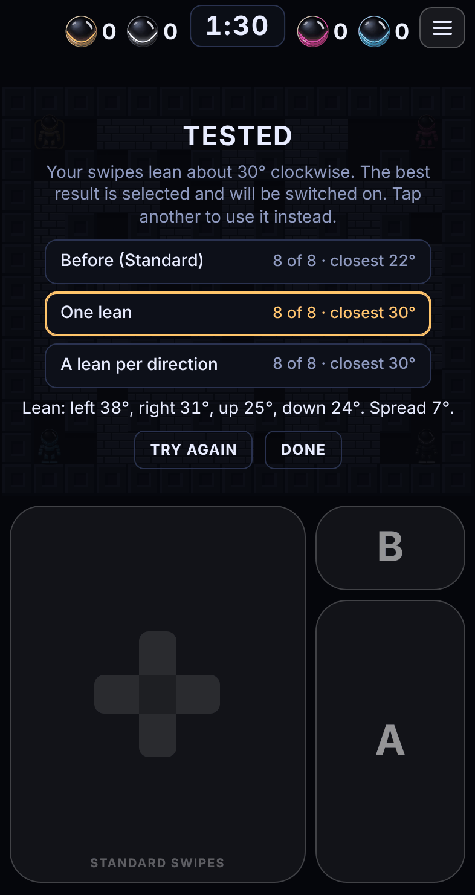

# BomberBot

A top-down 2D bomber battle game for the browser, built for phones. You steer a little robot round a maze of bricks, drop bombs to blast paths open, collect power-ups and knock out the other bots. The last bot standing wins.

It is a personal project for playing with friends.

<p align="center">
  
  
  
</p>

## Where it stands

Steps 1 to 3 of 7 are built: one arena to get the feel of the game right, CPU players to play it against, and a round timer with falling blocks so every round ends.

Working today:

- One arena with solid blocks and breakable bricks, a new layout every round
- A glossy armoured robot in nine colours, drawn in code (no image files), seen from the front, back and sides as it walks
- Bombs, blasts, chain reactions and seven power-ups, two of them very rare
- Kicking bombs, and lifting and throwing them
- Touch controls made for one thumb on each side, steered with the left or the right thumb, with a swipe pad that can be matched to your own thumb
- Three CPU players at three levels: Beginner, Normal and Hard
- A timer of 1 minute 30: when it reaches zero, blocks fall round the edge and inward for 50 seconds, leaving a 5 by 5 square in the middle to fight it out in
- A scoreboard of four heads beside the timer that counts the rounds each player has won, with a crown for whoever is in the lead
- A knock-out that burns the bot to ash while its ghost floats away, and a winner that jumps and dances
- A menu that pauses the round, with tabs for the main menu and the controls
- Keyboard controls for playing on a computer
- Sound effects

Not built yet: a choice of round length, teams, and playing online. The plan is in [docs/ROADMAP.md](docs/ROADMAP.md).

## How to play

Be the last bot standing. Three CPU players start in the other corners; choose how good they are under **CPU players** in the menu. Blast them without getting caught in a blast yourself.

| | Phone | Computer |
|---|---|---|
| Move | Swipe on the pad and keep your thumb down. Slide another way to turn. Lift to stop. | Arrow keys or W A S D |
| Drop a bomb | **A** | Space |
| Lift a bomb, then throw it | **B**, then **B** again (needs the glove) | Shift |
| Pause and open the menu | The three bars at the top right, then **✕** to go back | Escape |

Power-ups are hidden under some bricks:

| Power-up | What it does |
|---|---|
| Bomb | One more bomb out at a time |
| Flame | Your blasts reach one tile further. They start one tile long |
| Arrows (») | You walk faster |
| Boot | Run into a bomb to kick it sliding away |
| Glove | Lift a bomb with B and throw it. A lifted bomb goes off after 3 seconds, even in your hands |
| Shield (very rare) | The next blast does not knock you out. Wears off after 30 seconds |
| Skull (very rare) | A curse, not a gift: you walk slower than the starting speed for 8 seconds |

If the pad sometimes reads your swipes as the wrong direction, open the menu's **Controls** tab and tap **My thumb** to run Match my thumb. Twelve swipes measure how yours lean, eight more test the result, and it keeps whichever setting reads you best. It takes about 40 seconds, and you only do it once. The tab and the corner of the swipe pad show whether Standard or My thumb is on. [How it works](docs/MATCH-MY-THUMB.md).

The full rules are in [docs/GAME-RULES.md](docs/GAME-RULES.md).

## Run it yourself

You need [Node.js](https://nodejs.org). Version 22 is what the game is built and tested with.

```sh
npm install      # once, to fetch the build tools
npm run build    # makes dist/index.html
```

Open `dist/index.html` in a browser. That one file is the whole game.

```sh
npm test         # run the checks
npm run check    # type-check, test and build in one go
```

More, including how to play your own build on your phone: [docs/HOW-TO.md](docs/HOW-TO.md).

## What is in this repository

```
src/
  sim.ts        the game rules: arena, movement, bombs, blasts, power-ups, who wins
  swipe.ts      the swipe pad: turns thumb movement into up, down, left or right
  teach.ts      the maths behind Match my thumb: measuring, testing, choosing
  bot.ts        the CPU players: how they dodge, dig, hunt and the three levels
  input.ts      keyboard and touch wiring
  render.ts     all the drawing
  audio.ts      sound effects
  main.ts       ties it together: game loop, menu, screen layout, settings
  page.html     the page's markup and styles
tests/          automatic checks of the rules, the swipe pad, the thumb maths and the CPU players
experiments/    simulations used to tune the controls and measure the CPU players (not part of the game)
tools/          a script that retakes the screenshots (optional)
docs/           the documents listed below
build.mjs       builds everything into one file
CLAUDE.md       notes for working on this project with Claude
```

## Documentation

| Document | What it covers |
|---|---|
| [docs/HOW-TO.md](docs/HOW-TO.md) | Running, building, testing, changing things, sharing the game |
| [docs/GAME-RULES.md](docs/GAME-RULES.md) | Every rule of play, with the numbers |
| [docs/CONTROLS.md](docs/CONTROLS.md) | The touch layout, how the swipe pad reads a thumb, how turning works |
| [docs/MATCH-MY-THUMB.md](docs/MATCH-MY-THUMB.md) | What Match my thumb measures, how it tests the result, and how the pad uses it (version 2, in the game now) |
| [docs/MATCH-MY-THUMB-V1.md](docs/MATCH-MY-THUMB-V1.md) | The first version of Match my thumb, kept for reference |
| [docs/CPU-PLAYERS.md](docs/CPU-PLAYERS.md) | How the CPU players think, the three levels, and what has been measured |
| [docs/CODE-GUIDE.md](docs/CODE-GUIDE.md) | How the code is organised, file by file |
| [docs/ROADMAP.md](docs/ROADMAP.md) | What is planned, and the decisions made so far |
| [experiments/README.md](experiments/README.md) | The simulations behind the control tuning and the CPU player matches, and what they showed |

## How it is made

- TypeScript, drawn on an HTML canvas. No game engine and no image or sound files.
- The game rules are kept completely apart from drawing and input, so they can be tested without a browser and later run on a server for online play.
- The build produces a single HTML file of about 70 KB.
- Directed and playtested by codybakerxx. The code is written with Claude, Anthropic's AI.

## Credits and notes

BomberBot is inspired by the classic Bomberman games. It is an independent personal project and is not affiliated with or endorsed by Konami, which owns the Bomberman name.

All code, art and sound in this repository are original. The open-source fan remake [TommyBez/bomberman](https://github.com/TommyBez/bomberman) was studied for ideas at the very start; none of its code or art is used here.

No licence has been chosen for this repository yet.
