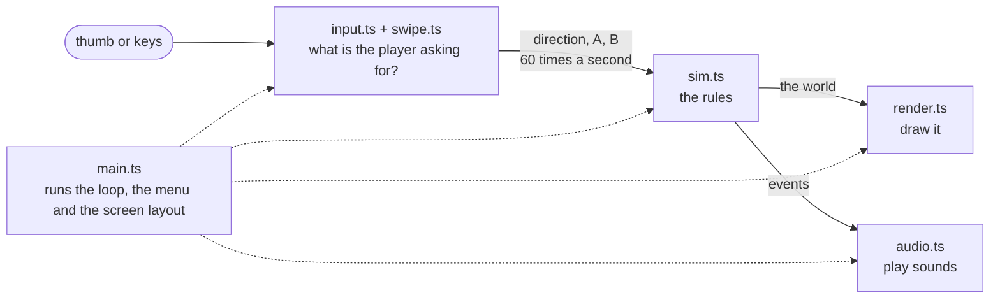

# Code guide

How the code is organised, what each file is for, and the rules to keep to when changing it. The files themselves carry comments on every part; this is the map.

## The big picture

The game is split into layers that only talk to each other in one direction.

- **Input** turns touches and key presses into three things: a direction, whether A is held, whether B is held.
- **The rules** take the current world and everyone's input and work out the world one tick later. They know nothing about screens, sound or browsers.
- **Rendering** draws the world. It never changes it.
- **Audio** plays a sound for each thing the rules report happened.
- **main.ts** owns the loop that drives all of this, plus everything about the page.

Keeping the rules apart is the most important decision in the project. It is why the rules can be tested without a browser, and it is what will let the same file run on a server for online play.

## One frame, step by step

1. The browser calls `frame()` in `main.ts` before each screen refresh.
2. `frame()` works out how much time has passed and runs `tick()` once for every sixtieth of a second owed. Screens that refresh at 90 or 120 times a second still get exactly 60 ticks a second.
3. `tick()` asks `input.state()` for the player's direction and buttons.
4. `tick()` calls `step(world, inputs)` in `sim.ts`, which moves everything forward one tick and fills `world.events`.
5. `tick()` plays a sound for each event and checks whether the round has ended.
6. `frame()` calls `render()`, which draws the cached floor layer and then everything that moves.

## File by file

### `src/sim.ts`: the rules

The whole game as pure logic. No drawing, no sound, no browser calls, no `Math.random`.

| Part | What it is |
|---|---|
| `World` | The complete state of a match: the tiles, the players, bombs, blasts, burning bricks, power-ups, and the result |
| `createWorld(config)` | Builds a fresh arena from a seed |
| `step(world, inputs)` | Advances the world one tick. The only function the rest of the game calls during play. |
| `movePlayer` | Walking, lining up with openings, turning, kicking |
| `placeBomb`, `useAction` | The A and B buttons |
| `moveBombs` | Carried bombs follow, thrown bombs fly, kicked bombs slide |
| `explode` | A blast: reach, what stops it, chain reactions |
| Constants | Every number of the game, named, near the top of the file |

Positions are in tiles, and tile centres are whole numbers. A robot at `x = 3` is exactly in the middle of column 3, and `Math.round(x)` is the tile it counts as standing on.

Plain-words version: [GAME-RULES.md](GAME-RULES.md).

### `src/swipe.ts`: the swipe pad

`SwipePad` turns a stream of thumb positions into a direction. Also pure logic, so it is tested with made-up thumb paths.

| Member | Use |
|---|---|
| `press(x, y, t)`, `move(x, y, t)`, `release()` | Feed it the touch |
| `poll(t)` | Call regularly so it notices a thumb that has stopped moving |
| `dir` | The direction it currently reads: 0 none, 1 up, 2 down, 3 left, 4 right |
| `scale` | Size of the quiet zone (the menu setting) |
| `tilt` | How far its four directions lean, in degrees clockwise |
| `onStroke` | Callback used by Match my thumb to measure swipes |

Plain-words version: [CONTROLS.md](CONTROLS.md).

### `src/teach.ts`: Match my thumb maths

Four small pure functions and a list: `leanOf` (how far one swipe leans), `summarise` (average a dozen), `tiltFor` (the lean the pad should use), and `TEACH_ORDER` (the directions asked for). Explained in [MATCH-MY-THUMB.md](MATCH-MY-THUMB.md).

### `src/input.ts`: keyboard and touch wiring

The `Input` class listens to the keyboard, the swipe pad area and the two buttons, and merges them. `state()` returns `{ dir, a, b }` once per tick.

It also **latches**: a tap or flick that begins and ends between two ticks is remembered until the game has read it once, so nothing is missed.

### `src/render.ts`: drawing

Everything on the canvas is drawn with shapes in code. There are no image files.

| Function | Draws |
|---|---|
| `drawRobot` | One robot, in any colour, facing any of four ways, mid-stride or still. The menu uses it too. |
| `drawStatic` | Floor and solid blocks. Drawn once onto a hidden canvas and reused every frame. |
| `drawDynamic` | Everything else, every frame: shadows, power-ups, bricks, the ring under your robot, bombs, blasts, robots, carried and flying bombs |
| `drawItemIcon` | The five power-up icons. The top bar uses it too. |
| `COLORS` | The nine bot colours. Only the coloured parts change; the black parts are shared. |

### `src/audio.ts`: sound

Each effect is a short synthesised tone or burst of noise. `sfx.place()`, `sfx.explode()` and so on. Sound only starts after the first tap or key press, because browsers require that.

### `src/main.ts`: the app shell

Everything that ties the game to the page:

- the fixed-rate loop (`frame`, `tick`)
- sizing the arena and controls to the screen (`layout`)
- the top bar (`drawHud`)
- the menu and bot picker (`buildPicker`, `start`, `toMenu`), and the result panel (`finish`)
- the D-pad settings (`settings`, `applySettings`)
- the Match my thumb screen (`startTeach`, `teachStroke`, `finishTeach`)

It holds no game rules.

### `src/page.html`: the page

The markup and all the styles. A comment at the top lists every element by id. `build.mjs` pastes the compiled code in at the `/*__BUNDLE__*/` marker.

Two classes on `<body>` drive the layout: `touch` (show the on-screen controls) and `portrait` (phone held upright). `layout()` in `main.ts` sets both.

### `build.mjs`: the build

Bundles `src/main.ts` with esbuild, pastes it into `src/page.html`, and writes `dist/index.html`. That single file is the whole game.

## The world, briefly

| In `World` | Holds |
|---|---|
| `tiles` | One number per tile: 0 floor, 1 solid block, 2 brick |
| `hidden` | Power-ups still under bricks |
| `players` | Position, facing, what they can do, whether they are still in |
| `bombs` | Position, owner, fuse, blast length, and whether on the floor, carried or flying |
| `flames` | The tiles of blasts still burning |
| `burning` | Bricks a blast has reached, about to become floor |
| `items` | Power-ups lying in the open |
| `events` | What happened this tick: place, kick, lift, throw, land, explode, pickup, death |
| `over` | Null until the round is decided, then the winner or a draw |

## Rules to keep to

1. **`sim.ts` stays pure.** No DOM, no `Math.random`, no clocks. Randomness comes from the seeded generator `makeRng`. The same seed with the same inputs must give exactly the same result every time; a test checks this. Online play will depend on it.
2. **Rendering never changes the world.** It only reads it.
3. **The rules never draw or play sound.** They report events; `main.ts` acts on them.
4. **`swipe.ts` and `teach.ts` stay pure too**, so they can be tested with made-up thumb paths.
5. **Numbers get names.** Game numbers are constants at the top of `sim.ts`, pad numbers at the top of `swipe.ts`.
6. **No image or sound files.** Everything is drawn and synthesised in code, which keeps the game one small file.
7. **Phones first.** Every screen has to work on an upright phone about 390 px wide, and sideways.
8. **Run `npm run check` before calling anything done.**

## Tests

`npm test` runs three files through `tests/index.ts`. Each is a plain script: it builds a situation, runs it, and asserts what must be true. The first failure stops with an error; reaching "all checks passed" means everything held.

| File | Covers |
|---|---|
| `tests/rules.test.ts` | The arena, walking and stopping, bombs and blasts, power-ups, chain reactions, kicking, lifting and throwing, winning, turning at openings, repeatability from a seed, and 45,000 ticks of random play that must never leave a robot inside a block or jittering |
| `tests/swipe.test.ts` | The pad: when a stroke starts, wiggles, drift and bounce-back ignored, turns and reverses mid-swipe, leaning swipes read correctly from every starting direction, the stroke reports Match my thumb relies on |
| `tests/teach.test.ts` | Measuring a lean, averaging, rejecting scattered swipes, the three-quarters rule and its limits |

To add a check, copy a block in the nearest file and change what it sets up and what it asserts.

There are no automatic browser tests. The game has been checked in a phone-sized browser window by hand and with the script in `tools/`, and play-tested on a real phone.

## Experiments and tools

- [`experiments/`](../experiments/README.md) holds simulations used to decide how the controls should work. They are not part of the game and nothing depends on them.
- `tools/screenshots.py` retakes the pictures in `docs/screenshots/`. It needs Python and a Chrome browser, and is optional.

## Where new features will go

| Planned | Where it fits |
|---|---|
| Computer players | A new module that looks at the world and returns a `PlayerInput` for a bot each tick. `tick()` in `main.ts` already passes a list of inputs; the three other bots just have none yet. |
| Shrinking arena | New state in `World` and a new stage in `step`. |
| More than four players, bigger arenas | `spawnPoints` and `createWorld` in `sim.ts`. The arena size is already a setting (`cols`, `rows`). |
| Teams | A team field on `Player`, and the win check at the end of `step`. |
| Online play | A small server runs `sim.ts` and is the authority. Each phone sends its `PlayerInput` and draws the world it is sent. The purity rules above are what make this possible. |
| Menus for characters, levels and custom items | `page.html` and `main.ts`. |
