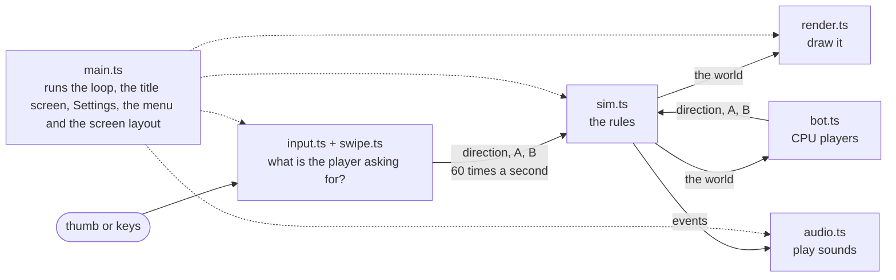

# Code guide

How the code is organised, what each file is for, and the rules to keep to when changing it. The files themselves carry comments on every part; this is the map.

## The big picture

The game is split into layers that only talk to each other in one direction.

- **Input** turns touches and key presses into three things: a direction, whether A is held, whether B is held.
- **The rules** take the current world and everyone's input and work out the world one tick later. They know nothing about screens, sound or browsers.
- **CPU players** look at the world and return the same three things a person's controls do. They never change the world either.
- **Rendering** draws the world. It never changes it.
- **Audio** plays a sound for each thing the rules report happened.
- **main.ts** owns the loop that drives all of this, plus everything about the page.

Keeping the rules apart is the most important decision in the project. It is why the rules can be tested without a browser, and it is what lets the same file run on the server for online play (below, and `docs/ONLINE.md`).

**Online**, the rules run in two places on a page. The server (`room.ts`, run by `worker.ts` on Cloudflare) steps its own world and the CPU players, and sends every page each tick's inputs for every player; the page steps its copy of that world with them the moment they arrive (`advance()` in `main.ts`, exactly what `tick()` does after reading input). That copy is always right and a little in the past. What is drawn (`shownWorld()`) is a picture `predict.ts` runs on from it to now with your own presses, so your robot moves at once. What you press goes to the server, marked with the tick it is for.

## One frame, step by step

1. The browser calls `frame()` in `main.ts` before each screen refresh.
2. `frame()` works out how much time has passed and runs `tick()` once for every sixtieth of a second owed. Screens that refresh at 90 or 120 times a second still get exactly 60 ticks a second.
3. `tick()` asks `input.state()` for the player's direction and buttons, and `botInput(world, bot)` for each CPU player's.
4. `tick()` calls `step(world, inputs)` in `sim.ts`, which moves everything forward one tick and fills `world.events`.
5. `tick()` plays a sound for each event and checks whether the round has ended.
6. `frame()` calls `render()`, which draws the cached floor layer and then everything that moves.

## File by file

### `src/sim.ts`: the rules

The whole game as pure logic. No drawing, no sound, no browser calls, no `Math.random`.

| Part | What it is |
|---|---|
| `World` | The complete state of a match: the tiles, the players, bombs, blasts, burning bricks, power-ups, and the result |
| `createWorld(config)` | Builds a fresh arena from a seed |
| `cloneWorld(world)` | A separate copy of a world, which CPU players use to try a move before making it |
| `step(world, inputs)` | Advances the world one tick. The only function the rest of the game calls during play. |
| `ticksLeft(world)`, `blockLandTick(world, k)` | What the timer shows, and when each falling block lands |
| `movePlayer` | Walking, lining up with openings, turning, kicking |
| `iceMove`, `glide` | On ice (`World.ice`, Frozen Lake): sliding on after letting go or turning back (`Player.slip`, `slipDir`, `skid`) |
| `beltLines`, `beltClock`, `beltsRunning`, `beltsAt`, `beltDir`, `beltCarry`, `beltBomb` | The Factory's conveyor belts (`World.belts`, `beltWay`, `beltFlip`): where they run, turning round after the alarm, which way one carries a robot or bomb (along its lane; through a crossing the way it came, `Player.ride`, `Bomb.ride`), carrying robots (let go when lined up to step off to the side) and bombs (waiting at anything in the way). `beltBomb` is shared with the CPU players' `foresee` |
| `placeBomb`, `useAction` | The A and B buttons |
| `moveBombs`, `slideBomb` | Carried bombs follow, thrown bombs fly, kicked bombs slide. `slideBomb` is one tick of a slide (on ice: slowing, stopping, bouncing; `Bomb.speed`), shared with the CPU players' `foresee` |
| `explode` | A blast: reach, what stops it, chain reactions |
| `knockOut`, `bringBack`, `comeBackTile` | Losing a life: coming back at the start, or out of the round (an angel, with angels on) |
| `angelStep`, `perimeterAt`, `angelAim`, `angelReach` | Angels: gliding round the outer wall, winding up and throwing a bomb in |
| `inRound`, `Player.zombie` | Who is still in the round; zombies (risen in `step`, knocked down in `knockOut`) are not |
| `launch`, `flyPlane`, `planeTurn`, `endFlight` | The laptop's plane: B takes off, `PlayerInput.aim` steers (`PLANE_STEP`: a table of moves per heading made with sums only, so every engine agrees), A drops, B lands. Its state is flat fields on `Player` (`laptop`, `flying`, `planeX`, `planeY`, `planeDir`, `planeBombs`, `planeCool`), so copies and the online picture carry it as they are |
| `moveDrops`, `dropLanding`, `blast` | Bombs falling from planes (`World.drops`): where one lands (CPU players use the same sums) and its blast, which `explode` shares |
| Constants | Every number of the game, named, near the top of the file |

Positions are in tiles, and tile centres are whole numbers. A robot at `x = 3` is exactly in the middle of column 3, and `Math.round(x)` is the tile it counts as standing on.

Plain-words version: [GAME-RULES.md](GAME-RULES.md).

### `src/swipe.ts`: the swipe pad

`SwipePad` turns a stream of thumb positions into a direction. Also pure logic, so it is tested with made-up thumb paths.

| Member | Use |
|---|---|
| `press(x, y, t)`, `move(x, y, t)`, `release()` | Feed it the touch |
| `poll(t)` | Call regularly so it notices a thumb that has stopped moving |
| `dir` | The direction it currently reads: 0 none, 1 up, 2 down, 3 left, 4 right |
| `scale` | Scales the quiet zone and turn distances. Always 1 in the game: there is no menu setting for it. |
| `aims` | The screen angle each direction is read around (index 1 to 4). Setting `tilt` instead leans all four the same number of degrees clockwise. Movement sensitivity sets them: `sensTilt(percent)`, 0.45° a percent |
| `pointing()` | The way the thumb points, from where its stroke began, at any angle: it steers the laptop's plane |
| `onStroke` | Callback with each stroke's movement, for measuring swipes (Match my thumb used it) |

Plain-words version: [CONTROLS.md](CONTROLS.md).

### `src/bot.ts`: the CPU players

Pure logic like the rules. Given the world, `botInput(world, bot)` returns one `PlayerInput`. A `Bot` holds that player's memory: its level, its plan, and its own seeded random generator.

| Part | What it is |
|---|---|
| `LEVELS` | The settings of the three levels, one line each |
| `createBot(id, level, seed)` | Makes the memory for one CPU player |
| `botInput(world, bot)` | What it presses this tick. Calls `flee` if its tile is going to be blasted, otherwise `calm`. |
| `dangerMap` | For every tile, when a blast will be on it: chain reactions, bricks that will be gone, sliding and thrown bombs (a sliding bomb's way, `path` from `foresee`/`slid`, so a blast that catches it on the way sets it off where it is then) |
| `beltStepTimes`, `beltsThen`, `beltPush`, `slid`, `occupied` | On the Factory's belts: steps timed with the belt's help or against it (across one, as anywhere), the belts' turn seen once the alarm starts, a bomb a belt carries followed to where it goes off (a bomb about to be dropped on one too) and where it will be on the way (`Danger.occ`: not stepped onto, not waited on), a robot standing still in its way holding it up (`standing`), standing still on a belt by walking against it, and no plane flown from a belt |
| `steer`, `coastTo`, `legOk`, `stepTimes`, `glideEnd`, `slideMayReach`, `lastDitch`, `scriptOk` | On ice: letting go early so the slide ends in the middle of a tile, the end of a way played as it really goes (walking, letting go, sliding on), turning back costing a slide, no bomb dropped where a sliding bomb a robot stopped could set it off, and, boxed in or in the middle of a kick or throw that no longer works, playing the nearest ways out forward on a copy of the world |
| `explore`, `pathTo`, `escapeTargets` | Where it can walk and how soon, never on a tile while it burns |
| `decide`, `chooseGoal` | Bomb a player, or pick a power-up, bricks or a player to walk to |
| `placeBomb` | The three checks before pressing A: a way out, nobody able to shut it, and the move played forward on a copy |
| `tryOut`, `wayOut` | Kicks and throws, each tried on a copy of the world first |
| `pilot` | Flying the laptop's plane: at the nearest rival, off by its level's `slop`, `lead` and `carry`, and never letting a bomb go that would reach its own robot or a teammate (`dropLanding` and `dangerMap` with the bomb added) |

It uses `cloneWorld` and `step` from `sim.ts` to play moves forward. Plain-words version: [CPU-PLAYERS.md](CPU-PLAYERS.md).

### `src/input.ts`: keyboard, touch and controller wiring

The `Input` class listens to the keyboard, the swipe pad area and the two buttons, reads every game controller once a frame (`pollGamepad`, one `PadReader` each), and merges yours (P1's, `mineIndex`) with the rest. A controller nobody has yet asks `claim` on its first press: yours, or a new player joining in the lobby (couch play); `reader(i)` gives a joined player's controller, whose `state()` drives their robot. `state()` returns `{ dir, a, b, aim }` once per tick (`aim`: the way to steer a plane, in 64ths of a turn, from the swipe pad's `pointing`, held keys or the controller; main.ts sends it online only while you fly: `flyingAim`). Keys and buttons go through the player's bindings (`setBindings`). `onDevice` reports whether a key, a controller or a touch was used last (for the hints). While Settings waits for a new key or button, `capture` gets the next press and nothing else does. `rumble` shakes the controller.

### `src/bindings.ts`: which keys and buttons do what

The actions (up, down, left, right, bomb, lift, pause), what each starts with, the names shown for keys and buttons, and `readKeys`/`readPad`, which check saved bindings and fill in anything missing. No page or browser in it.

### `src/padnav.ts`: menus with a controller

`createPadNav` moves the highlight to the nearest button in the direction pushed, within whatever is on top (`PadNavHost.top`), changes sliders and ‹ value › settings with left and right, presses with A, and hands B, LB, RB, Y and ≡ to `main.ts`.

### `src/remap.ts`: changing keys and buttons

Draws the Keyboard rows in Settings › Controls and the Buttons rows in Settings › Gamepad, and does the press-to-change: waiting, swapping (asks first), emptying, Reset, Rumble.

It also **latches**: a tap or flick that begins and ends between two ticks is remembered until the game has read it once, so nothing is missed.

### `src/robot.ts`: the robot

How one robot is drawn: from the front, the back and each side, standing, walking, with an arm raised, knocked out or as a ghost. The design was settled by the owner on a large front view; the back and side views were worked out from it. Read the note at the top of the file before changing a shape.

| Name | What it is |
|---|---|
| `drawRobot` | Draws one robot, in any colour, facing any of four ways, mid-stride or still. The lobby uses it too. |
| `drawHead` | A robot's helmet on its own, for the scoreboard, with the crown if asked |
| `Pose` | Ways to draw a robot other than standing or walking: jumping, arms up, leaning, crosses for eyes, a ghost, a crown, shrinking; `fine: false` leaves out the soft rounding however large it is drawn (the title screen) |
| `ROBOT` | Where the robot's head, top and shoulders are, in tiles, and how big it is next to the size its wings and halo were first drawn for (`scale`): for whatever is drawn round one (crown, halo, wings, shield ring, a carried bomb) |
| `warmRobots` | Makes robots' pictures ahead of the moment they are needed, a few each frame |
| `forgetSprites` | Throws away the pictures made at one size: the title screen lets go of its large ones when it closes |

**Sprites.** Drawing one robot takes a few hundred canvas calls, which is too many to make for four robots sixty times a second on a phone. So each robot is drawn once into a small picture of its own (a sprite) for each way it can look: colour, direction, one of 8 steps of the walk, how far each arm is raised. After that, drawing it is a single `drawImage`. Making a sprite takes a few thousandths of a second, so `warmSprites` in `render.ts` (called once a frame from `main.ts`) makes the ones a round will need a few at a time, before they are needed. A change of screen size makes new ones; when there are more than 700 they are all thrown away and made again as wanted.

**Two levels of finish.** Every piece is lit, shaded, given a reflection and a highlight, and throws a shadow on the piece below. On a drawing with a robot over 500 pixels tall (artwork from `tools/portraits.py`) each piece is also rounded by soft shadow and light inside its edges. At playing size that would be less than a pixel, so it is left out. The soft version uses a canvas shadow to blur (`softly`), because the canvas blur filter is missing on iPhones; it has only been tried in Chrome. The title screen's robots are that large on a phone, so it draws them with `fine: false` until the soft version has been tried on an iPhone.

### `src/setup.ts`: what the lobby and Settings choose

`MatchSetup` is the match the host sets up in the lobby: the CPU players (each `{ colorId, level }`, up to `MAX_CPUS` 3), the arena (`ARENAS`: Compact 11 by 9, Classic 13 by 11, Big 15 by 13), and the rules (round timer and length, how fast the blocks close in (`CLOSE_IN`), rounds to win, bricks (`BRICKS`), a custom start, how many bricks hide a power-up (`itemShare`, percent) and a custom power-up mix (`ITEM_AMOUNTS` times each kind's weight; `itemChances` makes the two into chances with `itemMix`)). `worldConfig` turns it into the config `createWorld` takes; `summary` is the one line the lobby and the menu show; `problem` says why a setup cannot start (no CPU player). `Prefs` is a player's own settings: sound on, volume, sounds switched off, sharpness (`SHARPNESS`), ghosts, less movement, how strongly the touch controls show. `readSetup` and `readPrefs` read what was saved and ignore anything that does not look right. Saved under `matchSetup` and `prefs`.

### `src/lobby.ts`: the lobby

Randomize CPUs (the switch at the foot of the Players page, `randEmotes` and `randLevels` in the setup): `rollCpus` in setup.ts picks each CPU player's emote and level when a match starts (`newMatch` in main.ts keeps them in `rolled`; online, `newScore` in room.ts, and the seats carry each CPU's level). The cards' own are left alone and show Random meanwhile. The map buttons (`mapPick`) set `setup.map`.

`createLobby(host)` wires up the lobby's two pages (see docs/CONTROLS.md): your colour, the player cards (each with Team, Level and Emote rows, taps on the robot and the name, and dragging one card onto another), the arena picture (a real arena from `createWorld`, drawn with `drawStatic` and `drawDynamic`) and the rules. It changes `host.setup` and `host.myColor` and calls `host.save()` after every change, then redraws everything (`refresh`). Colours always stay different: you cannot pick a CPU player's colour, and a CPU player's Colour choice lists only free ones. Other players on this screen (`host.guests`, couch play) join with `join(pad)`, and main.ts passes their controller's presses to `guestStep`, `guestReady` and `guestBack`; their robots go after yours and before the CPU players in the world (`worldConfig`'s `guests`).

### `src/ui.ts`: the menus' controls

The pieces every menu is built from, so each setting works the same with a finger, a mouse or the keys: `choice` (‹ value ›), `slider` (− slider +, with its value written out), `toggle` (a switch; the settings that only matter when it is on sit under it and show when it is), `heading`, `note`. Each is an `Opt` with `refresh()`; `mount` puts a list on a page and returns a function that refreshes them all. `swipeable` turns a sideways swipe on an element into ‹ or ›. `confirmFirst` asks before anything that cannot be undone, in the `#confirm` panel.

### `src/quick.ts`: quick chat and the quick menu

Two small panels over the round that never pause it. `createChat` builds the chat panel from `CHAT_GROUPS` (five kinds, the last, Custom, a box to type in) and calls back with the line picked; main.ts shows it at once on this screen or sends it to the room online. `createBubbles` keeps a bubble under the scoreboard head of each player who said something, placed every frame the arena is drawn (`place`, from `render` in main.ts, with where `drawScore` put each head, `headAt`, and the room `layout` leaves it, `bubbleRoom`: never over the arena). `createQuickMenu` opens a few settings (`Opt`s from ui.ts) when the menu button is held down, and still opens the full menu on a tap. Both close on a press outside them, which still goes through to the game.

### `src/title.ts`: the title screen's picture

The picture behind the title screen, drawn in code: your robot in your colour (`myColor`), front and centre, waving every 6.5 seconds; two rivals a step behind it (blue and pink, or the next bright colours if one of those is yours); a bomb with a lit fuse at its feet; and a stretch of arena behind them, with the robots in an open corridor across it, fading into the dark behind the name and the buttons. `drawTitle` draws it on a canvas the size of the screen, standing the robots in the box main.ts measures from `#titleStage` (the space the page leaves between the name and the buttons). The arena and the dark over it are drawn once per screen size and colour and kept. `closeTitle` lets go of the large robot pictures. It reads nothing of the game. The numbers for the group (how far back the rivals stand, the bomb, the wave's timing) are named at the top of the file.

### `src/render.ts`: drawing

Everything on the canvas is drawn with shapes in code. There are no image files. The robots are drawn by `robot.ts`; `render.ts` hands `drawRobot`, `drawHead` and `ROBOT` on, so the rest of the game finds all the drawing in one place.

| Function | Draws |
|---|---|
| `drawStatic` | Floor and solid blocks. Drawn once onto a hidden canvas and reused every frame. |
| `setMap`, `drawFloor`, `drawHard`, `drawSoft` | The map being drawn (`MAPS` in setup.ts): each map has its own floor, solid block and breakable block. Midnight: `drawSteel`, `drawBricks`. Wild West: `drawSand`, `drawRock` (a front face unless a block is right below; a cactus on some), `drawCrate` (stamped from a picture made once per size), with its colours in `WEST`. Frozen Lake: `drawLakeIce`, `drawSnowRock` (a snow cap, and a front face with icicles unless a block is right below), `drawIceBlock` (four variants), with its colours in `FROST`; a robot sliding on it is drawn by `drawFrost`. main.ts (`redrawStatic`) and the lobby's arena picture call `setMap` before drawing. A new map is a new id in `MAPS` and a branch in these three. |
| `drawDynamic` | Everything else, every frame: shadows, power-ups, bricks, the ring under your robot, bombs, blasts, robots, carried and flying bombs |
| `drawItemIcon` | The eight power-up icons |
| `danceFrame` (in `dances.ts`) | The winner's victory dance at a moment: facing, steps, slide and `Pose` |
| `warmSprites` | Gets the robots' pictures ready ahead of need: everyone's walk, the burnt robot, the ghosts, the winner's dance |
| `drawGhosts` | The ghosts of knocked-out robots, with wings and a halo, floating up to the top of the screen. Drawn on a layer of its own, because they leave the arena |
| `drawStatus` | What is drawn over a robot: the shield ring, the ring flying off when a shield is used up, the skull over a cursed robot |
| `drawLaptopHeld`, `drawSkies`, `drawPlane`, `drawFallingBomb` | The laptop in a robot's hands (with signal waves while it flies), and over everything the planes (in their pilot's colours, with a shadow) and the bombs falling from them, shrinking as they fall. No mark shows where a bomb will land (the owner's ask) |
| `drawBombArt`, `drawHard`, `drawSoft` | A bomb with a lit fuse, a solid block and a brick, on their own: for the title screen (always Midnight's) and the lobby's map buttons |
| `drawPlate`, `drawMachine`, `drawBox`, `drawFactory`, `drawFactoryLive`, `drawBeltIcon` (in `factory.ts`) | The Factory: steel floor plates, machines (four kinds, by the tile: a cabinet with a gauge, a cooling unit, a motor, a pipe junction; each a picture made once per size), cardboard boxes (on a belt drawn between its frame, `boxOnBelt`). `drawStatic` adds the hazard stripes along the walls, the belts at rest, the crossings (tables of rolling balls), a drive with a beacon at each end of each belt and two furnaces with their glow (`drawFactory`); `drawDynamic` the treads moving (a picture per size and way, stamped with an offset from `World.beltRun`), the beacons and arrows flashing amber while the alarm sounds, the machines' lights blinking and the furnaces flickering (`drawFactoryLive`) |
| `drawRails`, `drawCrossing`, `drawTrain`, `drawBarrel`, `drawLitTnt` (in `railway.ts`) | The Wild West's railway and TNT. `drawStatic` adds the track, the tunnels and the signals at rest (`drawRails`); `drawGround` the barrels of TNT (`drawBarrel`, a picture made once per size, with TNT on its label); `drawDynamic` the line a train is coming on (lamps flashing in turn, gates down, a red pulse: `drawCrossing`, which draws the wall tile under each signal again), barrels about to go off (`drawLitTnt`) and the train (`drawTrain`: along a row among the robots, in front of those behind its line; down a column over them all). The train is one picture per size, made once (`sideSprite` from the side, `topSprite` from above), drawn on a layer of its own so its ends darken in the tunnels, with the drive wheels and rods, smoke and the headlight's beam drawn each frame. A barrel's blast always burns with plain orange fire (`Flame.tnt`) |
| `COLORS` | The nine bot colours. Only the coloured parts change (the armour, the helmet's rim and chin piece, the lit soles); the black parts are shared. |

### `src/audio.ts`: sound

Each effect is a few layers made in code and played together: tones that slide in pitch (`voice`, with an optional falling lowpass filter, a pitch wobble and overdrive) and bursts of noise through a sweeping filter (`hiss`), timed on the audio clock. Everything goes through one master volume and a compressor, so a chain of blasts stays clean. Frequent sounds vary their pitch a little each time (`vary`). `sfx.place()`, `sfx.explode()` and so on. Sound only starts after the first tap or key press, because browsers require that. `setSound(on, volume, muted)` puts Settings › Sound into effect: every sound is scaled by the volume, and a sound switched off is not played. `preview(id)` plays one whatever its switch says, for the ▶ buttons.

### `src/main.ts`: the app shell

Everything that ties the game to the page:

- the fixed-rate loop (`frame`, `tick`): a tick a frame, evenly, whatever the wobble in a phone's frame times (`STEP_SLACK`, `STEP_LOCK`)
- staying sharp: `density`, `screenDensity` and `watchZoom` (the page's zoom counts), `keepSharp` every frame, and `checkSharp`, which measures the arena on the screen twice a second, puts it right and says what it found (shown in Settings › Graphics)
- the arena as one picture (`ground`: floor, blocks, shadows and breakable blocks, made again only when a block breaks or lands)
- sizing the arena and controls to the screen (`layout`)
- the round timer at the top (`drawTimer`)
- the title screen, where the game opens: showing it (`showTitle`), drawing it each frame instead of the arena (`renderTitle`, with the picture from `title.ts`), and leaving it for the lobby (`leaveTitle`, from Local; Online opens `#onlineSheet`, see Online play above). The lobby's back button goes back to it
- the lobby's host (`lobbyHost`, handed to `createLobby` in `lobby.ts`) and opening it (`showLobby`): it holds `setup` and `myColor`, and saves them
- the match: `newMatch` (score to 0, round 1), `start` (the next round), `resume`, `watch`, the score (`wins`, `roundNo`, `matchWinner`; `setup.firstTo` wins take the match) and the result panel (`finish`). A round's players, colours and levels are set in `newWorld`, from the setup, and nowhere else
- the menu during a match (`openPause`, `showPause`, `fillPause`, `closePause`), and its Restart (the whole match, `newMatch`) and Leave to the lobby, which ask first (`confirmFirst` in `ui.ts`)
- Settings (`showSettings`, `showSetTab`, `closeSettings`): the Sound and Graphics pages are built from `ui.ts` controls (`soundOpts`, `gfxOpts`, `padOpts`); your settings are `prefs`, put into effect by `applyPrefs`
- the keys for the menus: Escape back one step, Q and E to turn pages
- the layer the ghosts float up on (`ghosts`, placed by `layout`, drawn in `render`)
- the scoreboard (`drawScore`; `layout` works out where its four places go), the count of rounds won (`wins`) and who wears the crown (`leader`), which last until the game is closed
- the three CPU players of the round (`bots`, made in `newWorld`, asked for their input in `tick`)
- the control settings: steering thumb and swipe direction (`settings`, `thumb`, `applySettings`)
- Movement sensitivity on Settings › Controls (`settings.sens`, `sensOpts`; SENSITIVITY in swipe.ts)
- the shake of the arena on a blast (`shake`, `SHAKE_PX`, `SHAKE_S`; not with Less movement)
- Settings › App (`showApp`, `APP_LEAD`, `APP_STEPS`, `notifyOpts`, `setPush`, with `app.ts`), the host's bell in an online lobby (`roomTell`), and, on the website, the links to the icon and the manifest and the service worker (at the end of the file)

It holds no game rules.

### Online play: `src/net.ts`, `src/room.ts`, `src/worker.ts`, `src/online.ts`, `src/predict.ts`

- `net.ts` (pure, shared by page and server): the messages each way, a player's input in five bits (and the plane's steering, `IN_AIM`) and a tick's inputs as one character each (two for a player steering a plane), presses waiting for their tick (`InputQueue`, `takeInput`: the server and the page take presses in with the same lines), the world checksum (`worldHash`), the whole world as plain data (`encodeWorld`, `decodeWorld`), room codes and names.
- `room.ts` (the server's decisions, with no network or clock of its own, so `tests/room.test.ts` plays rooms through): joining by code, robots staying different, the host's setup and buttons, starting a match (people in joining order, then CPU players: `seats`), stepping the round to the time (`advance`), counting wins, dropped connections and a host handing on (`housekeep`).
- `worker.ts`: the Cloudflare side. Requests for `/api/room/CODE` go to that code's Durable Object (`RoomDO`), which holds a `Room`, turns WebSocket messages into calls on it, and runs two clocks: the round's (every 16 ms while one is played) and a tidying one (every 4 s). Everything else is the game page (`env.ASSETS`).
- `worker.ts` also holds `Friends`, notifications: one Durable Object for the whole game that keeps the phones that turned them on (`/api/push/key`, `/subscribe`, `/unsubscribe`), and sends "Cody wants to play" when a host taps the bell in the lobby (the `invite` message, through the room), answering with how it went (`BellAnswer`, shown in a bubble under the bell by `bellSay` in `main.ts`). Sign-ups only for real push services (`PUSH_HOSTS`); a room once a minute, 30 an hour, the newest 45 phones; a phone that is gone is dropped. Its signing key is made on its first use and kept on its own disk, so no secret has to be set up anywhere. `tests/friends.test.ts` plays it through with made-up phones.
- `push.ts`: what sending a notification needs, with only the standard Web Crypto: the signed VAPID token (RFC 8292) and the message locked for one phone (RFC 8291, aes128gcm). `tests/push.test.ts` opens a message the way a phone does.
- `app.ts` (the page): whether it is the home-screen app, which steps fit this device (`howToAdd`), the browser's own Install offer, and notifications on and off (`pushState`, `pushOn`, `pushOff`).
- `sw.js` (plain JavaScript, copied to `dist/` by `build.mjs` with the build's version in it): the service worker. It keeps a copy of the page, icons and font, so the game opens and plays Local with no connection (the page itself is network first, so a new version shows at once when online); and it shows notifications and opens the room when one is tapped.
- `online.ts`: the page's connection (`Online`): making or joining, trying again after a drop, pings, and asking for the whole world when a checksum differs. It hands a round to a `Predictor`.
- `predict.ts` (pure: the time is handed in, so `tests/predict.test.ts` runs it against a room over made-up connections): the round on the page. `ticks` steps the server's world as its inputs arrive and keeps a short history of where everyone was. `frame`, once a frame, sends a press when what you hold changes (marked with the picture's next tick), moves the clock (`pong`, `slew`), copies the server's world and plays it on to now with your presses (`rebuild`, `stepOn`), and makes the world to draw (`view`): that picture, with the other robots from the history a few ticks back. `heard` stops a sound made early from being made again. The header of the file explains each part.
- In `main.ts`: `joinOnline`, `onRoom` (the room's people become the lobby's `guests`, with `remote` set), `onRound` (a round or a whole world from the server), `leaveOnline`; `net`, `seats` and `meIdx` (your place: player 0 is you only on this screen), `couch()`, `human()`, `nameOf()`; `advance()` is the half of a tick that does not read input (online it steps the server's world, from the connection, not from the frame loop); `shownWorld()` is the world that is drawn; `soundOf()` plays an event's sound; `announce()` writes the result.
- In `lobby.ts`: `host.online()` says whether you are in a room and whether you host; the Match page and the CPU players are then read-only for the others (`canEdit`).

### `src/page.html`: the page

The markup and all the styles. A comment at the top lists every element by id. `build.mjs` pastes the compiled code in at the `/*__BUNDLE__*/` marker.

Classes on `<body>` drive the layout: `touch` (show the on-screen controls) and `portrait` (phone held upright), both set by `layout()` in `main.ts`; `righty` (the right thumb steers, so the controls are mirrored), set by `applySettings()`; `menu-open` (hide the Menu button and top strip while a menu screen is open), set by `showLobby()`, `showSettings()` and `showPause()`; `calm` (no animation in the menus), set by `applyPrefs()`; and `title-open` (hide everything of the game screen under the title), set by `showTitle()`.

Every canvas is made for the screen's size and pixel density at the moment `layout()` runs. A phone can change its pixel density without a resize event (the Claude app can open the page at density 1 and correct it a moment later), which left the whole game blurry until the next resize. So `keepSharp()` checks size and density every frame and lays the page out again when either has changed; the lobby's robots are redrawn when the density changes. The density used is the phone's own (less if Settings › Graphics › Sharpness asks for it), capped at 6 (`MAX_DENSITY`, `density()`; it was 3, then 4): a phone whose page is zoomed reports more, which drew the arena, robots and power-ups stretched and blurry while the page's text stayed sharp. That was the blur the owner saw, and lifting the cap fixed it on his phone.

### `build.mjs`: the build

Bundles `src/main.ts` with esbuild, pastes it into `src/page.html`, and writes `dist/index.html`. That single file is the whole game.

## The world, briefly

| In `World` | Holds |
|---|---|
| `tiles` | One number per tile: 0 floor, 1 solid block, 2 brick |
| `hidden` | Power-ups still under bricks |
| `players` | Position, facing, what they can do, whether they are still in |
| `bombs` | Position, owner, fuse, blast length, and whether on the floor, carried or flying |
| `drops` | Bombs falling from planes: where, how fast, how long until they land, and whose |
| `flames` | The tiles of blasts still burning |
| `burning` | Bricks a blast has reached, about to become floor |
| `items` | Power-ups lying in the open |
| `events` | What happened this tick: place, kick, lift, throw, land, explode, pickup, shield, block (one landed), death (with what caused it and whose bomb), launch, drop and home (a plane) |
| `roundTicks`, `shrinkTicks` | The length of the round and of the part of it in which blocks fall |
| `shrinkOrder`, `shrinkNext`, `falling` | The tiles blocks will fall on, in order; how many have started; and the ones in the air now |
| `over` | Null until the round is decided, then the winner or a draw |

## Rules to keep to

1. **`sim.ts` stays pure.** No DOM, no `Math.random`, no clocks. Randomness comes from the seeded generator `makeRng`. The same seed with the same inputs must give exactly the same result every time; a test checks this. Online play will depend on it.
2. **Rendering never changes the world.** It only reads it.
3. **The rules never draw or play sound.** They report events; `main.ts` acts on them.
4. **`swipe.ts` and `bot.ts` stay pure too**, so they can be tested without a browser, and so a server can run CPU players.
5. **Numbers get names.** Game numbers are constants at the top of `sim.ts`, pad numbers at the top of `swipe.ts`.
6. **No image or sound files.** Everything is drawn and synthesised in code, which keeps the game one small file.
7. **Phones first.** Every screen has to work on an upright phone about 390 px wide, and sideways.
8. **Run `npm run check` before calling anything done.**

## Tests

`npm test` runs the files below through `tests/index.ts`. Each is a plain script: it builds a situation, runs it, and asserts what must be true. The first failure stops with an error; reaching "all checks passed" means everything held.

| File | Covers |
|---|---|
| `tests/rules.test.ts` | The arena, walking and stopping, which way the robot looks, bombs and blasts, power-ups, chain reactions, kicking, lifting and throwing, winning, turning at openings, repeatability from a seed, and 45,000 ticks of random play that must never leave a robot inside a block or jittering |
| `tests/swipe.test.ts` | The pad: when a stroke starts, wiggles, drift and bounce-back ignored, turns and reverses mid-swipe, leaning swipes read correctly from every starting direction, the stroke reports, a separate aim per direction, the three steps of Movement sensitivity |
| `tests/room.test.ts` | Online rooms: codes, joining and refusing, robots kept different, only the host setting up and starting, a match played through with every page's world checked against the server's, a quick tap of A not lost, a dropped page coming back mid-round, only the host moving on or restarting, a host handing on |
| `tests/predict.test.ts` | How an online round feels on a page, over made-up connections from wired to bad, at 60 and 120 frames a second: your robot moving on the frame of the press and walking evenly, the other robot walking evenly, the page's world staying the server's, a press that arrives late being put right, sounds made once, carrying on after the whole world is sent again |
| `tests/bot.test.ts` | The CPU players: the danger map and chain reactions, slow levels noticing bombs late, that thinking never changes the world, no bomb without a way out, every level surviving two minutes in a full arena, every level finding and beating a player who stands still, and repeatability |

To add a check, copy a block in the nearest file and change what it sets up and what it asserts.

There are no automatic browser tests. The game has been checked in a phone-sized browser window by hand and with the script in `tools/`, and play-tested on a real phone.

## Experiments and tools

- [`experiments/`](../experiments/README.md) holds simulations used to decide how the controls should work, and the script that plays CPU players against each other. They are not part of the game and nothing depends on them.
- `tools/screenshots.py` retakes the pictures in `docs/screenshots/`. It needs Python and a Chrome browser, and is optional.
- `tools/online-feel.py` measures how online play feels: two browsers play each other through a slow, uneven connection, and it reports how long a press takes to show and how evenly the robots walk (`docs/ONLINE.md` has the numbers).
- `tools/portraits.py` saves large pictures of the robots as PNG files with transparent backgrounds, for title screens and other artwork: the robot exactly as the game draws it (`tools/portrait.ts` calls `drawRobot`), at a size where the soft finish shows, from the front or with `--view back`, `right` or `left`. Not part of the game.

## Where new features will go

| Planned | Where it fits |
|---|---|
| More than four players, bigger arenas | `spawnPoints` and `createWorld` in `sim.ts`. The arena size is already a setting (`cols`, `rows`). |
| Teams | A team field on `Player`, and the win check at the end of `step`. |
| Menus for characters, levels and custom items | `page.html` and `main.ts`. |
