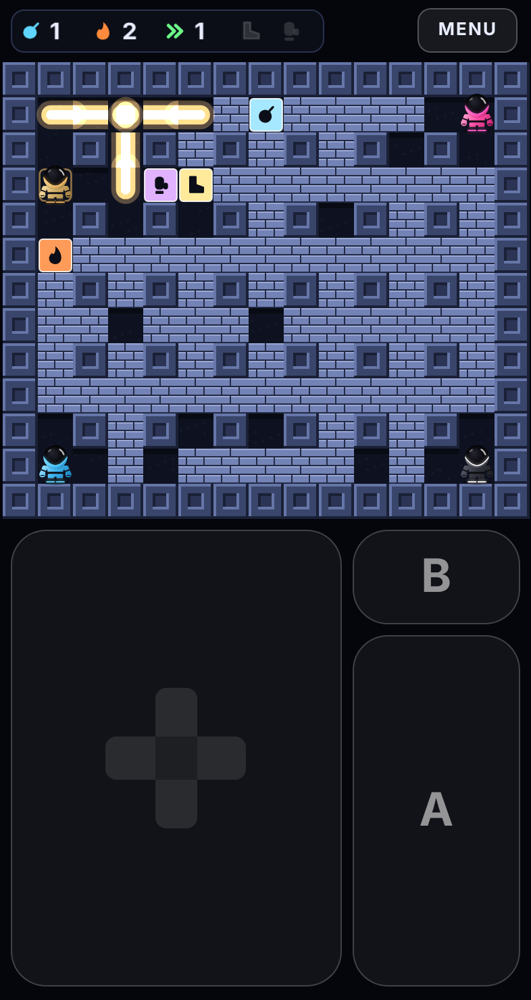
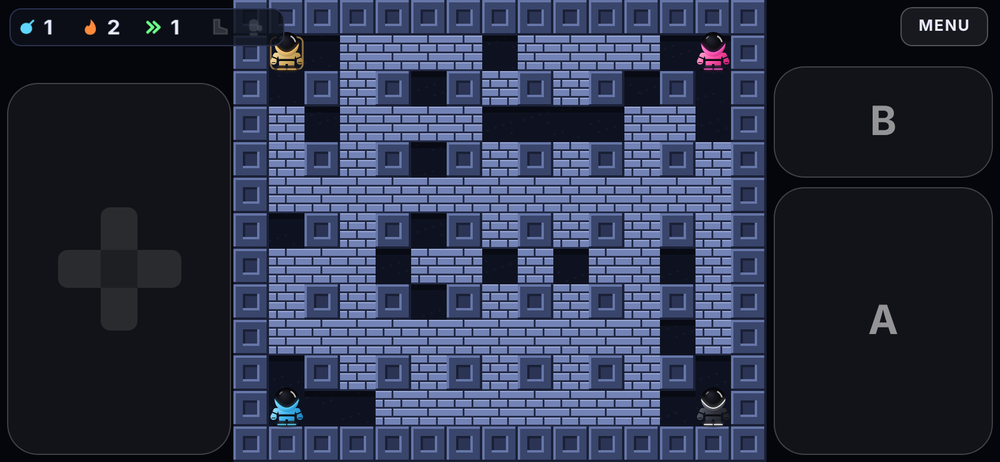
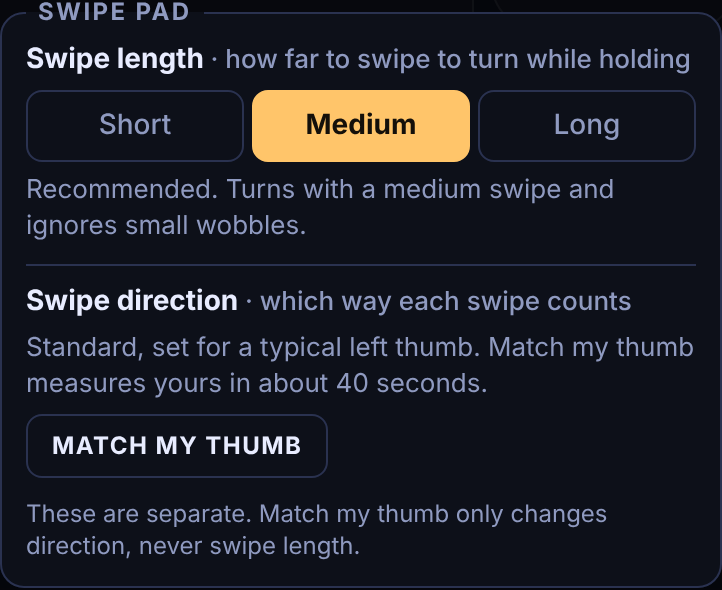

# Controls

How the game is controlled, how the swipe pad turns a moving thumb into a direction, and how to tune it.

- The swipe pad's logic is in [`src/swipe.ts`](../src/swipe.ts).
- The wiring to touches and keys is in [`src/input.ts`](../src/input.ts).
- What the robot does with a direction is in `movePlayer` in [`src/sim.ts`](../src/sim.ts), described under "Turning" in [GAME-RULES.md](GAME-RULES.md).

## The layout

  
  

On a phone held upright the arena sits at the top and the controls fill everything below it:

- **Swipe pad:** the left two thirds. The cross in the middle only shows which direction is being read. It is not a button and you do not need to touch it.
- **B:** top right. Lifts a bomb, then throws it (needs the glove).
- **A:** below B, the larger of the two. Drops a bomb.

Held sideways, the pad runs down the left edge and B and A down the right edge, either side of the arena. The panels are see-through.

The strip at the top left shows how many bombs you can have out, your blast length, your speed, and whether you hold the boot and the glove. **Menu** is at the top right.

On a computer the touch controls are hidden and the keyboard is used:

| Action | Keys |
|---|---|
| Move | Arrow keys, or W A S D |
| A (drop a bomb) | Space, X, J or Enter |
| B (lift and throw) | Shift, Z or K |

## Using the swipe pad

1. Put your thumb down anywhere on the pad.
2. Swipe the way you want to go. The robot starts moving.
3. Keep your thumb down to keep going. You do not have to keep swiping.
4. To turn, swipe another way from wherever your thumb is now.
5. Lift your thumb to stop.

"Left, then down" in one continuous movement works: the robot turns when your thumb does.

Things the pad deliberately ignores while your thumb is resting on it:

- **Small movements.** Wiggles and little flicks that stay inside a small zone round your resting thumb do nothing.
- **Slow drift.** If your thumb creeps across the pad, the zone creeps with it.
- **Bounce-back.** The small rebound at the end of a quick swipe does not turn you round.

## How the pad reads a thumb

The pad answers two separate questions.

### 1. When has the thumb started a new stroke?

**From a resting thumb.** A thumb that stays within 6 px for 120 ms counts as resting. A resting thumb has a **quiet zone** round it, 30 px in radius at the Normal setting, which is about 5 mm on a phone. Nothing inside the zone counts. A stroke starts when the thumb leaves the zone. Every time the thumb comes to rest, the zone re-centres on it, which is why slow drift never adds up to a stroke.

**From a fresh touch.** Before the robot has been given any direction, the first stroke registers after 14 px, so starting off feels quick.

**In the middle of a swipe.** Once a stroke has started, the pad follows it as a straight **leg** in whatever direction the thumb is really travelling. A new leg starts when the thumb either:

- breaks away **sideways** from the leg by 24 px (this is the "left, then down" turn), or
- comes **back** along the leg by 30 px (a deliberate reverse).

Both distances are measured against the stroke's own line, not the screen's, so a turn needs the same thumb travel whichever way the stroke was leaning. A gently curving stroke does not count as breaking away: the line follows it.

### 2. Which of the four directions is that stroke?

Whichever of up, down, left and right the leg points nearest to. Three details matter:

- **The whole leg is judged**, not a few pixels of it. A first stroke that registered at 14 px is still being read until it is 36 px long. If the longer look clearly disagrees with the first read, the direction is corrected.
- **The robot's current direction plays no part.** The same swipe always gives the same answer. (An earlier version favoured the axis the robot was already moving along, which made sideways swipes read as up or down.)
- **"Nearest" is measured against aims that lean.** A thumb pivots at its base, so quick swipes lean: with a left thumb, left drifts up and right drifts down. Each direction has an *aim*, the screen angle its swipes are expected to point at, and a stroke counts as the direction it is aimed nearest to. By default all four aims lean 15° clockwise. [Match my thumb](MATCH-MY-THUMB.md) can replace that with one lean measured for the player, or a lean for each direction. The aims change only which direction a stroke counts as. They never change how far the thumb has to travel.

### Nothing is lost between frames

The game reads the controls 60 times a second. A quick flick or a tap on A or B can begin and end between two of those readings. `src/input.ts` remembers any new direction or button press until the game has read it once, so even the shortest tap counts.

## The settings in the menu

The menu has a **Swipe pad** box (on touch screens only) with two separate settings.

### Swipe length

How far you have to swipe to turn while your thumb is held down. It sets the size of the quiet zone; the sideways and reverse distances scale with it.

| Choice | What it means | Quiet zone | Sideways turn mid-swipe | Reverse mid-swipe |
|---|---|---|---|---|
| Short | Turns with a small swipe. Quickest to react, but a wobble of your thumb can turn you. | 21 px | 17 px | 21 px |
| **Medium** | Recommended. Turns with a medium swipe and ignores small wobbles. | **30 px** | **24 px** | **30 px** |
| Long | Turns only with a longer swipe. Best if the robot turns when you did not mean it to. | 42 px | 34 px | 42 px |

On a phone, 5 to 6 px is about one millimetre. The first swipe after touching down always needs only 14 px, whatever the choice, so starting off stays quick.

The game used to offer five levels (Least, Less, Normal, More, Most). A setting saved with those is moved to the nearest of the three: Least and Less become Short, More and Most become Long.

### Swipe direction

Which of up, down, left and right each swipe counts as. It shows whether the pad is using the standard setting (15° for a typical left thumb) or one measured by [Match my thumb](MATCH-MY-THUMB.md), with the button to run it and, once matched, **Use standard** to go back.

### How the two relate

They are independent. Swipe length decides *when* a movement counts as a swipe; swipe direction decides *which way* it counts. Match my thumb never changes the swipe length, and changing the swipe length never undoes a match. The box says so in its last line.

Both are saved in the browser on that device. They do not travel with the game to another phone.

## Turning in the maze

A direction from the pad is only half of a turn. The robot can only go sideways where there is an opening, so the rules decide where the turn happens:

- If the tile the robot is standing on has the opening, it turns there.
- Otherwise it keeps running and takes the **next opening ahead**. It never doubles back to one it has passed.

So you can swipe early for a turning that is coming up. The full list is under "Turning" in [GAME-RULES.md](GAME-RULES.md).

One thing looks odd until you know why: if the robot is **standing still** between two openings and you swipe sideways, it first steps up or down to the nearest opening. It has to, because that is the only place it can go sideways from.

## Tuning it in the code

Every distance is a named constant at the top of `src/swipe.ts`.

| Constant | Value | What it controls | Symptom it fixes |
|---|---|---|---|
| `START` | 14 px | Thumb travel before the first direction after touching down | Lower: starting feels sluggish. Higher: the robot sets off when you only rested your thumb. |
| `QUIET` | 30 px | Radius of the quiet zone at Medium | Lower: turns need too much travel. Higher: small movements turn the robot. |
| `TURN` | 0.8 | Sideways break needed mid-swipe, as a share of `QUIET` | Lower: "left, then down" in one motion is slow to turn. Higher: sloppy strokes cause turns. |
| `REVISE_UNTIL` | 36 px | How long a stroke is still being read | Higher: more early mistakes get corrected, but corrections come later. |
| `REVISE_MARGIN` | 0.2 | How clearly the longer look must disagree to overrule the first read | Lower: more corrections. Higher: fewer. |
| `SETTLE_PX`, `SETTLE_MS` | 6 px, 120 ms | When a thumb counts as resting | Together they set the slowest movement that still counts as a stroke: about 50 px a second. |
| `DEFAULT_TILT` | 15° | Lean of all four aims until Match my thumb has been run | See [MATCH-MY-THUMB.md](MATCH-MY-THUMB.md). |

The three Swipe length choices are `ZONE_LEVELS` in `src/main.ts` (70, 100 and 140 percent of `QUIET`), with their descriptions in `ZONE_WORDS`.

After changing anything here, run `npm test`. `tests/swipe.test.ts` replays made-up thumb paths through the pad and checks the results: wiggles ignored, drift ignored, bounce-back ignored, real swipes read, leaning swipes read correctly from every starting direction, and a separate aim per direction honoured.

## How it got this way

The controls went through several rounds of play-testing on a phone. Each round fixed something real, and the reasons are worth keeping:

1. **Drag anywhere.** The first pad read direction from where the thumb was relative to the pad's centre. It was replaced by swiping from wherever the thumb is, in the layout of a hand-drawn wireframe: big pad on the left, B over A on the right.
2. **Small movements were too sensitive.** Direction was judged from the last 14 px of movement, so a wiggle could flip it, and the rebound after a flick could reverse it. The quiet zone, the resting rule and the bounce-back rule came from this.
3. **Whole-tile stepping was tried and removed.** Making every swipe finish on the middle of a tile was rejected in play-testing: a small movement should not move a whole block. The code for it is still in `sim.ts` (`stepAssist`) but it is switched off and has no setting.
4. **"I go up instead of left."** Two causes were found. The robot doubled back to the nearest opening when a turn was swiped early, which the next-opening-ahead rule fixed. And sideways swipes were misread while the robot was moving up or down, which the unbiased, leaning read fixed. Match my thumb was added in the same round.
5. **Match my thumb version 2.** A lean per direction and a test round were added. Simulation showed a lean per direction alone is roughly a wash, so the test round decides, on each player's own swipes, whether it is used.

The simulations used to compare the old and new behaviour are in [`experiments/`](../experiments/README.md).
