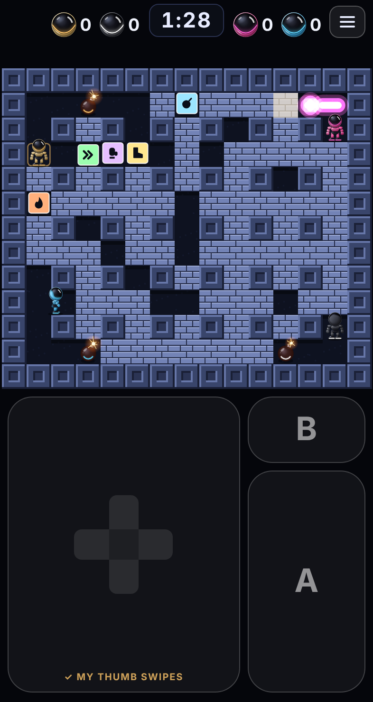
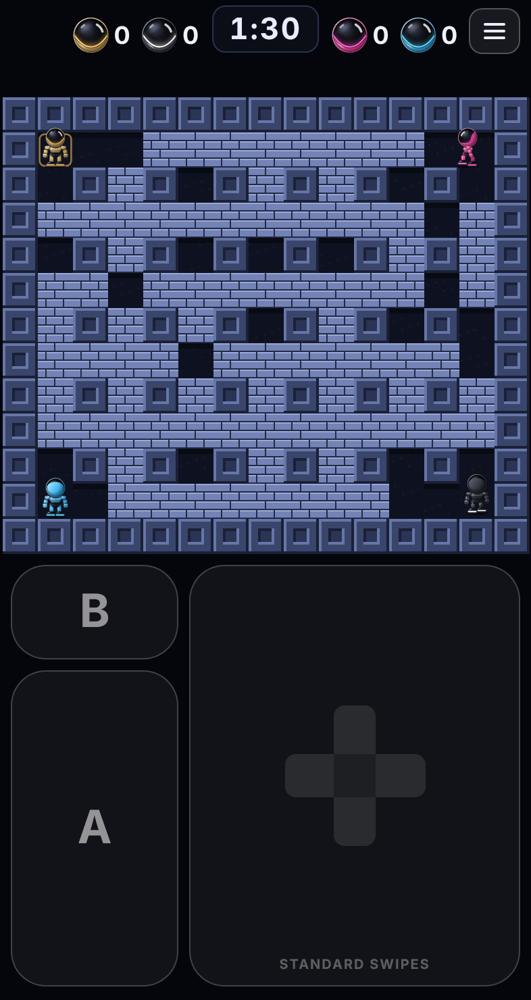
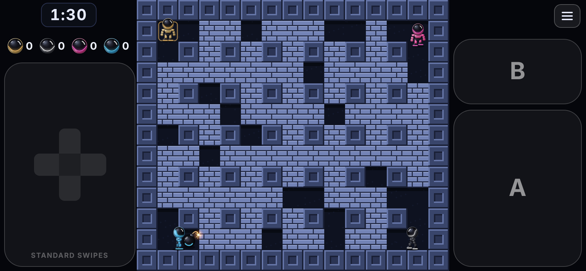
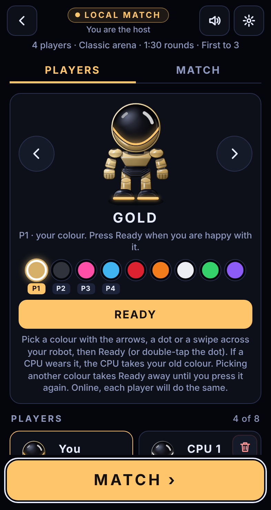
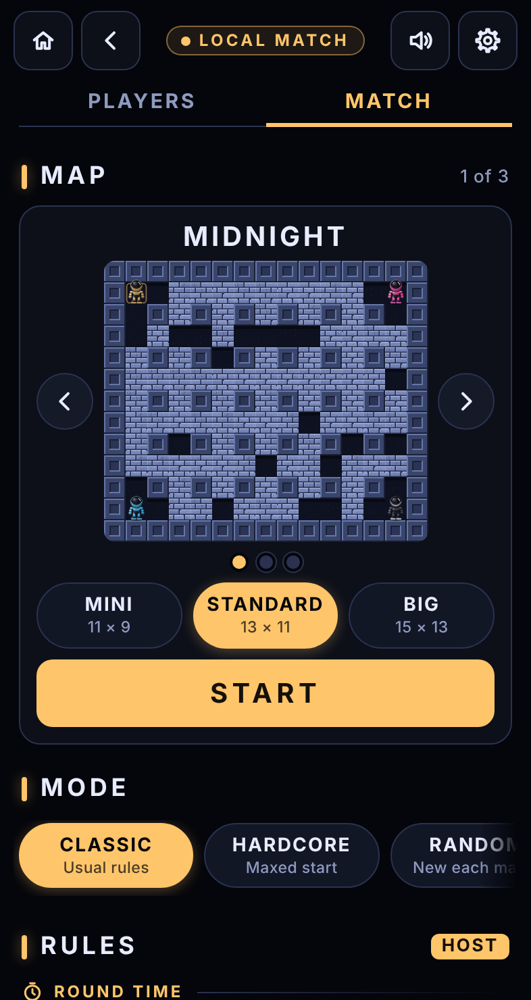
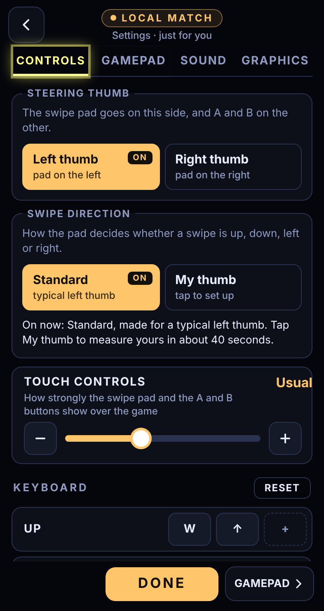
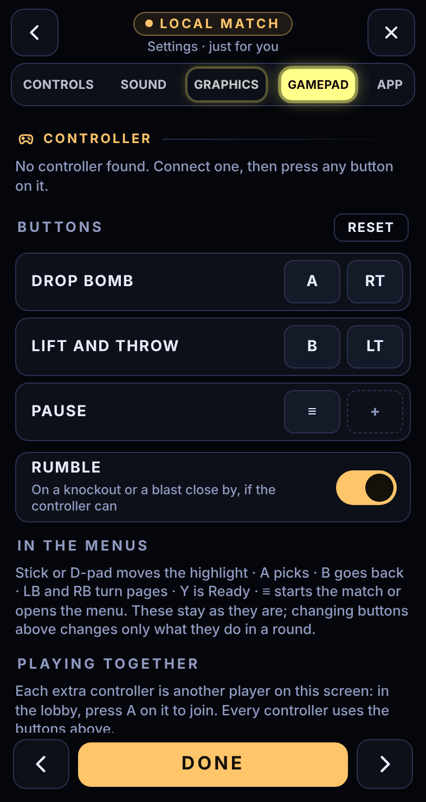
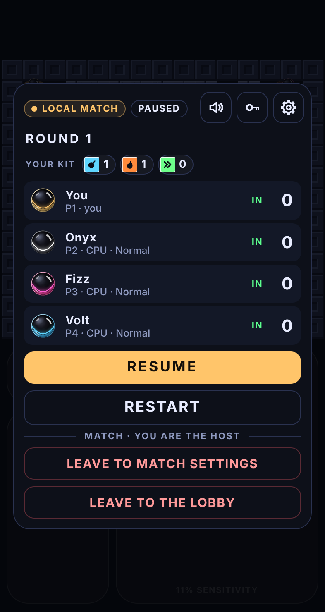
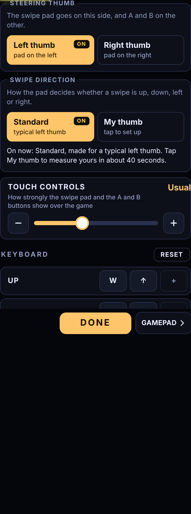
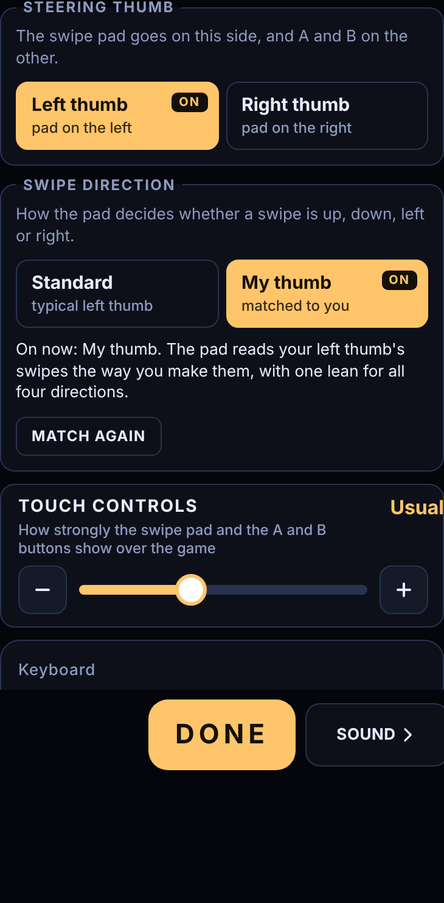

# Controls

How the game is controlled, how the swipe pad turns a moving thumb into a direction, and how to tune it.

- The swipe pad's logic is in [`src/swipe.ts`](../src/swipe.ts).
- The wiring to touches, keys and game controllers (one `PadReader` each) is in [`src/input.ts`](../src/input.ts); the keys and buttons each action starts with are in [`src/bindings.ts`](../src/bindings.ts); getting round the menus with a controller is [`src/padnav.ts`](../src/padnav.ts); changing keys and buttons in Settings is [`src/remap.ts`](../src/remap.ts).
- What the robot does with a direction is in `movePlayer` in [`src/sim.ts`](../src/sim.ts), described under "Turning" in [GAME-RULES.md](GAME-RULES.md).

## The layout

  
  

  

On a phone held upright the top bar comes first (the scoreboard and the timer are in it), then a blank line one block high, then the arena, and the controls fill everything below it:

- **Swipe pad:** two thirds of the width. The cross in the middle only shows which direction is being read. It is not a button and you do not need to touch it.
- **B:** on the other side, at the top. Lifts a bomb, then throws it (needs the glove).
- **A:** below B, the larger of the two. Drops a bomb.

Which side the pad is on is a setting, **Steering thumb**. With *Left thumb* (the default) the pad is on the left and B and A on the right. With *Right thumb* the same layout is mirrored.

Held sideways, the pad runs down one edge and B and A down the other, either side of the arena. The panels are see-through.

The **scoreboard** is in the top bar: four heads, two on each side of the timer, each with the rounds that player has won to its right, and a crown on whoever is in the lead (see [GAME-RULES.md](GAME-RULES.md)). The two pairs are placed to match: the same room is left clear at the far left as the menu button takes at the far right. Held sideways, the four sit in a row under the timer, over the column beside the arena.

The line under the top bar is blank, kept for information to come. It is exactly as tall as one block of the arena (`INFO_ROWS` in `layout()` in `main.ts`). The scoreboard was in it at first, with the numbers under the heads; it moved up beside the timer in play-testing. Making room for the line moved the arena and the controls down by one block: the swipe pad and A are one block shorter than they were, and B is the same size, one block lower. Held sideways there is no such line; the arena already fills the height.

The **timer** is in the middle of the top bar, counting down the round. It turns amber for the last 30 seconds and red for the last ten, and stays at 0:00 in red once the blocks start to fall. The **menu button** (three bars) is at the top right. It used to say Menu; it was made narrow so the scoreboard fits beside the timer. Held sideways, the timer sits over the column beside the arena instead, because the arena fills the full height.

There used to be a strip at the top left showing your bombs, blast length, speed, boot and glove. It was removed to make room for the timer. The shield and the curse are still shown on the robot itself.

The caption on the swipe pad (*Standard swipes* or *My thumb swipes*) is centred along its bottom edge.

## The lobby, Settings and the menu

  
  
  
  
  

**Local** on the title screen opens the **lobby**, where a match is set up. It has two pages, **Players** and **Match**. The page names along the top switch pages, and on the Match page a **‹** at the top left, beside them, goes back to Players. There is no bar fixed at the bottom: each page ends with its own button, there once you scroll down. The Players page ends with **Next ›**, dim until you press **Ready** and lit after, which goes on to the Match page; Ready itself becomes **Next ›** too, and tapping **Match** along the top works as well. The Match page has **Start** right under the arena picture and again at the end, after the rules. Either Start, when you are not ready, asks first. On a wide screen both pages show side by side.

- **Players:** your robot, with ‹ › either side, a dot for each colour under it, and a sideways swipe anywhere on the robot's panel (it counts once the finger has gone a short way, and a swipe that starts on a dot or on Ready does not press it): three ways to pick a colour. Each colour is a robot with its own name (Auric, Onyx, Fizz, Volt, Blaze, Tango, Frost, Gizmo, Vortex), shown over the dots and on the cards. The **pencil** beside that name lets you type your own name in its place. It shows on your robot, and becomes yours when you press **Ready** (or double-tap the dot): a **P1** tag pops up under it, your card shows **✓ Ready**, and the Ready button becomes **Next ›** (on a wide screen, where both pages show, it says **✓ Ready**). **P2** to **P8** sit under the CPU players' colours, and CPU players are always ready. Take a CPU player's colour and it gets the one you had. Picking another colour takes Ready away until you press it again. This page has no Start. Then a card for each player. Along the foot of every card is its **victory dance**, marked **Emote** in small letters over its name (♪ Party, Spin or Wave), what that player does on winning a round: its ‹ ›, or a swipe across the card, change it, and the card's robot then does it once through (tap the dance's name to see it again). Tap a CPU player's card for its panel: Colour, Level (with what that level does), Victory dance (its robot dances it there), Remove and Done. The **bin** on a CPU player's card removes it at once; an **Undo** bar shows for a few seconds. **Add CPU player** adds one, up to seven (eight players in all). With more than six players the arena grows by two tiles each way. **All CPUs** sets every CPU player's level at once.
- **Match** (the host's): the arena, with ‹ ›, dots or a swipe anywhere on its panel; the picture fills the space between the arrows, and under its name is just its size, such as 13 × 11 (Compact 11 by 9 tiles, Classic 13 by 11, Big 15 by 13; the picture is the real arena, with the bricks the rules ask for), then the rules: Round timer (a switch; when on, Round length and Closing in appear under it; picking an arena puts in its own round length and closing speed), Rounds to win, Bricks, Custom start (a switch; Bombs, Blast and Speed under it), Custom power-ups (a switch; a slider for each power-up under it). **Put the rules back to normal** asks first.
- Every slider has − and + beside it, and every setting is saved on this device as it changes.

**Settings** are your own and change nobody else's game. Open them with the gear or the speaker in the lobby, or with Settings in the menu during a match. Four pages, with a slim Done in the middle of the bottom bar and the pages either side of it:

| Page | What is on it |
|---|---|
| **Controls** | **Steering thumb** and **Swipe direction** (both described below), how strongly the touch controls show, then **Keyboard**: the keys for each action, which can be changed (below). |
| **Gamepad** | Which controllers are connected, the **Buttons** for each action (changed the same way as keys), **Rumble**, and two short notes: the menu buttons, and how other controllers join. |
| **Sound** | Sound effects on or off, with the volume under it when on. Then a switch for each sound, with ▶ to hear it. |
| **Graphics** | Sharpness (Sharpest, Balanced, Battery saver), Ghosts on or off, Less movement. |

The **menu during a match** (the three bars at the top right, or Escape) pauses the round. It says whether the match is local, whether the round is paused or over, which round it is, the rules and the time left, and every player's state (in or out) and rounds won. Then **Resume** (back into the round, or back to its result), **Settings**, and the host's choices: **Restart** (the whole match again: everyone's score back to 0, round 1, same players and rules) and **Leave to the lobby**. Both ask first.

When a round ends, the result panel offers **Next round** and **Menu**. When someone has won the match it offers **Rematch** (same players and rules, the score back to 0) and **Lobby**.

Keys in the menus: Tab moves between buttons, ← and → change the setting in focus, Q and E turn the pages, and Escape goes back one step (closes a question or a panel, leaves Settings, resumes from the menu, goes from the lobby to the title).

## As an angel or a zombie

Out of lives, with Out of lives set to **Zombie** in the lobby, you get up again as a zombie and play as usual: move, and **A** drops your one small bomb. B does nothing. A short line over the arena says so the first time.

Out of lives, with Out of lives set to **Angel**, you are an angel on the arena's outer wall (see GAME-RULES.md, Lives and angels). The same controls work: the pad (or keys, or stick) glides you round the wall, and **A** throws, further the longer it is held, with a ring showing where it will land. A short line over the arena says so the first time in a match. Once you are an angel there is no knocked-out panel; the round goes on until it is decided.

## Keyboard and game controller

On a computer the touch controls are hidden and the keyboard is used. An Xbox controller (or any controller the browser knows as a standard one) works too, for playing and for every menu; it is noticed as soon as one of its buttons is pressed. These are what each action starts with:

| Action | Keys | Controller |
|---|---|---|
| Move | W A S D, or the arrow keys | Left stick or D-pad |
| Drop a bomb (A) | Space, J or X | A or RT |
| Lift and throw (B) | Shift, K or Z | B or LT |
| Pause, open the menu | P (and Escape, always) | ≡ (Menu) |

In the menus with a controller: the stick or D-pad moves the highlight, and held it keeps going; on a slider or a ‹ value › setting, left and right change it. **A** presses the highlighted button, **B** goes back one step, **LB** and **RB** turn the pages, **Y** is Ready in the lobby, and **≡** is Start in the lobby and opens or closes the menu in a round. The controller shakes (rumble) when your robot is knocked out and when a blast goes off within two tiles of it, unless Rumble is off in Settings › Controls.

**Hints follow the last thing used.** After a controller button, small chips show which button does what (B on the back arrow, Y on Ready, ≡ on Start, LB on the lobby's ‹ and LB and RB on the Settings page arrows) and the highlighted button has a clear outline. After a key, the chips show the keys instead (Q, E, Escape). After a touch or a click, they go.

### Changing keys and buttons

Keys are changed in **Settings › Controls**, buttons in **Settings › Gamepad**. Each action has a row of boxes: up to three keys and up to two controller buttons. Tap a box (or highlight it and press A or Enter) and press the new key or button. A box with + adds one more. While a box is waiting:

- **Backspace** or **Delete** empties it; **Escape** leaves it as it was; tapping it again leaves it too. After 8 seconds with nothing pressed it gives up.
- A key or button that another action already has asks first: **Swap** gives that action this box's old one (or, if the box was empty, it just moves).
- Escape and Tab keep their own jobs and cannot be given to an action. The stick and D-pad always move. The menu buttons above (A pick, B back, LB and RB pages, Y Ready, ≡ Start) stay the same in the menus whatever is changed: changing buttons changes only what they do in a round.
- **Reset** beside Keyboard (or Buttons) puts them all back, and asks first.

Changes are saved on this device. Every controller uses the same buttons.

### Playing together on one screen (couch play)

Every extra controller can be another player on the same screen.

- **Which controller is yours (P1):** the first one you use outside the lobby, for example to press Local on the title screen. In the lobby a controller nobody has yet becomes yours if you use its D-pad or stick first.
- **Joining:** in the lobby, press **A** (or ≡) on a controller that is nobody's yet. That player gets a card after yours, P2, P3 and so on, before the CPU players (who move up a number), and a tag under their robot's dot. The lobby shows a card saying "Another controller? Press A on it to join" while there is room. If you are on the keyboard or touch screen, a controller picked up next to you joins this way; if it was meant to be yours, press B on it to leave, then use its D-pad.
- **On their card, with their controller:** left and right pick a robot, **up** and **down** pick their victory dance (their card does it), **A** or **Y** is Ready, **B** takes Ready away or, when not ready, leaves. Robots worn by other people here are skipped, and taking a CPU player's robot gives it theirs. Your colour dots for robots other people here wear cannot be picked. The bin on their card removes them.
- **Room:** eight players in all. When the match is full, a player who joins takes the last CPU player's place, and the bar says so. A match with another person here needs no CPU players at all; if everyone else leaves, a CPU player comes back.
- **Start** asks first if anyone here has not pressed Ready (**Ready & Start** readies them with the robots they are showing).
- **In a round:** each controller drives its own robot and shakes for its own robot. Anyone's ≡ opens and closes the menu, which you work. The round goes on while anyone here is still in; once everyone here is out and CPU players are still fighting, the result says so, and Next round gives the round to one of them at random. Results name people by robot (or your typed name) and P-number, such as "Volt (P2) wins the round".
- Players who join are not saved: they join again next time. A controller unplugged in the lobby leaves; unplugged in a round, its robot stands still.

## Using the swipe pad

1. Put your thumb down anywhere on the pad.
2. Swipe the way you want to go. The robot starts moving.
3. Keep your thumb down to keep going. You do not have to keep swiping.
4. To turn, swipe another way from wherever your thumb is now.
5. Lift your thumb to stop.

"Left, then down" in one continuous movement works: the robot turns when your thumb does.

Things the pad deliberately ignores while your thumb is resting on it:

- **Small movements.** Wiggles and little flicks that stay inside a small zone round your resting thumb do nothing.
- **Slow drift.** If your thumb creeps across the pad, the zone creeps with it.
- **Bounce-back.** The small rebound at the end of a quick swipe does not turn you round.

## How the pad reads a thumb

The pad answers two separate questions.

### 1. When has the thumb started a new stroke?

**From a resting thumb.** A thumb that stays within 6 px for 120 ms counts as resting. A resting thumb has a **quiet zone** round it, 30 px in radius at the Normal setting, which is about 5 mm on a phone. Nothing inside the zone counts. A stroke starts when the thumb leaves the zone. Every time the thumb comes to rest, the zone re-centres on it, which is why slow drift never adds up to a stroke.

**From a fresh touch.** Before the robot has been given any direction, the first stroke registers after 14 px, so starting off feels quick.

**In the middle of a swipe.** Once a stroke has started, the pad follows it as a straight **leg** in whatever direction the thumb is really travelling. A new leg starts when the thumb either:

- breaks away **sideways** from the leg by 24 px (this is the "left, then down" turn), or
- comes **back** along the leg by 30 px (a deliberate reverse).

Both distances are measured against the stroke's own line, not the screen's, so a turn needs the same thumb travel whichever way the stroke was leaning. A gently curving stroke does not count as breaking away: the line follows it.

### 2. Which of the four directions is that stroke?

Whichever of up, down, left and right the leg points nearest to. Three details matter:

- **The whole leg is judged**, not a few pixels of it. A first stroke that registered at 14 px is still being read until it is 36 px long. If the longer look clearly disagrees with the first read, the direction is corrected.
- **The robot's current direction plays no part.** The same swipe always gives the same answer. (An earlier version favoured the axis the robot was already moving along, which made sideways swipes read as up or down.)
- **"Nearest" is measured against aims that lean.** A thumb pivots at its base, so quick swipes lean: with a left thumb, left drifts up and right drifts down. Each direction has an *aim*, the screen angle its swipes are expected to point at, and a stroke counts as the direction it is aimed nearest to. By default all four aims lean 15°: clockwise when the left thumb steers, anticlockwise when the right thumb does. [Match my thumb](MATCH-MY-THUMB.md) can replace that with one lean measured for the player, or a lean for each direction. The aims change only which direction a stroke counts as. They never change how far the thumb has to travel.

### Nothing is lost between frames

The game reads the controls 60 times a second. A quick flick or a tap on A or B can begin and end between two of those readings. `src/input.ts` remembers any new direction or button press until the game has read it once, so even the shortest tap counts.

## The settings on Settings › Controls

  
  

Both settings are two-sided switches. The side in use is filled in and tagged **On**.

### Steering thumb

Which thumb you steer with. The swipe pad goes on that side of the screen and A and B on the other.

| Side | Layout | Standard swipe direction |
|---|---|---|
| **Left thumb** (default) | Pad on the left, B over A on the right | Leans 15° clockwise |
| **Right thumb** | Pad on the right, B over A on the left | Leans 15° anticlockwise |

The two thumbs are mirror images. Each pivots at its own bottom corner of the phone, so a left thumb's quick swipes lean clockwise and a right thumb's lean anticlockwise. Switching thumbs therefore switches the standard lean too, and **each thumb keeps its own Match my thumb result**. Switching back and forth loses nothing.

### Swipe direction

Which of up, down, left and right each swipe counts as, for the thumb selected above.

| Side | What it is | Tapping it |
|---|---|---|
| **Standard** | The built-in setting: all four directions lean 15° the way a typical thumb on that side does. | Switches to Standard. A saved match is kept, just switched off. |
| **My thumb** | The setting measured from your own swipes by [Match my thumb](MATCH-MY-THUMB.md). Its small print says *tap to set up*, *matched to you* or *matched, switched off*. | With no match saved yet for this thumb, starts Match my thumb. Otherwise switches your match back on. |

The line underneath says in words which is on. **Match again** appears once a match is saved, to redo it.

While you play, a small caption in the bottom corner of the swipe pad shows which side is on: **Standard swipes**, or **✓ My thumb swipes** in gold.

The settings are saved in the browser on that device and load by themselves next time. They do not travel with the game to another phone. If a browser refuses to save anything, the tab says so.

### Swipe length is not a setting

How far you have to swipe to turn is fixed: the quiet zone is 30 px, a sideways turn mid-swipe takes 24 px and a reverse 30 px. On a phone, 5 to 6 px is about one millimetre. The first swipe after touching down needs only 14 px, so starting off stays quick.

The menu used to offer a choice here, first five levels and then three (Short, Medium, Long). Medium felt right in play-testing, so the choice was removed and Medium became the only size. A swipe length saved by an older version is ignored. The pad's code can still scale its distances (`scale` on `SwipePad`); nothing in the game changes it.

## Turning in the maze

A direction from the pad is only half of a turn. The robot can only go sideways where there is an opening, so the rules decide where the turn happens:

- If the tile the robot is standing on has the opening, it turns there.
- Otherwise it keeps running and takes the **next opening ahead**. It never doubles back to one it has passed.

So you can swipe early for a turning that is coming up. The full list is under "Turning" in [GAME-RULES.md](GAME-RULES.md).

One thing looks odd until you know why: if the robot is **standing still** between two openings and you swipe sideways, it first steps up or down to the nearest opening. It has to, because that is the only place it can go sideways from.

The robot **looks** the way you swiped straight away, even at a block and even while it is still on its way to the opening.

Between two blocks there is one more rule. A **quick swipe** at a block turns the robot to look at it and does not move it, which is how you aim a throw over a block. A swipe **held** for longer than 0.15 seconds sends it to the opening on the next tile and round the block, as before. The pause is `LOOK_TICKS` in `sim.ts`. It only applies when the robot is standing still and would have to leave its tile; a running robot, or one with an opening on its own tile, turns without any pause.

## Tuning it in the code

Every distance is a named constant at the top of `src/swipe.ts`.

| Constant | Value | What it controls | Symptom it fixes |
|---|---|---|---|
| `START` | 14 px | Thumb travel before the first direction after touching down | Lower: starting feels sluggish. Higher: the robot sets off when you only rested your thumb. |
| `QUIET` | 30 px | Radius of the quiet zone | Lower: turns need too much travel. Higher: small movements turn the robot. |
| `TURN` | 0.8 | Sideways break needed mid-swipe, as a share of `QUIET` | Lower: "left, then down" in one motion is slow to turn. Higher: sloppy strokes cause turns. |
| `REVISE_UNTIL` | 36 px | How long a stroke is still being read | Higher: more early mistakes get corrected, but corrections come later. |
| `REVISE_MARGIN` | 0.2 | How clearly the longer look must disagree to overrule the first read | Lower: more corrections. Higher: fewer. |
| `SETTLE_PX`, `SETTLE_MS` | 6 px, 120 ms | When a thumb counts as resting | Together they set the slowest movement that still counts as a stroke: about 50 px a second. |
| `DEFAULT_TILT` | 15° | Lean of all four aims until Match my thumb has been run | See [MATCH-MY-THUMB.md](MATCH-MY-THUMB.md). |

There is no menu setting for these distances any more. To change them for everyone, edit the constants above.

After changing anything here, run `npm test`. `tests/swipe.test.ts` replays made-up thumb paths through the pad and checks the results: wiggles ignored, drift ignored, bounce-back ignored, real swipes read, leaning swipes read correctly from every starting direction, and a separate aim per direction honoured.

## How it got this way

The controls went through several rounds of play-testing on a phone. Each round fixed something real, and the reasons are worth keeping:

1. **Drag anywhere.** The first pad read direction from where the thumb was relative to the pad's centre. It was replaced by swiping from wherever the thumb is, in the layout of a hand-drawn wireframe: big pad on the left, B over A on the right.
2. **Small movements were too sensitive.** Direction was judged from the last 14 px of movement, so a wiggle could flip it, and the rebound after a flick could reverse it. The quiet zone, the resting rule and the bounce-back rule came from this.
3. **Whole-tile stepping was tried and removed.** Making every swipe finish on the middle of a tile was rejected in play-testing: a small movement should not move a whole block. The code for it is still in `sim.ts` (`stepAssist`) but it is switched off and has no setting.
4. **"I go up instead of left."** Two causes were found. The robot doubled back to the nearest opening when a turn was swiped early, which the next-opening-ahead rule fixed. And sideways swipes were misread while the robot was moving up or down, which the unbiased, leaning read fixed. Match my thumb was added in the same round.
5. **Swipe length settled.** A menu choice of quiet-zone size went from five levels to three, then was removed once Medium proved right in play-testing.
6. **A menu that can be closed, in two tabs.** Opening the menu used to end the round. It now pauses it, with a close button to go back, and the control settings moved to their own tab.
7. **Right thumb steering.** The layout can be mirrored, with the standard lean mirrored too and a separate match kept for each thumb.
8. **No walking back through a bomb.** A bomb used to stay passable for as long as the robot overlapped it at all. It now turns solid the moment the robot counts as standing on the next tile.
9. **Match my thumb version 2.** A lean per direction and a test round were added. Simulation showed a lean per direction alone is roughly a wash, so the test round decides, on each player's own swipes, whether it is used.
10. **Looking where you swipe.** The robot used to look the way it was walking. Between two blocks, a swipe at a block made it walk toward the nearest opening and look that way instead, so it could not be turned to face the block. It now looks the way it was asked to go, at once, and between two blocks a quick swipe only turns it: it sets off for the opening if the swipe is held for 0.15 seconds.

The simulations used to compare the old and new behaviour are in [`experiments/`](../experiments/README.md).
