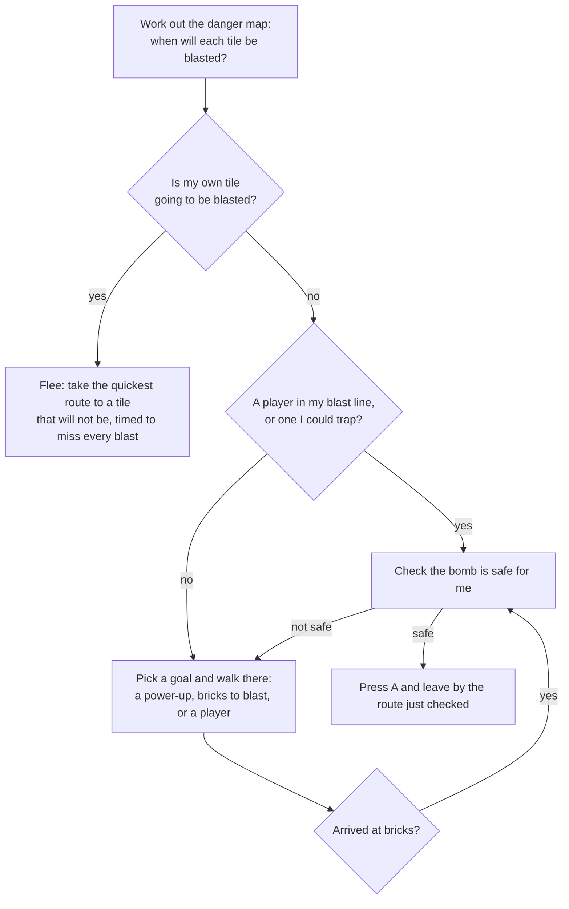

# CPU players

The three other bots in a round are played by the computer. This explains how they think, how the three levels differ, and what has been measured about them. The code is `src/bot.ts`.

- [What they are](#what-they-are)
- [How one thinks](#how-one-thinks)
- [How they avoid their own bombs](#how-they-avoid-their-own-bombs)
- [How they go after players](#how-they-go-after-players)
- [The shield and the curse](#the-shield-and-the-curse)
- [The falling blocks](#the-falling-blocks)
- [The three levels](#the-three-levels)
- [What has been measured](#what-has-been-measured)
- [What is not known yet](#what-is-not-known-yet)
- [Changing them](#changing-them)

## What they are

A CPU player is handed the world and gives back exactly what your controls give: a direction, and whether A and B are pressed, sixty times a second. It moves by the same rules as you, at the same speed, with the same bombs. It cannot see under bricks and has no powers a player lacks.

You choose the level in the menu, under **CPU players**: Beginner, Normal or Hard. Normal is the default. The choice is remembered on the device, and changing it in the middle of a paused round takes effect at once.

## How one thinks

**The danger map** is the heart of it. For every tile it holds when a blast will be there and for how long. It is built from every bomb on the floor, and it follows the rules exactly: bricks stop a blast unless an earlier blast will have burnt them away, a bomb caught in a blast goes off early and sets off the next, a kicked bomb is followed to where it will stop, and a thrown bomb to where it will land.

**Walking** uses that map with timing. A route is only taken if every tile on it is clear while the bot is on it, with a little time to spare. That lets a bot run through a lane that will be blasted later, or wait out a blast and cross after it.

## How they avoid their own bombs

Before any level presses A, three things must all be true. If one fails, it does not drop the bomb.

1. **There is a way out.** With the new bomb added to the danger map, there must be a tile it can reach in time that will not be blasted.
2. **Nobody can shut that way out.** It looks at each player close by who has a bomb to drop. If that player could get onto the escape route before it does, or could cut the route by dropping a bomb where they stand, the route does not count and it tries another. Lower levels only watch players near them; Hard watches everyone.
3. **The move works when played forward.** It copies the whole world, presses A in the copy, walks the escape route with the real rules, and checks it is still alive when the bomb has gone off.

The first version only did steps 1 and 3. Alone, that was enough: no bot ever blasted itself. With four bots in the arena, about one in five went out to its own bomb. Replaying those matches showed the same thing every time: the escape route was fine when the bomb was dropped, and then another player dropped a bomb on it. Step 2 was added for that.

A bot can still be caught by its own bomb when another player traps it after the bomb is down. That is the other player's doing, and it is a tactic Hard uses on purpose.

When a bot is boxed in with no route out, Normal and Hard will kick a bomb out of the way if they have the boot, and Hard will lift one and throw it clear if it has the glove. Each of these is also played forward on a copy first.

## How they go after players

- **Bombing a player in line.** If a player is in its blast line and close enough, it drops a bomb (after the safety checks). How close, and how often it takes the chance, depends on the level.
- **Hunting.** Spots it could bomb a player from are goals, alongside power-ups and bricks. Higher levels weigh them more, so they come looking for you sooner.
- **Traps (Hard).** It works out whether one bomb would leave a player no way out at all, always takes that shot, and looks for nearby spots where it would be true.
- **Kicking bombs at players (Hard).** With the boot, a bomb lying next to it with a player further down the lane gets kicked at them.
- **Not being trapped (Hard).** If a nearby player could box it in with one bomb, it moves somewhere that is not true before doing anything else.

## The shield and the curse

- **Every level wants a shield** and will walk to one, about as keenly as to any other power-up.
- **Holding a shield changes nothing about how careful they are.** They dodge blasts and check their bombs exactly as before. The shield is there for the blast they did not see coming.
- **Once a shield has taken a blast**, they know blasts do no harm for the next half second and use it to walk out through the flames. Before that was added, a bot stood still in a chain reaction and was caught by the second bomb.
- **No level goes looking for a curse.** Normal and Hard also treat one lying on the floor as something to walk round, when there is another way. If the only way to anything worth doing is through it, or the only way out of a blast, they go through. Beginner does not look.
- Hard does not count a curse as a power-up worth sparing when it blasts bricks.

## The falling blocks

When the timer reaches 0:00 blocks fall round the edge and inward for 50 seconds (see [GAME-RULES.md](GAME-RULES.md)). The order is fixed and the same every round, so a person can learn it, and the CPU players know it.

- **A tile a block will land on is treated like a blast that never ends.** It goes into the danger map from just before the block lands. Each level looks a different distance ahead (`blockSight`): Beginner only as far as the blocks it can see falling, Hard eight seconds.
- **A block about to land sends it running**, as a blast does (within about a second and a half).
- **A block further off is a reason to move on, not to run.** It heads for the nearest tile that will last longer, but it can still stop to bomb a player on the way. That keeps them fighting while the arena closes.
- **A blast comes before a block.** Getting clear of a bomb, a tile only has to outlast the blast, even if a block is due on it a few seconds later.
- **The square in the middle is never covered**, so there is always somewhere that counts as safe, and they end up in it.
- Hard will step out to bomb a spot that shuts other players into a dead end of the closing arena, if it can still get clear itself.

Beginner has one weakness left in on purpose. Because it only steps aside from the block that is falling, it can back itself into a corner that the ring then closes.

## Pressing in the square

Careful players in a 5 by 5 square can circle each other for minutes. So once the timer has run out and a Normal or Hard CPU player is standing in the square, it presses (`squareBold` in `LEVELS`, `emboldened` and `inSquare` in `src/bot.ts`). While it is there:

- it bombs any player in line, every chance it gets, from any distance;
- it uses every bomb it holds;
- it is pulled toward players much harder, and does not pause before setting off;
- it drops bombs beside players as well as in line with them, to take away the room they have to stand in (within `SQUEEZE_REACH`, 4 steps);
- it stops holding back in case a rival shuts its way out (`guard` is switched off).

What does not change: it still needs a way out before it presses A, and it still plays the move forward on a copy of the world first. So it does not walk into its own blast, but it can now be shut in by a rival's bomb, which is the risk that ends rounds.

It applies only while the bot itself is inside the square after 0:00. A bot still on its way in plays as it did. Beginner never presses.

## The three levels

All of these are in the `LEVELS` table at the top of `src/bot.ts`. Times are in ticks: 60 ticks are one second.

| | Beginner | Normal | Hard |
|---|---|---|---|
| Thinks every (`think`) | 30 ticks | 16 | 4 |
| Pause before setting off (`hesitate`) | 40 to 110 ticks | 6 to 26 | none |
| Notices another player's bomb after (`notice`) | 70 ticks | 22 | at once |
| Time kept spare when dodging (`margin`) | 14 ticks | 9 | 4 |
| Bombs out at once (`maxBombs`) | 1 | 2 | all it has |
| Pull toward players (`hunt`) | 0.12 | 0.55 | 1.6 |
| Bombs a player in line (`attack`) | 20% of chances | 50% | always |
| From how far (`attackReach`) | 2 tiles | 4 | 8 |
| Sets traps (`killShot`) | no | no | yes |
| Watches for players who could shut it in (`guard`) | within 3 tiles | 5 | whole arena |
| Kicks a bomb to escape (`kickEscape`) | no | yes | yes |
| Kicks bombs at players (`kickAttack`) | no | no | yes |
| Throws a bomb to escape (`throwEscape`) | no | no | yes |
| Moves out of spots it could be trapped in (`evade`) | no | no | yes |
| Leaves power-ups unburnt (`spareItems`) | no | no | yes |
| Walks round a curse (`dodgeCurse`) | no | yes | yes |
| Knows where blocks will fall (`blockSight`) | 0.9 s ahead | 2.5 s | 8 s |
| Presses in the square after 0:00 (`squareBold`) | no | yes | yes |
| Randomness in choosing goals (`wobble`) | 0.6 | 0.3 | 0.05 |

In short:

- **Beginner** is slow to react, carries one bomb, and mostly digs for power-ups. It will sometimes bomb you if you stand next to it, and it will blunder over a curse lying in its way.
- **Normal** collects power-ups and comes after you once it can reach you.
- **Hard** reacts at once, hunts you, sets traps, uses the boot and the glove, and will not let itself be cornered.

There were four levels at first. On 11 November 2026 they were cut to three after play-testing: what was called Extreme is now Hard, the old Hard (which sat between the two) was dropped, and Normal was eased a little (it thinks every 16 ticks instead of 14, pauses 6 to 26 ticks before setting off instead of 0 to 14, notices bombs after 22 ticks instead of 16, `hunt` 0.55 from 0.7, `attack` 50% from 60%). Beginner was not changed. A phone that had Extreme saved now gets Hard.

No level cheats, and no level is made easier by being careless with its own bombs. The easy levels are easy because they are slow and unambitious.

## What has been measured

`experiments/cpu-matches.ts` plays whole rounds with no screen and counts how each bot went out. These are the real CPU players under the real rules: three levels, a blast that starts one tile long, the timer, the falling blocks that start when it reaches 0:00, the square they leave open, and Normal and Hard pressing once they are in it. Recorded on 11 November 2026, after the timer was shortened to 1 minute 30 and the blocks made 20% faster.

A round has no end of its own: the timer runs 1 minute 30, the blocks take 50 seconds to fall, and then it goes on in the square until someone wins. These runs give up 2 minutes after the blocks stop (4 minutes 20 in) and count the round as **not decided**.

**Four of the same level** (60 rounds, so 240 bots per level):

| Level | Blasted itself | Shut in by a rival | Caught in a rival's blast | Under a block, early | Under a block, in the last 15 s of them | Won | Rounds drawn | Not decided | Decided after |
|---|---|---|---|---|---|---|---|---|---|
| Beginner | 0.0% | 0.8% | 57.9% | 2.5% | 5.0% | 16.7% | 0 of 60 | 20 of 60 | 154 s |
| Normal | 0.0% | 22.1% | 43.8% | 1.7% | 8.3% | 24.2% | 2 of 60 | 0 of 60 | 146 s |
| Hard | 0.0% | 34.2% | 41.3% | 0.4% | 2.1% | 20.4% | 9 of 60 | 2 of 60 | 163 s |

- "Shut in by a rival" and "blasted itself" are both a bot caught by its own blast. The script calls it "shut in by a rival" when, within six steps of where the bot stood, there was a tile its own bombs would not have reached that was blocked or about to be blasted by a bomb a rival dropped *after* the bomb that caught it. It looks at the arena as it was when that bomb was dropped, so a tile a block has landed on since still counts as a way out it had. A rival's bomb dropped on the very same tick counts too, and so does one a rival threw or kicked that came to rest on the way out afterwards. It is also "shut in by a rival" when the bot's own bomb went off early because a rival's bomb set it off, and that rival's bomb was dropped, kicked or thrown after the bot dropped its own. Anything else is "blasted itself".
- Before Normal and Hard pressed in the square, Normal left 32 of 60 rounds not decided and Hard 9. Now it is none and 2. The price shows in "shut in by a rival": Normal went from 3.8% to about 20%, Hard from 27.5% to about 34%. That is the risk they now take on purpose. Beginner does not press, and its 20 of 60 is the old figure give or take (it was 15).
- "Decided after" is the average length of the rounds that were decided. The blocks stop at 140 s, so most are settled in the square.
- With the shorter timer and faster blocks, rounds are settled about 35 seconds sooner than before, and the other columns moved little. One thing did move: four Hards drew 9 rounds of 60 (it was 2). Why has not been looked into.

**One of each level in the same round** (three players, 180 rounds, each level in each of three corners equally often):

| Level | Won | Blasted | Under a block, early | Blasted itself | Rivals it blasted |
|---|---|---|---|---|---|
| Beginner | 2.2% | 80.6% | 3.9% | 0.0% | 5 |
| Normal | 30.6% | 62.8% | 1.7% | 0.0% | 57 |
| Hard | 63.3% | 34.4% | 0.0% | 0.0% | 179 |

5 of 180 drawn, 2 left undecided (it was 27 before they pressed in the square). The levels are well apart: each wins far more and blasts far more rivals than the one below.

**Three of one level against a slow, careless player** (a Beginner CPU player standing in for a person, 80 rounds):

| Three of | Blasted the player | Average time | A block got the player | The player won | Not decided | CPU players that blasted themselves |
|---|---|---|---|---|---|---|
| Beginner | 54 of 80 | 125 s | 4 of 80 | 10 of 80 | 24 of 80 | 0 |
| Normal | 60 of 80 | 115 s | 18 of 80 | 2 of 80 | 0 of 80 | 0 |
| Hard | 67 of 80 | 103 s | 11 of 80 | 1 of 80 | 1 of 80 | 0 |

This table is noisy, and the stand-in is not a person. Read it loosely.

**Alone until 10 seconds after the blocks stop, in an arena of bricks** (40 arenas). Does it get into the square before the blocks stop?

| Level | Blasted itself | Caught by a block | In the square at the end |
|---|---|---|---|
| Beginner | 0 of 40 | 1 of 40 | 39 of 40 |
| Normal | 0 of 40 | 0 of 40 | 40 of 40 |
| Hard | 0 of 40 | 0 of 40 | 40 of 40 |

**Alone with a player who stands still, no timer** (40 arenas, 3 minutes each). This one is run without the timer, because otherwise the blocks would get the still player and it would look like a win:

| Level | Blasted itself | Got the other player | Average time |
|---|---|---|---|
| Beginner | 0 of 40 | 17 of 40 | 152 s |
| Normal | 0 of 40 | 40 of 40 | 129 s |
| Hard | 0 of 40 | 40 of 40 | 111 s |

Most of that time is spent digging through bricks from one corner to the other. It takes longer than it did, because a blast now starts one tile long. Beginner's figures moved since the last run (11 of 40 then) although Beginner was not changed: the arenas are different, because boots and gloves are rarer and bombs, flames and speeds a little commoner.

### What the replays have caught

The "blasted itself" column is only worth anything because every case that lands in it is replayed. So far:

- **The first version** checked only that a bomb left a way out. With four bots in the arena about one in five went out to its own bomb, each time because a rival then bombed the way out. That is what `guard` was added for.
- **The narrow test.** The first test for "shut in by a rival" (a rival's bomb on or next to the bot's tile) left four cases under "blasted itself". All four were a rival's later bomb, further off. The test was widened.
- **The shield.** One Hard bot stood still in a chain reaction after its shield took the first blast, and the second bomb's blast outlasted the half second of safety. They now walk out.
- **The falling blocks.** One bot of the top level dropped a bomb with a way out, then refused to use it: a block was due on the safe tile five seconds later, and it counted that as no better than the blast. It stood in its own blast. A blast now comes first. One Hard bot in the last seven seconds was caught between its own bomb, a rival's bombs and a block that had just landed on its way out; the test now sees the arena as it was when the bomb was dropped.
- **Pressing in the square.** The first run with it put three bots under "blasted itself". Replayed, all three were a rival's doing: a rival dropped a bomb on the way out on the same tick the bot dropped its own, or threw one that landed on the way out afterwards. The test only counted bombs dropped later, on the tile they were dropped on. It now counts those cases too.
- **Set off early.** The first run with the shorter timer put two Normal bots under "blasted itself" in the run against the stand-in. Replayed, both were the same thing: the bot dropped a bomb with a way out and was walking it; a rival then kicked a bomb of its own into a blast that was still burning, which set that bomb off two seconds early; its blast reached the bot's bomb and set that off too, with the bot still in line. Nothing on the board when it pressed A said that would happen. The test now counts a bot's bomb set off early by a rival's bomb that was dropped, kicked or thrown afterwards.
- **Beginner was made easier on 10 November 2026** after play-testing found it still hard: it pauses longer before setting off (40 to 110 ticks, was 20 to 60), notices other players' bombs later (70 ticks, was 45), is drawn to players less (`hunt` 0.12, was 0.3) and bombs a player beside it less often (20% of chances, was 40%).

One weakness the replays showed and that is still there: a CPU player with no safe route left stands still. Trying anyway would sometimes save it, and that is not built.

## What is not known yet

- **How they feel to play against.** The numbers say they are safe and that the levels are in order. Whether Beginner is easy enough, or Hard too mean, for a person on a phone has to be found by playing.
- **Whether the square now feels like a fight.** Between Normal or Hard CPU players the stall is gone in these runs. Against a person it has not been played: pressing may feel fair, or it may feel like being rushed the moment the timer runs out. `emboldened` in `src/bot.ts` holds the numbers to turn down if so.
- **Beginner still stalls.** About a third of rounds between four Beginners, and between three Beginners and the stand-in, were still going 2 minutes after the blocks stopped. That was asked for (Beginner does not press), and against a person it is the person who has to finish it.
- **The stand-in player is not a person.** A Beginner CPU player never walks into a blast it has noticed. People do.

## Changing them

- To make a level harder or easier, change its line in `LEVELS`. `hunt`, `attack` and `attackReach` are the ones that change how often it comes for you; `think` and `notice` change how sharp it is.
- After any change run `npm test`, then `npx tsx experiments/cpu-matches.ts` (about fifteen minutes), and the same with `solo`, `versus` and `alone`. The "blasted itself" columns should stay at zero, and anything that lands in them should be replayed before it is believed.
- `src/bot.ts` follows the same rules as `src/sim.ts`: no browser features, no `Math.random`, no clocks. Its randomness comes from a seeded generator kept in each bot, so the same seed gives the same match, and a server will be able to run CPU players for online games.
- The checks are in `tests/bot.test.ts`.
