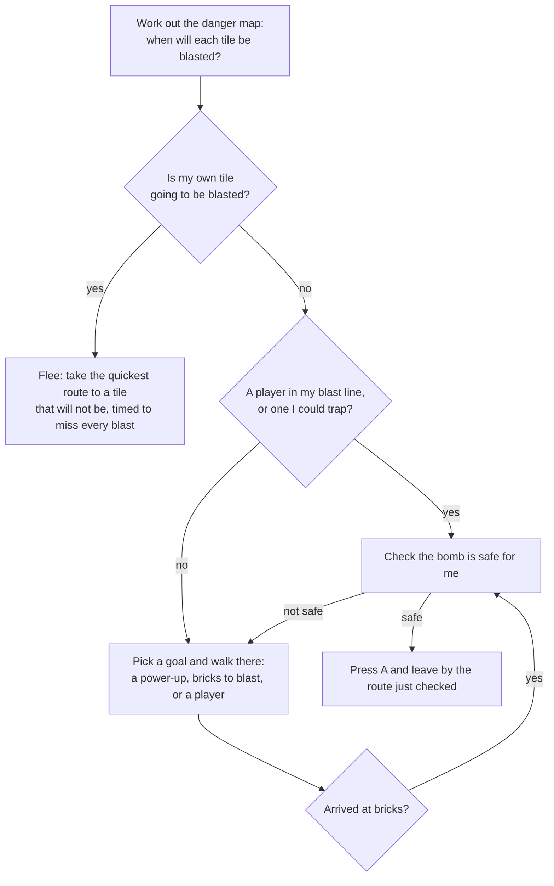

# CPU players

The three other bots in a round are played by the computer. This explains how they think, how the four levels differ, and what has been measured about them. The code is `src/bot.ts`.

- [What they are](#what-they-are)
- [How one thinks](#how-one-thinks)
- [How they avoid their own bombs](#how-they-avoid-their-own-bombs)
- [How they go after players](#how-they-go-after-players)
- [The four levels](#the-four-levels)
- [What has been measured](#what-has-been-measured)
- [What is not known yet](#what-is-not-known-yet)
- [Changing them](#changing-them)

## What they are

A CPU player is handed the world and gives back exactly what your controls give: a direction, and whether A and B are pressed, sixty times a second. It moves by the same rules as you, at the same speed, with the same bombs. It cannot see under bricks and has no powers a player lacks.

You choose the level in the menu, under **CPU players**: Beginner, Normal, Hard or Extreme. Normal is the default. The choice is remembered on the device, and changing it in the middle of a paused round takes effect at once.

## How one thinks

**The danger map** is the heart of it. For every tile it holds when a blast will be there and for how long. It is built from every bomb on the floor, and it follows the rules exactly: bricks stop a blast unless an earlier blast will have burnt them away, a bomb caught in a blast goes off early and sets off the next, a kicked bomb is followed to where it will stop, and a thrown bomb to where it will land.

**Walking** uses that map with timing. A route is only taken if every tile on it is clear while the bot is on it, with a little time to spare. That lets a bot run through a lane that will be blasted later, or wait out a blast and cross after it.

## How they avoid their own bombs

Before any level presses A, three things must all be true. If one fails, it does not drop the bomb.

1. **There is a way out.** With the new bomb added to the danger map, there must be a tile it can reach in time that will not be blasted.
2. **Nobody can shut that way out.** It looks at each player close by who has a bomb to drop. If that player could get onto the escape route before it does, or could cut the route by dropping a bomb where they stand, the route does not count and it tries another. Lower levels only watch players near them; Extreme watches everyone.
3. **The move works when played forward.** It copies the whole world, presses A in the copy, walks the escape route with the real rules, and checks it is still alive when the bomb has gone off.

The first version only did steps 1 and 3. Alone, that was enough: no bot ever blasted itself. With four bots in the arena, about one in five went out to its own bomb. Replaying those matches showed the same thing every time: the escape route was fine when the bomb was dropped, and then another player dropped a bomb on it. Step 2 was added for that.

A bot can still be caught by its own bomb when another player traps it after the bomb is down. That is the other player's doing, and it is a tactic Hard and Extreme use on purpose.

When a bot is boxed in with no route out, Normal and above will kick a bomb out of the way if they have the boot, and Hard and Extreme will lift one and throw it clear if they have the glove. Each of these is also played forward on a copy first.

## How they go after players

- **Bombing a player in line.** If a player is in its blast line and close enough, it drops a bomb (after the safety checks). How close, and how often it takes the chance, depends on the level.
- **Hunting.** Spots it could bomb a player from are goals, alongside power-ups and bricks. Higher levels weigh them more, so they come looking for you sooner.
- **Traps (Hard and Extreme).** It works out whether one bomb would leave a player no way out at all, always takes that shot, and looks for nearby spots where it would be true.
- **Kicking bombs at players (Hard and Extreme).** With the boot, a bomb lying next to it with a player further down the lane gets kicked at them.
- **Not being trapped (Extreme).** If a nearby player could box it in with one bomb, it moves somewhere that is not true before doing anything else.

## The four levels

All of these are in the `LEVELS` table at the top of `src/bot.ts`. Times are in ticks: 60 ticks are one second.

| | Beginner | Normal | Hard | Extreme |
|---|---|---|---|---|
| Thinks every (`think`) | 30 ticks | 14 | 8 | 4 |
| Pause before setting off (`hesitate`) | 20 to 60 ticks | 0 to 14 | none | none |
| Notices another player's bomb after (`notice`) | 45 ticks | 16 | 6 | at once |
| Time kept spare when dodging (`margin`) | 14 ticks | 9 | 6 | 4 |
| Bombs out at once (`maxBombs`) | 1 | 2 | all it has | all it has |
| Pull toward players (`hunt`) | 0.3 | 0.7 | 1.2 | 1.6 |
| Bombs a player in line (`attack`) | 40% of chances | 60% | 80% | always |
| From how far (`attackReach`) | 2 tiles | 4 | 8 | 8 |
| Sets traps (`killShot`) | no | no | yes | yes |
| Watches for players who could shut it in (`guard`) | within 3 tiles | 5 | 7 | whole arena |
| Kicks a bomb to escape (`kickEscape`) | no | yes | yes | yes |
| Kicks bombs at players (`kickAttack`) | no | no | yes | yes |
| Throws a bomb to escape (`throwEscape`) | no | no | yes | yes |
| Moves out of spots it could be trapped in (`evade`) | no | no | no | yes |
| Leaves power-ups unburnt (`spareItems`) | no | no | yes | yes |
| Randomness in choosing goals (`wobble`) | 0.6 | 0.3 | 0.15 | 0.05 |

In short:

- **Beginner** is slow to react, carries one bomb, and mostly digs for power-ups. It will bomb you if you stand next to it.
- **Normal** collects power-ups and comes after you once it can reach you.
- **Hard** is quick, hunts, sets traps and uses the boot and the glove.
- **Extreme** reacts at once, does everything Hard does, and will not let itself be cornered.

No level cheats, and no level is made easier by being careless with its own bombs. The easy levels are easy because they are slow and unambitious.

## What has been measured

`experiments/cpu-matches.ts` plays whole matches with no screen and counts how each bot went out. These are the real CPU players under the real rules. Recorded on 10 November 2026, with a blast lasting 0.45 seconds and each speed power-up adding 0.45 tiles a second.

**Alone with a player who stands still** (40 arenas, 3 minutes each):

| Level | Blasted itself | Got the other player | Average time |
|---|---|---|---|
| Beginner | 0 of 40 | 21 of 40 | 147 s |
| Normal | 0 of 40 | 40 of 40 | 127 s |
| Hard | 0 of 40 | 40 of 40 | 115 s |
| Extreme | 0 of 40 | 40 of 40 | 114 s |

Most of that time is spent digging through bricks from one corner to the other.

**Four of the same level** (60 matches of up to 3 minutes, so 240 bots per level):

| Level | Blasted itself | Shut in by a rival | Caught in a rival's blast | Still in at the end |
|---|---|---|---|---|
| Beginner | 0.0% | 1.3% | 19.6% | 79.2% |
| Normal | 0.0% | 4.6% | 10.4% | 85.0% |
| Hard | 0.0% | 7.9% | 9.2% | 82.9% |
| Extreme | 0.0% | 9.2% | 12.1% | 78.8% |

Both of the middle columns are a bot caught by its own blast. The script calls it "shut in by a rival" when, within six steps of where the bot stood, there was a tile its own bombs would not have reached that was blocked or about to be blasted by a bomb a rival dropped *after* the bomb that caught it. A rival's bomb that was already down does not count, because the bot should have known about it. Anything else is "blasted itself".

That test was drawn up from replays. An earlier, narrower one (a rival's bomb on or next to the bot's tile) left four cases in "blasted itself" across these runs. All four were replayed, and in each a rival's later bomb was the cause: twice it covered the far end of the only way out, and twice it drove a bot that was already clear back across its own bomb's lane, which it missed crossing by about a tick.

**One of each level in the same match** (240 matches, each level in each corner equally often):

| Level | Knocked out | Blasted itself | Rivals it blasted |
|---|---|---|---|
| Beginner | 29.6% | 0.0% | 4 |
| Normal | 17.9% | 0.0% | 29 |
| Hard | 13.8% | 0.0% | 41 |
| Extreme | 9.2% | 0.0% | 41 |

The levels come out in the right order for staying in. Hard and Extreme blasted the same number of rivals.

**Three of one level against a slow, careless player** (a Beginner CPU player standing in for a person, 80 matches of up to 3 minutes):

| Three of | Knocked the player out | Average time | CPU players out | Of those, blasted itself |
|---|---|---|---|---|
| Beginner | 19 of 80 | 98 s | 55 of 240 | 0 |
| Normal | 25 of 80 | 84 s | 38 of 240 | 0 |
| Hard | 26 of 80 | 72 s | 30 of 240 | 0 |
| Extreme | 26 of 80 | 87 s | 25 of 240 | 0 |

One weakness the replays showed: a CPU player with no safe route left stands still. Trying anyway would sometimes save it, and that is not built.

## What is not known yet

- **How they feel to play against.** The numbers say they are safe and that the levels are in order. Whether Normal is too easy or Extreme too mean for a person on a phone has to be found by playing.
- **Matches between CPU players rarely finish.** Only a handful of the 3-minute matches above were decided. They dodge each other's bombs well, so they wear each other down slowly. Against a person this matters less, and step 3 of the roadmap (falling blocks that shrink the arena) is what will force an ending.
- **The stand-in player is not a person.** A Beginner CPU player never walks into a blast it has noticed. People do.

## Changing them

- To make a level harder or easier, change its line in `LEVELS`. `hunt`, `attack` and `attackReach` are the ones that change how often it comes for you; `think` and `notice` change how sharp it is.
- After any change run `npm test`, then `npx tsx experiments/cpu-matches.ts` (about six minutes) and `npx tsx experiments/cpu-matches.ts solo`. The "blasted itself" columns should stay at zero.
- `src/bot.ts` follows the same rules as `src/sim.ts`: no browser features, no `Math.random`, no clocks. Its randomness comes from a seeded generator kept in each bot, so the same seed gives the same match, and a server will be able to run CPU players for online games.
- The checks are in `tests/bot.test.ts`.
