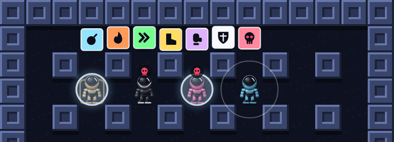
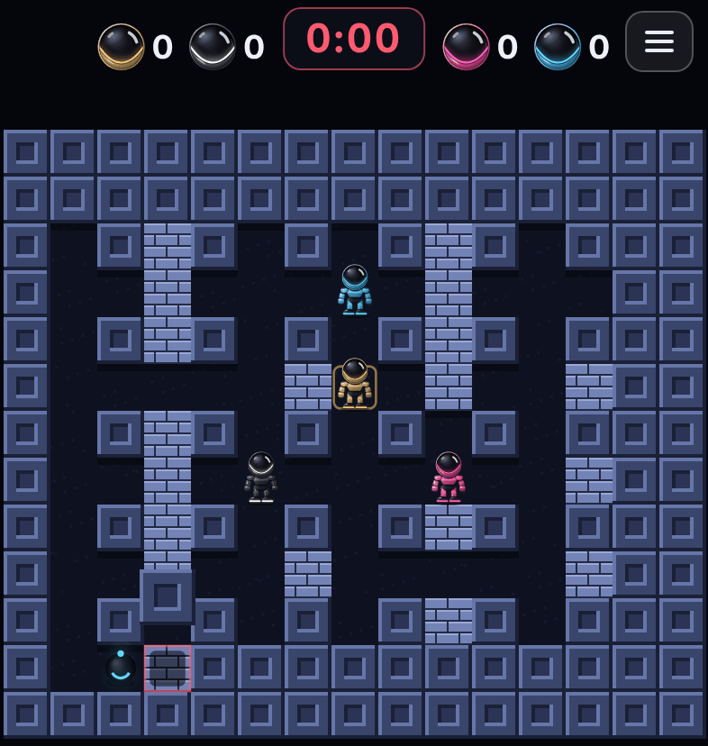
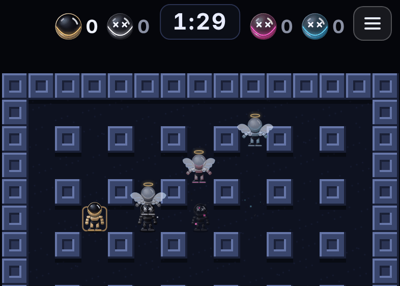
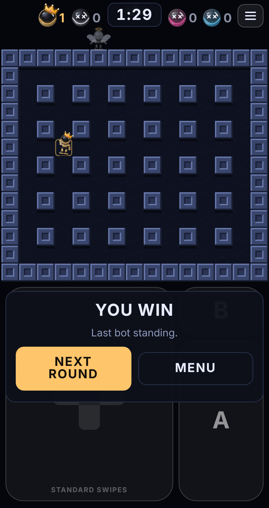

# Game rules

Every rule of play as the game works today, with the numbers. The rules live in one file, [`src/sim.ts`](../src/sim.ts), and each section here names the part of that file it describes.

The game runs at a fixed 60 ticks a second. Times below are given in seconds with the tick count in brackets.

## The arena

*`createWorld` in sim.ts*

- The arena is 15 tiles wide and 13 tall. The outer ring is wall, leaving 13 by 11 to play in.
- **Solid blocks** never break. They are the outer wall plus a pillar on every second tile in both directions. The pillars turn the arena into a grid of lanes.
- **Bricks** can be blasted away. At the start each open tile has a 78% chance of holding a brick.
- Each player's starting tile and the tiles next to it are always left clear, so nobody starts boxed in.
- Up to four players start in the corners, in this order: top-left, bottom-right, top-right, bottom-left. You are always top-left.
- The layout comes from a seed number. The same seed always builds the same arena. The game picks a new random seed for every round.

## Moving

*`movePlayer` in sim.ts. The touch and keyboard side is in [CONTROLS.md](CONTROLS.md).*

- A robot moves up, down, left or right, one direction at a time, and stops the moment no direction is held. It does not finish the step.
- Robots start at 2.55 tiles a second. Each speed power-up adds 0.5 tiles a second, and up to six of them count, which brings a robot to 5.55 tiles a second, 2.18 times its starting speed. Collecting a speed power-up is the only thing that raises a robot's speed. The only thing that lowers it is a curse, for 8 seconds.
- At the starting speed, getting clear of your own first bomb (two tiles along a lane) takes 0.78 seconds of the bomb's 2.5.
- The tile a robot **counts as standing on** is the one whose middle it is nearest to. The game draws a ring on yours. That tile decides where your bomb is dropped, whether a blast catches you and which power-up you pick up.
- A robot fills its lane, so it can only go sideways where there is an opening beside it. Bricks and solid blocks block it. So does a bomb, with one exception: a bomb on the tile the robot counts as standing on (the one it just dropped, or one thrown onto it) does not hold it in. It can move about on that tile and walk off. The moment it counts as standing on the next tile, that bomb is solid to it like any other, so there is no walking back through.

### Turning

A turn is often asked for between two openings. What happens then:

1. **Lined up with an opening:** the robot turns straight away.
2. **Running along a lane, and the tile it is standing on has the opening:** it lines up with that opening and turns. If it has already gone past the middle of the tile, this is a small step back of at most half a tile.
3. **Running along a lane, otherwise:** it keeps running the same way and takes the next opening ahead. It never turns round to reach an opening behind it.
4. **Running along a lane with nothing to turn into ahead:** it goes back to the opening just behind it if there is one. If there is none either way, it stops on the next tile.
5. **Standing still between two openings:** it steps to the nearer one that is open, then turns. If the tile it is standing on has no opening that way (it is between two blocks), it turns to look first, and only sets off for the opening on the next tile if the direction is held for 0.15 seconds.
6. **Reversing** is always immediate.

Rule 3 is the important one for swipe controls: swiping early for the next turning never sends the robot backwards.

### Which way the robot looks

The robot looks the way it was last asked to go, from the first tick of the swipe. That holds when a block is in the way, and while it is still running or stepping along to reach an opening (rules 3 to 5 above). So between two blocks, a quick swipe at either block turns the robot to look at it without moving it. Hold the swipe and it goes round the block instead.

It matters for more than looks: a lifted bomb is thrown the way the robot is looking, and B reaches for a bomb on the tile it is looking at.

## Bombs

*`placeBomb` and `step` in sim.ts*

- **A** drops a bomb on the tile you are standing on. You start able to have one bomb out at a time.
- A bomb goes off 2.5 seconds (150 ticks) after it is dropped.
- Its blast length is fixed when it is dropped. Picking up a flame afterwards does not lengthen bombs already out.
- You cannot drop a bomb on a tile that already has one, or while you are carrying one.

## Blasts

*`explode` in sim.ts*

- A blast covers the bomb's own tile and runs out in four straight lines. It starts **1 tile long** each way: the bomb's tile and the four next to it. Each flame power-up makes it one tile longer, up to 8. (It started at 2 until this was changed in play-testing.)
- A **solid block** stops it.
- The **first brick** it meets stops it too. That brick burns for 0.45 seconds (27 ticks), then turns to floor and shows its power-up if it was hiding one.
- A **power-up lying in the open** is destroyed, and the blast carries on past it.
- **Another bomb** in its path goes off 5 ticks later (a twelfth of a second), which is how chain reactions happen. The same goes for a bomb that slides or lands into a blast that is still burning.
- A blast stays for 0.45 seconds (27 ticks). It is drawn in the colour of the bot that dropped the bomb.
- A robot is **knocked out** if the tile it is standing on is in a blast. That includes your own. The one exception is a robot with a shield: see Power-ups.

## Power-ups

*`ITEM_CHANCE`, `createWorld` and `applyItem` in sim.ts*

Each brick hides at most one power-up. You pick one up by standing on its tile. A power-up in the open is a square of colour a little smaller than its tile, bobbing slowly over its shadow.

| Power-up | Effect | Limit |
|---|---|---|
| Bomb | One more bomb out at a time | 8 bombs |
| Flame | Blast one tile longer each way. The first one takes it from 1 tile to 2 | 8 tiles |
| Speed (») | Walk 0.5 tiles a second faster | 6 pick-ups |
| Boot | Lets you kick bombs | |
| Glove | Lets you lift and throw bombs | |
| Shield | The next blast does not knock you out. Wears off after 30 seconds if not used. | One at a time |
| Curse (skull) | A penalty: you walk at 85% of the starting speed for 8 seconds | |

### How rare each one is

The chance under each brick is set in `ITEM_CHANCE`. The other columns are what that comes to in play, counted over 20,000 arenas by `experiments/item-rarity.ts`. An arena starts with about 79 bricks, and about 38 of them hide something.

| Power-up | Chance under each brick | Average in an arena | Arenas with at least one | Arenas with two or more |
|---|---|---|---|---|
| Bomb | 15% | 11.8 | 100% | 100% |
| Flame | 15% | 11.8 | 100% | 100% |
| Speed | 11% | 8.7 | 100% | 100% |
| Boot | 2.5% | 2.1 | 100% | 59% |
| Glove | 2.5% | 2.1 | 100% | 59% |
| Shield | 1% | 0.8 | 54% | 19% |
| Curse | 1% | 0.8 | 54% | 19% |
| Nothing | 52% | | | |

- The **shield** and the **curse** are very rare on purpose. Each is missing from nearly half of all arenas, and when one is there it is usually the only one.
- Every arena has at least one **boot** and one **glove**. If the dice give none, one is placed under a brick that would otherwise be empty. Nothing else is guaranteed.
- These are what an arena *hides*. Fewer are picked up: a power-up lying in the open is destroyed by a blast, and some bricks are never broken.
- The **boot** and the **glove** are the next rarest: about two of each in an arena, and in four arenas in ten there is only the one.
- The first five began at 40% of bricks between them and were raised to 46% in the same mix. The shield and the curse added 1% each. Then the boot and the glove went from 6% to 4% each and later to 2.5% each, and what they gave up went to the bomb, the flame and speed (now 15%, 15% and 11%). The total stayed at 48%.

### Shield

*`applyItem` and the blast check in `step`*

- Picking one up starts 30 seconds. A ring is drawn round the robot, and blinks for the last 5 seconds.
- The first blast to reach the robot in that time does not knock it out. The shield is used up, and a ring flies outward.
- For half a second after that, blasts do no harm. That is long enough for the blast that broke the shield to clear, so standing still in it is safe.
- It protects against **one bomb**. A second blast after that half second knocks the robot out as usual. That includes a chain reaction: if a second bomb goes off in the chain, its blast lasts a little longer than the half second, so the robot has to get out of the lane.
- Not used in 30 seconds, it wears off.
- A second shield does not stack. It starts the 30 seconds again.

### Curse

*`applyItem` and `playerSpeed`*

- It looks like any other power-up tile, in red with a skull. Walking onto it picks it up.
- For 8 seconds the robot walks at 85% of the starting speed: 2.17 tiles a second instead of 2.55. Speed power-ups do not count while it lasts, so a fast robot loses the most.
- A small skull floats over the robot, and blinks for the last 2 seconds.
- Afterwards the robot is back to its usual speed, with every speed power-up it had.
- A second curse starts the 8 seconds again.
- A blast destroys a curse lying in the open, like any power-up.

## Kicking

*`movePlayer` and `moveBombs` in sim.ts*

- You need the **boot**. Without it a bomb in your way just blocks you.
- Walk into a bomb from the tile next to it and it slides away in that direction at 8.4 tiles a second. That includes pushing back into a bomb you have only just stepped off.
- It keeps sliding until the next tile is not free, then stops in the middle of the last free tile. A solid block, a brick, another bomb or a robot stops it.
- A bomb with something directly behind it cannot be kicked.
- Its fuse keeps running while it slides.

## Lifting and throwing

*`useAction` and `moveBombs` in sim.ts*

- You need the **glove** to lift.
- **B** lifts a bomb from the tile you are standing on. If there is none there, it takes one from the tile you are facing, and failing that from any tile next to you.
- The first time a bomb is lifted its fuse is set to **3 seconds** (180 ticks), and it keeps counting down in your hands. Lifting the same bomb again later does not reset it.
- While carrying you cannot drop another bomb.
- **B** again throws it the way you are facing. It lands 3 tiles away.
- If the landing tile is a block, a brick or another bomb, it bounces on one tile at a time until it finds free floor. A robot does not stop it landing.
- Thrown off the edge of the arena, it comes back in on the opposite side.
- If the 3 seconds run out **in your hands**, it goes off on your tile and knocks you out. If they run out **in the air**, it goes off the moment it lands.
- If the bot carrying a bomb is knocked out, the bomb drops where it stood.

## The timer and the falling blocks

*`fallBlocks`, `blockLandTick`, `spiral` and `keptOpen` in sim.ts*

The timer at the top counts down **1 minute 30 seconds**. (It was 2 minutes at first. The length will be a choice later; for now it is fixed.) A round has three parts:

1. **While the timer runs** nothing falls. The timer is white, turns amber for the last 30 seconds as a warning, and red for the last 10.
2. **When it reaches 0:00 the blocks start to fall.** It stays at 0:00, in red. The blocks take 50 seconds.
3. **Then the blocks stop**, and whoever is left fights on in the square in the middle until someone wins. The round has no time limit.

How the blocks fall:

- **One at a time**, about half a second apart. The first one starts to fall the moment the timer reaches 0:00.
- **Where:** round the edge of the arena, starting at the top-left corner and going clockwise: along the top, down the right side, back along the bottom, up the left side. Then the same again one ring further in, and once more. Pillars are skipped: they are solid already.
- **A square in the middle is left open.** It is 5 tiles by 5: columns 5 to 9, rows 4 to 8. No block ever falls in it, and whatever is in it (bricks, power-ups) is untouched. The last four blocks close the two columns either side of it.
- **Warning:** each block is in the air for a little under two thirds of a second (0.63 s) before it lands. Its tile is marked with a red outline and a shadow that darkens as it comes down.
- **Landing:** the tile becomes a solid block for the rest of the round. A brick there, and anything under it, is gone. So is a power-up, a blast, or a bomb (it does not go off, and its owner gets it back).
- **A robot under a landing block is knocked out.** A shield does not help: it stops a blast, not a block.
- A robot or a bomb on the next tile that was leaning over the block's tile is pushed back onto the middle of its own.

When each part is finished, in a 13 by 11 arena:

| Part | Blocks | Finished this long after 0:00 |
|---|---|---|
| The outer edge | 44 | 23 seconds |
| The second ring | 18 | 33 seconds |
| The third ring | 28 | 48 seconds |
| The two columns beside the square | 4 | 50 seconds |

The square has 19 tiles to stand on: 25 less the 6 pillars inside it.

An earlier version dropped the blocks during the last minute of the timer, so that they stopped at 0:00. That was changed in play-testing: the whole of the timer is now played on the whole arena.

The blocks were made 20% faster on 11 November 2026, after play-testing: they took a minute at first, each 0.75 s in the air and about two thirds of a second apart. Both the time in the air and the gap between blocks were shortened by the same share.

## Winning

*the end of `step`, and `fallBlocks`, in sim.ts*

- The round is decided when only one robot is left, or none. There is no time limit on that: the timer only says when the blocks start.
- The result is declared three quarters of a second later (45 ticks). That pause lets a blast that catches the last two together count as a **draw**.
- If a block knocks out the only robot left, that robot still wins: it outlasted the others. If the last robots are under the *same* block, it is a draw.
- Once a round is decided, nothing more can happen to the winner, no more blocks start to fall, and nobody moves.
- The three other bots are CPU players. Be the last one in and the round is won.

### The scoreboard and the end of a round

*`drawScore`, `tick` and `finish` in main.ts*

- **The scoreboard** is in the top bar: four heads, two on each side of the timer, each in its player's colour with the rounds that player has won to its right. Yours is the first on the left. (Sideways, the four are in a row under the timer.)
- **The player in the lead wears a crown**, sitting crooked on its head, on the scoreboard and on its robot in the arena. Nobody has it until someone wins a round. It changes hands only when another player gets ahead: drawing level with the leader does not take it.
- A player knocked out of the round in play is dimmed, with crosses for eyes. A place with no player in it (when fewer than four are playing) is a grey head with no number.
- **Winning a round adds one** to the winner's number, which is shown in the winner's colour until the next round starts. A draw adds nothing.
- The numbers count up for as long as the game stays open. How many rounds make a match will be a setting later; for now there is no end to it.
- **When you are knocked out** a panel says how (whose blast caught you, or that a block did) and that the others are still fighting. The round carries on, and its winner still gets the win. **Next round** does not wait for it.
- **When the round is decided** the panel says who won: *You win*, *Pink wins*, or *Draw*.
- The panel never covers the arena. Upright it lies over the controls; sideways it is in the column beside the arena.

### Knocked out, and winning

*`drawPlayer` and `winPose` in render.ts*

- **Knocked out by a blast:** the robot is burnt black, with two crosses for eyes. It crumbles into specks of ash that drift up and away. At the same time a pale ghost of it, in a faint version of its suit colour, with angel wings that flap slowly and a gold halo over its helmet, floats straight up, out of the arena, all the way to the top of the screen, and fades as it gets near the top. The burning takes a second and a half; the ghost takes up to three seconds more, depending on how far it has to go. (It rose a tile and a half at first, then three tiles.)
- **Knocked out by a falling block:** there is nothing left to see under the block, so only the ghost rises.
- **The winner** jumps with one arm in the air, then dances: bouncing from side to side and pumping each arm in turn, for as long as the result is showing.

 
- CPU players follow every rule on this page and have nothing a player lacks. How they play is in [CPU-PLAYERS.md](CPU-PLAYERS.md).

## The numbers

All of these are named constants near the top of `src/sim.ts`. Changing one changes the game; the tests in `tests/rules.test.ts` will say if a change breaks a rule.

| Constant | Value | Meaning |
|---|---|---|
| `TICK_HZ` | 60 | Rule steps per second |
| `BASE_SPEED` | 0.04250390625 | Starting walking speed in tiles per tick (2.55 a second) |
| `SPEED_STEP` | 0.5 / 60 (0.00833) | Extra speed per speed power-up (0.5 a second) |
| `MAX_SPEED_ITEMS` | 6 | Most speed power-ups that count |
| `MAX_BOMBS` | 8 | Most bombs out at once |
| `START_FIRE` | 1 | How long a blast is, in tiles each way, before any flame power-up |
| `MAX_FIRE` | 8 | Longest blast, in tiles |
| `KEEP_OPEN` | 5 | The falling blocks leave a square this many tiles across open in the middle |
| `FUSE_TICKS` | 150 | Fuse of a dropped bomb (2.5 s) |
| `FLAME_TICKS` | 27 | How long a blast and a burning brick last (0.45 s) |
| `CHAIN_TICKS` | 5 | Delay before a bomb caught in a blast goes off |
| `CARRY_FUSE_TICKS` | 180 | Fuse set by the first lift (3 s) |
| `KICK_SPEED` | 0.14 | Sliding speed of a kicked bomb in tiles per tick (8.4 a second) |
| `THROW_TILES` | 3 | How far a throw goes |
| `FLY_TICKS_PER_TILE` | 7 | Time a thrown bomb takes over each tile |
| `BACK_TOLERANCE` | 0.5 | How far past an opening a turn will still step back to it, in tiles |
| `LOOK_TICKS` | 9 | Standing between two blocks, how long a direction must be held before the robot sets off for the next opening (0.15 s). Shorter than that only turns it to look. |
| `SHIELD_TICKS` | 1800 | How long an unused shield lasts (30 s) |
| `SHIELD_GRACE_TICKS` | 30 | After a shield takes a blast, how long blasts do no harm (0.5 s) |
| `CURSE_TICKS` | 480 | How long a curse lasts (8 s) |
| `CURSE_SPEED` | 0.85 | Walking speed while cursed, as a share of the starting speed |
| `ITEM_CHANCE` | see Power-ups | The chance that a brick hides each power-up |
| `ROUND_TICKS` | 5400 | What the timer counts down from (1 minute 30). The blocks start when it reaches 0 |
| `SHRINK_TICKS` | 3000 | How long the blocks take to fall, from the moment the timer reaches 0 (50 seconds) |
| `FALL_TICKS` | 38 | How long a falling block is in the air, with its shadow showing, before it lands (0.63 s) |
| `DEATH_TICKS` | 90 | Length of the knocked-out animation (1.5 s). If it is you, the panel appears when it ends |
| `GHOST_TICKS` | 300 | How long the count after a knock-out goes on (5 s), so the ghost has time to float off the top of the screen |

Starting values for every player are set in `createWorld`: 1 bomb, a blast 1 tile long, no speed power-ups, no boot, no glove, no shield, no curse. The arena size (13 by 11) and the brick chance (78%) are defaults there too.

## Not in the game yet

A choice of round length, teams, playing online, more arenas, and setting bombs off by remote. See [ROADMAP.md](ROADMAP.md).
