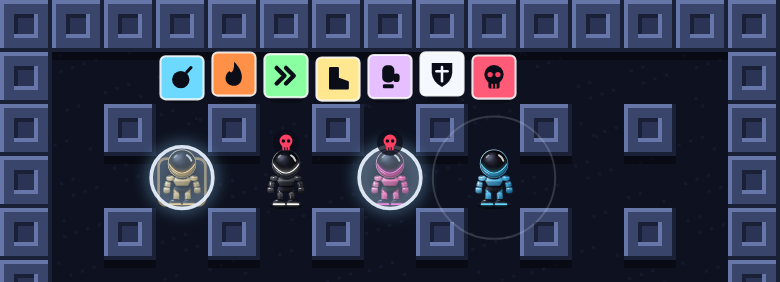
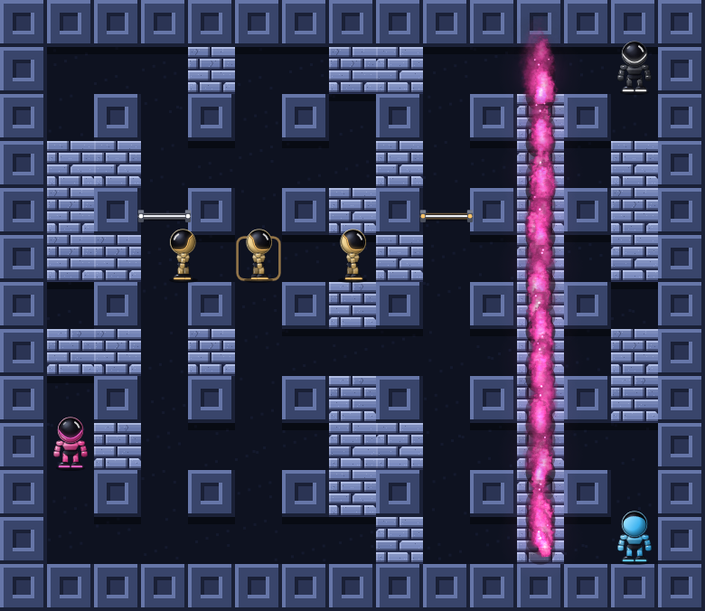
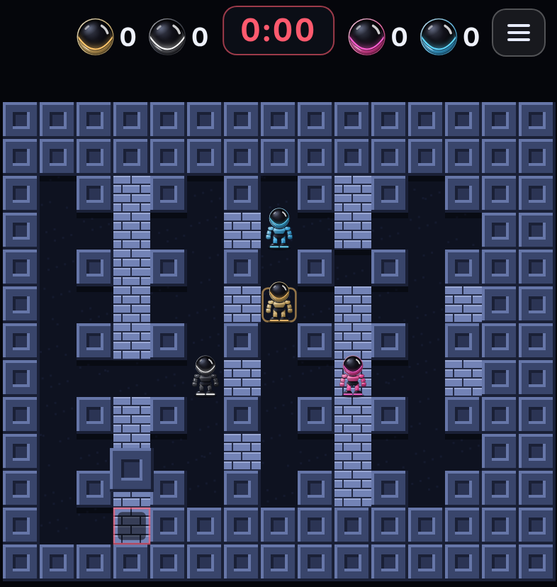
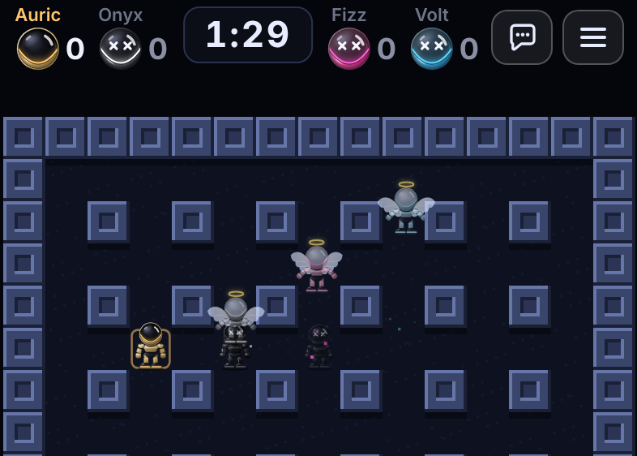
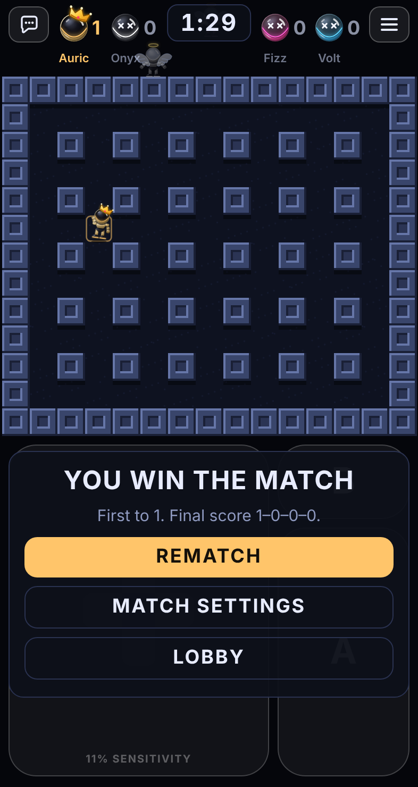

# Game rules

Every rule of play as the game works today, with the numbers. The rules live in one file, [`src/sim.ts`](../src/sim.ts), and each section here names the part of that file it describes.

The game runs at a fixed 60 ticks a second. Times below are given in seconds with the tick count in brackets.

## The arena

*`createWorld` in sim.ts*

- The usual arena (Classic) is 15 tiles wide and 13 tall. The outer ring is wall, leaving 13 by 11 to play in. The lobby also offers Compact (11 by 9 to play in) and Big (15 by 13): the same build in other sizes. It also offers four maps, Midnight (steel blocks and bricks), Wild West (red rock and wooden crates), Frozen Lake (snowy boulders and blocks of ice on a frozen lake) and Factory (machines and cardboard boxes on steel floor plates). Midnight is only a look. The Wild West also has a railway with trains and barrels of TNT (below, **The Wild West's railway and TNT**); Frozen Lake's floor is ice, where robots and bombs slide (below, **Frozen Lake's ice**); the Factory has conveyor belts that carry robots and bombs (below, **The Factory's conveyor belts**). Every other rule here is the same on all four.
- **Solid blocks** never break. They are the outer wall plus a pillar on every second tile in both directions. The pillars turn the arena into a grid of lanes.
- **Bricks** can be blasted away. At the start each open tile has an 80% chance of holding a brick (`SOFT_DENSITY`). The lobby's Brick density setting changes that, from 0% to 100% in steps of 5% (it was 78% until 19 November 2026).
- Each player's starting tile and the tiles next to it are always left clear, so nobody starts boxed in.
- Two to eight players (you and one to seven CPU players, as the lobby says). The first four start in the corners, in this order: top-left, bottom-right, top-right, bottom-left. You are always top-left. A fifth starts in the middle. With six, the fifth and sixth start in the middle row, a third of the way in from each side. Seven add the middle of the top and bottom edges to the five; eight use the corners and the middle of all four edges. With more than six players the arena is two tiles wider and taller.
- The layout comes from a seed number. The same seed always builds the same arena. The game picks a new random seed for every round.

## Moving

*`movePlayer` in sim.ts. The touch and keyboard side is in [CONTROLS.md](CONTROLS.md).*

- A robot moves up, down, left or right, one direction at a time, and stops the moment no direction is held. It does not finish the step. (On Frozen Lake's ice it slides on first, further the faster it is: below, **Frozen Lake's ice**. On the Factory's belts a belt carries it: below, **The Factory's conveyor belts**.)
- Robots start at 2.55 tiles a second. Each speed power-up adds 0.5 tiles a second, and up to six of them count, which brings a robot to 5.55 tiles a second, 2.18 times its starting speed. Collecting a speed power-up is the only thing that raises a robot's speed. The only thing that lowers it is a curse, for 8 seconds.
- At the starting speed, getting clear of your own first bomb (two tiles along a lane) takes 0.78 seconds of the bomb's 2.58.
- The tile a robot **counts as standing on** is the one whose middle it is nearest to. The game draws a ring on yours. That tile decides where your bomb is dropped, whether a blast catches you and which power-up you pick up.
- A robot fills its lane, so it can only go sideways where there is an opening beside it. Bricks and solid blocks block it. So does a bomb, with one exception: a bomb on the tile the robot counts as standing on (the one it just dropped, or one thrown onto it) does not hold it in. It can move about on that tile and walk off. The moment it counts as standing on the next tile, that bomb is solid to it like any other, so there is no walking back through.

### Turning

A turn is often asked for between two openings. What happens then:

1. **Lined up with an opening:** the robot turns straight away.
2. **Running along a lane, and the tile it is standing on has the opening:** it lines up with that opening and turns. If it has already gone past the middle of the tile, this is a small step back of at most half a tile.
3. **Running along a lane, otherwise:** it keeps running the same way and takes the next opening ahead. It never turns round to reach an opening behind it.
4. **Running along a lane with nothing to turn into ahead:** it goes back to the opening just behind it if there is one. If there is none either way, it stops on the next tile.
5. **Standing still between two openings:** it steps to the nearer one that is open, then turns. If the tile it is standing on has no opening that way (it is between two blocks), it turns to look first, and only sets off for the opening on the next tile if the direction is held for 0.15 seconds.
6. **Reversing** is always immediate.

Rule 3 is the important one for swipe controls: swiping early for the next turning never sends the robot backwards.

### Which way the robot looks

The robot looks the way it was last asked to go, from the first tick of the swipe. That holds when a block is in the way, and while it is still running or stepping along to reach an opening (rules 3 to 5 above). So between two blocks, a quick swipe at either block turns the robot to look at it without moving it. Hold the swipe and it goes round the block instead.

It matters for more than looks: a lifted bomb is thrown the way the robot is looking, and B reaches for a bomb on the tile it is looking at.

## Bombs

*`placeBomb` and `step` in sim.ts*

- **A** drops a bomb on the tile you are standing on. You start able to have one bomb out at a time.
- A bomb goes off 2.58 seconds (155 ticks) after it is dropped (the owner's choice, 27 November 2026; it was 2.55 s from 18 November, and 2.5 s before).
- Its blast length is fixed when it is dropped. Picking up a flame afterwards does not lengthen bombs already out.
- You cannot drop a bomb on a tile that already has one, or while you are carrying one.

## Blasts

*`explode` in sim.ts*

- A blast covers the bomb's own tile and runs out in four straight lines. It starts **1 tile long** each way: the bomb's tile and the four next to it. Each flame power-up makes it one tile longer, up to 8. (It started at 2 until this was changed in play-testing.)
- A **solid block** stops it.
- The **first brick** it meets stops it too. That brick burns for 0.45 seconds (27 ticks), then turns to floor and shows its power-up if it was hiding one.
- A **power-up lying in the open** is destroyed, and the blast carries on past it.
- **Another bomb** in its path goes off 5 ticks later (a twelfth of a second), which is how chain reactions happen. The same goes for a bomb that slides or lands into a blast that is still burning.
- A blast stays for 0.45 seconds (27 ticks). It is drawn in the colour of the bot that dropped the bomb.
- A robot is **knocked out** if the tile it is standing on is in a blast. That includes your own. The one exception is a robot with a shield: see Power-ups.

## Power-ups

*`ITEM_SHARE`, `ITEM_WEIGHT`, `ITEM_CHANCE`, `createWorld` and `applyItem` in sim.ts*

Each brick hides at most one power-up. You pick one up by standing on its tile. A power-up in the open is a square of colour a little smaller than its tile, bobbing slowly over its shadow.

| Power-up | Effect | Limit |
|---|---|---|
| Bomb | One more bomb out at a time | 8 bombs |
| Flame | Blast one tile longer each way. The first one takes it from 1 tile to 2 | 8 tiles |
| Speed (») | Walk 0.5 tiles a second faster | 6 pick-ups |
| Boot | Lets you kick bombs | |
| Glove | Lets you lift and throw bombs | |
| Shield | The next blast does not knock you out. Wears off after 30 seconds if not used. | One at a time |
| Curse (skull) | A penalty: you walk at 85% of the starting speed for 8 seconds | |
| Laptop | Held in your robot's hands. **B** flies a plane: steer it anywhere, and **A** drops its one bomb, which goes off where it lands. See Laptop below | One flight |
| Decoy (two heads) | Two copies of your robot appear beside you and walk when you walk, one the same way, one the opposite way, for 15 seconds. See Decoy below | Two at a time |
| Trip wire | **B**, standing between two solid blocks, strings it across that gap. Anyone who walks into it sets off a blast along the whole lane. See Trip wire below | 3 held |

### How rare each one is

**60% of the bricks hide a power-up** (`ITEM_SHARE`): the lobby's **Power-up density** setting, from none to every brick (the owner's ask and name, 19 November 2026). Which one is drawn by each kind's weight (`ITEM_WEIGHT`), so each keeps its share of the power-ups however many there are: bombs and flames 29.4% of them each, speed 21.6%, boots and gloves 4.9% each, shields, curses, laptops, decoys and trip wires 2% each. The chance under each brick is the two together (`ITEM_CHANCE`). The other columns are what that comes to in play, counted over 20,000 arenas by `experiments/item-rarity.ts`, at the usual 60%. An arena starts with about 81 bricks, and about 50 of them hide something (every chance was raised by a quarter in November 2026, the owner's ask: 38 before).

| Power-up | Chance under each brick | Average in an arena | Arenas with at least one | Arenas with two or more |
|---|---|---|---|---|
| Bomb | 17.6% | 14.3 | 100% | 100% |
| Flame | 17.6% | 14.3 | 100% | 100% |
| Speed | 12.9% | 10.4 | 100% | 100% |
| Boot | 2.9% | 2.5 | 100% | 69% |
| Glove | 2.9% | 2.5 | 100% | 69% |
| Shield | 1.2% | 0.9 | 62% | 25% |
| Curse | 1.2% | 0.9 | 61% | 24% |
| Laptop | 1.2% | 1.3 | 100% | 24% |
| Decoy | 1.2% | 1.3 | 100% | 24% |
| Trip wire | 1.2% | 1.3 | 100% | 25% |
| Nothing | 40% | | | |

- The **shield** and the **curse** are very rare on purpose. Each is missing from nearly four arenas in ten, and when one is there it is usually the only one.
- Every arena has at least one **boot**, one **glove**, one **laptop**, one **decoy** and one **trip wire** (`SURE_KINDS`). If the dice give none, one is placed under a brick that would otherwise be empty. Nothing else is guaranteed. (The laptop, the decoy and the trip wire are as rare under a brick as the shield; the one made sure of is why an arena averages more.)
- These are what an arena *hides*. Fewer are picked up: a power-up lying in the open is destroyed by a blast, and some bricks are never broken.
- The **boot** and the **glove** are the next rarest: two or three of each in an arena, and in three arenas in ten there is only the one.
- The first five began at 40% of bricks between them and were raised to 46% in the same mix. The shield and the curse added 1% each. Then the boot and the glove went from 6% to 4% each and later to 2.5% each, and what they gave up went to the bomb, the flame and speed (now 15%, 15% and 11%). The total stayed at 48%, until every chance was raised by a quarter (60% in all) at the owner's ask in November 2026. The laptop added 1.25% (61.25%) on 18 November 2026. On 19 November 2026 the total became the Power-up density setting, 60% by default, the laptop sharing it with the rest (each kind's chance about 2% less than the day before). The decoy and the trip wire came on 26 November 2026, sharing it too (each other kind's chance about 4% less).

### Shield

*`applyItem` and the blast check in `step`*

- Picking one up starts 30 seconds. A ring is drawn round the robot, and blinks for the last 5 seconds.
- The first blast to reach the robot in that time does not knock it out. The shield is used up, and a ring flies outward.
- For half a second after that, blasts do no harm. That is long enough for the blast that broke the shield to clear, so standing still in it is safe.
- It protects against **one bomb**. A second blast after that half second knocks the robot out as usual. That includes a chain reaction: if a second bomb goes off in the chain, its blast lasts a little longer than the half second, so the robot has to get out of the lane.
- Not used in 30 seconds, it wears off.
- A second shield does not stack. It starts the 30 seconds again.

### Curse

*`applyItem` and `playerSpeed`*

- It looks like any other power-up tile, in red with a skull. Walking onto it picks it up.
- For 8 seconds the robot walks at 85% of the starting speed: 2.17 tiles a second instead of 2.55. Speed power-ups do not count while it lasts, so a fast robot loses the most.
- A small skull floats over the robot, and blinks for the last 2 seconds.
- Afterwards the robot is back to its usual speed, with every speed power-up it had.
- A second curse starts the 8 seconds again.
- A blast destroys a curse lying in the open, like any power-up.

### Laptop

*`useAction`, `launch`, `flyPlane` and `moveDrops` in sim.ts (the owner's design, 18 November 2026)*

- Picked up like any power-up. The robot holds it in its hands. While it does, **B** is the laptop, so it cannot lift bombs, glove or not (a bomb it was already carrying is still thrown first).
- **B** flies a plane, in the robot's colours, from the robot, always heading for the middle of the arena to start with, whichever way the robot faces (`headingTo`; the owner's ask, 23 November 2026: it took off the way the robot faced). A robot standing right in the middle takes off the way it faces. The robot **stands still** until the plane lands, and can be blasted where it stands. Signal waves over its helmet say it is flying.
- The plane never stops. It flies at 3.3 tiles a second, a little quicker than a robot with no speed power-ups, and turns smoothly towards the way it is steered, at most about 122° a second (a full circle takes about 3 seconds, and is about 15% tighter than before), so it sweeps round in a gentle curve rather than turning on the spot. (It was 4.8 tiles and 169° a second until 19 November 2026, when the owner asked for it slower and turning less, to be easier to control; then 84° a second until 23 November 2026, when he asked for its turning circle 10% tighter; then 3 tiles and 93.75° a second until 24 November 2026, when he asked for it tighter again and slightly faster.) By default (Settings › Controls › Inverse plane controls, on: the owner's ask, 19 November 2026) it is steered like a pilot: left and right turn it to its own left and right, whichever way it is flying, at that full turning speed while held, and up, down or nothing fly it straight on. The page turns that into an aim a quarter turn to that side of the plane's heading (`pilotAim` in input.ts), so the rules and what is sent online are the same either way. With the setting off it goes the way it is pointed. It can be steered any way at all (in 64ths of a turn), not just the four ways a robot walks: with the swipe pad the way the thumb points from where its stroke began (a stroke that curves steers round with it), with a stick the way it leans, with the D-pad or the keys in eight ways. Off one edge of the arena it comes back in on the other.
- **A** drops its bomb, **one** a flight (3 until the owner's ask, 23 November 2026): not in the first half second, so it cannot come down on the robot it took off from.
- A dropped bomb falls for **0.8 s**, carried on the way the plane was flying and slowing as it falls: it lands about a tile on from where it was let go. It is drawn shrinking as it falls. **Nothing shows where it will land** (the owner's ask: hitting someone should not be easy).
- It goes off **the moment it lands**, a blast **one tile each way**, in the pilot's name. On a brick, only the brick burns and breaks. On a solid block it blasts from the top of it. A power-up where it lands is destroyed, and a bomb there is set off, like any blast.
- **B** again lands the plane at once. Otherwise it lands by itself **6 seconds** after take-off (8 at first, 16 from 19 November 2026, 6 since the owner's ask of 23 November 2026), or half a second after its bomb. It blinks for its last second and a half. Bombs still falling still land. Once it lands the laptop is used up.
- Knocked out while flying, the plane is gone (bombs already falling still land). When the round is decided every plane lands. A robot coming back with a new life has no laptop.
- Teammates: a plane's blast hurts them only with Friendly fire on, like any blast.
- CPU players fly it too (see `docs/CPU-PLAYERS.md`).

### Decoy

*`makeDecoys`, `moveDecoys` and `popDecoy` in sim.ts (the owner's design, 26 November 2026; the numbers are Claude's)*

- Picking one up makes **two copies** of your robot appear on the free tiles nearest you (open floor with no bomb, blast or block about to land, found step by step across the floor, at most 6 steps away), each in a puff of smoke.
- They **walk whenever you walk**: the nearer one the way you are asked to go, the other the **opposite** way. They move by the same rules as a robot (lining up for turns, sliding on ice, carried by belts) and stand still when you do, or while you fly a laptop's plane. They show your shield, curse and laptop too, so nothing gives them away. They do not drop bombs, pick up power-ups, kick bombs or set off trip wires, and robots and bombs pass through them.
- Any **blast**, whoever's, pops one in a puff of smoke, and so does a **falling block** or the **train**. Otherwise they vanish after **15 seconds** (`DECOY_TICKS`; the owner's pick). They go when you are knocked out.
- Another decoy replaces the two you have: two at a time.
- Decoys look exactly like their robot, on your own screen too (the owner's ask, 27 November 2026: they used to be a little see-through for you). Everyone sees them exactly as they see you, and the CPU players cannot tell them apart either: they go after decoys too.

### Trip wire

*`wireSpot`, `useAction`, `checkWires`, `tripWire` and `wireLane` in sim.ts (the owner's design, 26 November 2026; the numbers are Claude's)*

- Picking one up gives you a trip wire to string (up to 3 held, `MAX_WIRES`).
- **B**, standing on a tile with a **solid block on each side** (left and right, or above and below: in an arena's lanes, every tile between two pillars or between a pillar and the outer wall), strings it across that tile from one block to the other (`wireSpot`). Anywhere else B does what it always does (throw, fly a plane, lift a bomb). While you hold one and stand where it can go, B glows and says *set wire*, and a faint wire shows where it would be. Not on a bomb, and one wire to a tile.
- It is a thin steel wire between two small plates, with a light on each in the colour of whoever strung it. It is **armed** once nobody stands on its tile (you walk off it first); then the lights blink.
- **Anyone who walks into it sets it off** (`checkWires`): any robot on its tile within 0.3 of the wire (`WIRE_REACH`), the one who strung it included, and a zombie too. Decoys do not. Nothing else does: a bomb's blast leaves it be, a falling block crushes it without setting it off, and the train tears it away.
- **Its blast runs the whole length of its lane, both ways**, from the wire's tile to the walls (`tripWire`, `wireLane`): along the column for a wire strung left to right, along the row for one strung top to bottom. Nothing but a solid block stops it (the outer wall, or a block that has fallen): it burns every brick on the way and carries on, sets off bombs and barrels of TNT, and destroys power-ups lying there. It lasts as long as any blast, in the colour of whoever strung it, and counts as their blast (knocked out by it, it is "their trip wire's blast"; with Friendly fire off it spares their teammates).
- Not strung, trip wires go down with the rest of the kit in Item Drop. A robot coming back with a new life has none.
- CPU players string them now and then, and never walk into one (see `docs/CPU-PLAYERS.md`).

## Kicking

*`movePlayer` and `moveBombs` in sim.ts*

- You need the **boot**. Without it a bomb in your way just blocks you.
- Walk into a bomb from the tile next to it and it slides away in that direction at 8.4 tiles a second. That includes pushing back into a bomb you have only just stepped off.
- It keeps sliding until the next tile is not free, then stops in the middle of the last free tile. A solid block, a brick, another bomb or a robot stops it. (On Frozen Lake's ice it slows down as it goes, and may bounce back: below.)
- A bomb with something directly behind it cannot be kicked.
- Its fuse keeps running while it slides.

## Lifting and throwing

*`useAction` and `moveBombs` in sim.ts*

- You need the **glove** to lift.
- **B** lifts a bomb from the tile you are standing on. If there is none there, it takes one from the tile you are facing, and failing that from any tile next to you.
- The first time a bomb is lifted its fuse is set to **3 seconds** (180 ticks), and it keeps counting down in your hands. Lifting the same bomb again later does not reset it.
- While carrying you cannot drop another bomb.
- **B** again throws it the way you are facing. It lands 3 tiles away.
- If the landing tile is a block, a brick or another bomb, it bounces on one tile at a time until it finds free floor. A robot does not stop it landing.
- Thrown off the edge of the arena, it comes back in on the opposite side.
- On Frozen Lake's ice it does not stay where it lands: it slides on the way it was thrown (below).
- If the 3 seconds run out **in your hands**, it goes off on your tile and knocks you out. If they run out **in the air**, it goes off the moment it lands.
- If the bot carrying a bomb is knocked out, the bomb drops where it stood.

## The timer and the falling blocks

*`fallBlocks`, `blockLandTick`, `spiral` and `keptOpen` in sim.ts*

The timer at the top counts down **1 minute 30 seconds**. (It was 2 minutes at first. The length will be a choice later; for now it is fixed.) A round has three parts:

1. **While the timer runs** nothing falls. The timer is white, turns amber for the last 30 seconds as a warning, and red for the last 10.
2. **When it reaches 0:00 the blocks start to fall.** It stays at 0:00, in red. The blocks take 50 seconds.
3. **Then the blocks stop**, and whoever is left fights on in the open area in the middle until someone wins. The round has no time limit.

How the blocks fall:

- **One at a time**, about half a second apart. The first one starts to fall the moment the timer reaches 0:00.
- **Where:** round the edge of the arena, starting at the top-left corner and going clockwise: along the top, down the right side, back along the bottom, up the left side. Then the same again one ring further in, and once more. Pillars are skipped: they are solid already.
- **An area in the middle is left open.** It is always a clean rectangle: its edges run along open rows and columns, never through the pillars, which stand inside it (`keptSize`; the owner's ask, 20 November 2026). That makes it 9 tiles across by 7 down on Standard (columns 3 to 11, rows 3 to 9: 51 tiles to stand on), 7 by 5 on Mini and Big (29 tiles), and on an arena grown for seven or eight players 7 by 5 on Mini and Standard, 9 by 7 on Big. On Standard it was 7 by 5 from 18 to 20 November 2026, with pillars on its edges, so it did not end as a clean rectangle. No block ever falls in it, and whatever is in it (bricks, power-ups) is untouched. It was a 5 by 5 square until the owner had it widened (18 November 2026): the last four blocks used to close the two columns either side of it.
- **Warning:** each block is in the air for about half a second (0.53 s; 0.75 s at first, then 0.63 s until the owner asked for it 20% faster, 23 November 2026) before it lands. Its tile is marked with a red outline and a shadow that darkens as it comes down. Each block comes in from its own side of the arena, from outside, so it never hides the open floor: the top row's fall downwards, the right side's to the left, the bottom row's upwards, the left side's to the right; a corner goes with its row (`fallFrom` in render.ts; the owner's ask, 23 November 2026: they all came down from above).
- **Landing:** the tile becomes a solid block for the rest of the round. A brick there, and anything under it, is gone. So is a power-up, a blast, or a bomb (it does not go off, and its owner gets it back).
- **A robot under a landing block is knocked out.** A shield does not help: it stops a blast, not a block.
- A robot or a bomb on the next tile that was leaning over the block's tile is pushed back onto the middle of its own.

When each part is finished, in a 13 by 11 arena:

| Part | Blocks | Finished this long after 0:00 |
|---|---|---|
| The outer edge | 44 | 24.5 seconds |
| The second ring | 18 | 34.5 seconds |
| The third ring | 28 | 50 seconds |

The open area has 23 tiles to stand on there: 35 less the 12 pillars inside it. On the Mini arena (50 blocks, two rings) and the Big one (124 blocks, four rings) its edges fall between the pillars, so it has 29 tiles to stand on: 35 less 6 pillars.

An earlier version dropped the blocks during the last minute of the timer, so that they stopped at 0:00. That was changed in play-testing: the whole of the timer is now played on the whole arena.

The blocks were made 20% faster on 11 November 2026, after play-testing: they took a minute at first, each 0.75 s in the air and about two thirds of a second apart. Both the time in the air and the gap between blocks were shortened by the same share.

## The Wild West's railway and TNT

*`railLines`, `runTrain`, `trainFrom`, `trainSpan`, `tntBlast` and `lightTnt` in sim.ts; drawn in railway.ts. The owner's design, 25 November 2026.*

On the Wild West map, on every size (`rails` and `tnt` in the round's config, set by `worldConfig` for that map; online too):

**The railway.** Four lines cross the arena, two along rows and two down columns: the third row from the top and from the bottom, the third column from the left and from the right (`railLines`). Bricks lie on them as anywhere else (the owner's ask, 25 November 2026: at first the lines were kept clear, and the map had about 40% fewer bricks than Midnight), but never a barrel of TNT, and no robot starts on one, on any size or number of players. Each line runs from a tunnel in the outer wall to one in the wall opposite. Beside each tunnel, on the outer wall, one each side of the line, is a crossing signal: a crossbuck, two red lamps and a red and white gate.

**Trains.** Now and then a train comes down one of the lines, picked at random, either way:

- The first warning comes 6 to 10 seconds into the round (`TRAIN_FIRST`), then each next one 8 to 12 seconds after the one before (`TRAIN_GAP`): about every 10 seconds (the owner's ask, 25 November 2026; it was 8 to 14 and 12 to 18, about every 15). Which line, which way and when come from the round's seed, the same on every copy of an online round.
- **The warning:** that line's lamps flash red in turn, a bell rings twice a second, the line pulses red, and its gates come down over half a second (`GATE_TICKS`). **2.5 seconds** later (`TRAIN_WARN_TICKS`) the engine comes out of its tunnel; it whistles three quarters of a second before (`TRAIN_WHISTLE_TICKS`).
- The train is an engine, its tender and two coaches, 6.7 tiles long (`TRAIN_CARS`, `TRAIN_COUPLING`, `TRAIN_LENGTH`), and goes **9.4 tiles a second** (`TRAIN_SPEED`): across a Standard arena and into the far tunnel in about 2 seconds. The lamps keep flashing until it has gone, and the gates go up half a second after.
- **It knocks out any robot it touches:** a robot that counts as standing on a tile of its line (the tile it is ringed on, as for a blast) once the train's front, or its back, is within 0.3 of a tile of it along the line (`TRAIN_NOSE`). A robot on the next tile is safe, however close. A shield does not help (as with a falling block). The result says "You got run over". Once the round is decided it leaves the winner be.
- A bomb on its line goes off the moment the train reaches it. A brick on its line is smashed as it reaches it, crumbling as a burnt one does, and the power-up it hid is left on the line. A power-up lying on the line is left be.
- **No train runs once the blocks start to fall:** one is only sent if it will be gone, and its gates up, before the timer reaches 0:00. With no timer they keep coming. Once a round is decided, a train still in its tunnel stays there.

**TNT.** One brick in ten is a red barrel of TNT instead, taken from the bricks that hide no power-up (`TNT_SHARE`; if there are not enough of those, from the others, and their power-up is lost): 3 to 10 on the sizes, more with more bricks.

- A barrel is a block: robots and bombs cannot go through it, and a thrown bomb bounces on over it.
- **A blast that reaches a barrel sets it off:** the blast stops at the barrel, as at a brick, and the barrel goes off 0.13 s later (`TNT_FUSE_TICKS`). A bomb from a plane landing on one sets it off too. So does another barrel's blast.
- **Its blast runs every way until something stops it:** the outer wall, a solid block, or a brick, which it does **not** break (it shelters what is behind it, so a brick can be kept for that). A barrel in its way goes off in turn. Bombs it reaches go off moments later; power-ups in the open are burnt. It burns with ordinary orange fire, whoever set it off.
- It counts as the blast of whoever set it off: their bomb's blast reached it, or a barrel they set off did. A robot it knocks out is theirs ("Caught in a TNT blast Volt set off"), it can knock out the one who set it off, and in a teams match with friendly fire off it spares their teammates.
- The barrel's tile is open floor afterwards. A falling block landing on a barrel, even one about to go off, crushes it: it never goes off.

| Constant | Value | Meaning |
|---|---|---|
| `TRAIN_SPEED` | 0.15625 tiles a tick | 9.4 tiles a second (a robot's fastest is 5.55) |
| `TRAIN_CARS`, `TRAIN_COUPLING` | 2, 1.0625, 1.625, 1.625; 0.125 | The cars' lengths, engine first, and the gap between two: 6.69 tiles in all (`TRAIN_LENGTH`) |
| `TRAIN_WARN_TICKS` | 150 (2.5 s) | From the lamps, bell and gates to the engine coming out of its tunnel |
| `TRAIN_WHISTLE_TICKS` | 45 (0.75 s) | Its whistle, this long before it comes out |
| `TRAIN_FIRST`, `TRAIN_GAP` | 6 to 10 s, 8 to 12 s | When the first warning comes, and the next after the one before |
| `TRAIN_NOSE` | 0.3 | How near its front or back must be, along the line, to hit a robot on the line |
| `GATE_TICKS`, `BELL_TICKS` | 30, 30 | The gates take half a second; the bell rings every half second |
| `TNT_SHARE` | 0.1 | Share of the bricks that are barrels of TNT |
| `TNT_FUSE_TICKS` | 8 (0.13 s) | A barrel goes off this long after a blast reaches it |

## Frozen Lake's ice

*`iceMove`, `glide` and `slideBomb` in sim.ts; the CPU players' side in `steer`, `stepTimes`, `glideEnd` and `foresee` in bot.ts. The owner's design, 25 November 2026.*

On the Frozen Lake map, on every size (`ice` in the round's config, set by `worldConfig` for that map; online too, `PROTOCOL` 14), the floor is ice:

**Robots slide.** A robot that lets go slides on the way it was going, losing the same speed every tick until it stops (`ICE_GRIP`). So how far it slides grows with the square of its speed, and every speed power-up makes it slide noticeably further than the one before: about a third of a tile at the starting speed, over a tile and a half at top speed (below). Asked to go back the way it came, it slides on first (looking the new way, leaning back, kicking up frost) and only walks back once it has stopped. Fast enough, it slides off its tile onto the next, or further.

| Speed power-ups | Speed (tiles a second) | Slides | For |
|---|---|---|---|
| 0 | 2.55 | 0.36 of a tile | 0.28 s |
| 1 | 3.05 | 0.51 | 0.35 s |
| 2 | 3.55 | 0.70 | 0.40 s |
| 3 | 4.05 | 0.92 | 0.47 s |
| 4 | 4.55 | 1.16 | 0.52 s |
| 5 | 5.05 | 1.43 | 0.58 s |
| 6 | 5.55 | 1.74 | 0.63 s |

A curse (85% of the starting speed) slides about a quarter of a tile.

- It slides along its lane, so it is always in line with its tiles. A block, a brick or a bomb ahead stops it in the middle of its tile, as walking would.
- A turn to the side works as on any map: it takes the next opening, with no slide across.
- Starting off is as quick as anywhere: only stopping and turning back slide.
- Opening a laptop stops it on the spot.

**Bombs slide.** A thrown bomb lands where it would anywhere, then slides on the way it was thrown, about three and a half tiles. A kicked bomb slides at a kick's speed, but slows as it goes, about thirteen tiles before it crawls (more than most arenas are wide, so it usually hits something first). Slowed to a crawl, a bomb carries on to the middle of the next tile and stops there. Its fuse keeps running while it slides.

**Bombs bounce.** A sliding bomb that something stops (a block, a brick, another bomb, a barrel or a robot) bounces back the way it came at half the speed it hit at, if it hit at 0.05 tiles a tick or faster (`ICE_BOUNCE_MIN`: fast enough to go back at least a tile) and the tile behind it is free. Slower than that, it stops in the middle of its tile as anywhere. So a bomb kicked at a wall a few tiles away comes back a tile or two; a thrown one bounces only if it lands right against the wall; a slow one just stops. It never slides onto a robot. A bounce sounds like a bomb landing.

| Constant | Value | Meaning |
|---|---|---|
| `ICE_GRIP` | 0.0024 | Speed a sliding robot loses each tick, tiles a tick: it slides about speed² / (2 × 0.0024), the table above |
| `ICE_LAND_SPEED` | 0.075 | A thrown bomb lands sliding at this speed, tiles a tick (in the air it flies at 0.14): 3.6 tiles |
| `ICE_FRICTION` | 0.0007 | Speed a sliding bomb loses each tick: a kick goes 13.6 tiles |
| `ICE_CRAWL` | 0.025 | Slowed to this, a bomb goes on to the middle of the next tile and stops |
| `ICE_BOUNCE` | 0.5 | A bomb bounces back at this share of the speed it hit at |
| `ICE_BOUNCE_MIN` | 0.05 | The least speed a bomb bounces at (`ICE_CRAWL` / `ICE_BOUNCE`) |

The numbers are Claude's, to be play-tested. They were made more slippery on 26 November 2026 at the owner's ask ("more slippery at normal conditions, and every speed boost you slide even more; the bombs should slide more as well"). At first a robot kept 0.84 of its speed each tick (`ICE_DRAG`, stopping under `ICE_STILL` 0.004): a fifth of a tile at the starting speed and under half a tile at top speed, so a robot let go in the middle of a tile never slid off it; a thrown bomb landed at 0.065 and went about two tiles; bombs lost 0.001 a tick, so a kick went about nine tiles.

## The Factory's conveyor belts

*`beltLines`, `beltClock`, `beltDir`, `beltCarry` and `beltBomb` in sim.ts; drawn in factory.ts; the CPU players' side in `beltStepTimes`, `beltsThen` and `slid` in bot.ts. The owner's design, 26 November 2026.*

On the Factory map, on every size (`belts` in the round's config, set by `worldConfig` for that map; online too, `PROTOCOL` 16):

**The belts.** Four conveyor belts cross the arena, two along rows and two down columns, on the same lines as the Wild West's railway: the third row from the top and from the bottom, the third column from the left and from the right (`beltLines`), so no robot starts on one, on any size or number of players. They cross at four points, each a table of rolling balls. Each runs from a drive in the outer wall to one in the wall opposite. At the start they run round the arena the way a clock's hands go: right along the top one, down the right one, left along the bottom one, up the left one. Boxes sit on them as anywhere else (drawn on the tread, between the belt's frame); they do not ride, and a belt stops at one as at a wall.

**What they carry.** Robots and bombs, not power-ups (the owner's pick):

- A robot on a belt is carried along it at **1.3 tiles a second** (`BELT_SPEED`), standing or walking: walking with it, it goes its speed and the belt's (3.9 tiles a second at the start); against it, its speed less the belt's (1.2 at the start, about half). Walking across a belt it is not dragged sideways, and lined up with an opening it has asked to go through, the belt lets it go, so it can always step off to the side.
- A belt carries a robot along the lane it is in. Through a crossing it rides on the way it came; standing still in the middle of one, it rides the belt that last carried it.
- A block, a box or a bomb ahead stops it in the middle of its tile, as walking would; at the end of a belt it stops against the wall.
- A bomb on a belt rides it the same way, at the same speed: one dropped on it, one thrown onto it, and one kicked along that comes to rest on it. At the middle of each tile it looks at the tile ahead: a block, a box, a bomb or a robot there and it waits until the way is clear.
- A robot flying a laptop's plane is carried too, standing at its laptop.

**Turning round.** Now and then the belts all turn round:

- The first time 15 to 20 seconds into the round (`BELT_FIRST`), then 15 to 20 seconds after the last (`BELT_GAP`). When comes from the round's seed, the same on every copy of an online round.
- **The warning:** for 2 seconds before (`BELT_WARN_TICKS`) the amber beacons on the belts' drives flash in turn, the belts' arrows flash amber and an alarm buzzes twice a second (`BELT_ALARM_TICKS`). In the last half second the belts stand still (`BELT_STOP_TICKS`); then they run the other way.
- They keep turning while the blocks fall. Once the round is decided they stop.

| Constant | Value | Meaning |
|---|---|---|
| `BELT_SPEED` | 0.021875 tiles a tick | 1.31 tiles a second (a robot starts at 2.55) |
| `BELT_FIRST`, `BELT_GAP` | 15 to 20 s, 15 to 20 s | When they first turn round, and the next time after the last |
| `BELT_WARN_TICKS` | 120 (2 s) | The beacons and the alarm, before they turn |
| `BELT_STOP_TICKS` | 30 (0.5 s) | The belts stand still for the end of the warning |
| `BELT_ALARM_TICKS` | 30 | The alarm buzzes every half second |

The numbers are Claude's, to be play-tested.

## Winning

*the end of `step`, and `fallBlocks`, in sim.ts*

- The round is decided when only one robot is left, or none. There is no time limit on that: the timer only says when the blocks start.
- The result is declared three quarters of a second later (45 ticks). That pause lets a blast that catches the last two together count as a **draw**.
- If a block knocks out the only robot left, that robot still wins: it outlasted the others. If the last robots are under the *same* block, it is a draw.
- Once a round is decided, nothing more can happen to the winner, no more blocks start to fall, and nobody moves.
- The other bots are CPU players, each at the level the lobby gave it. Be the last one in and the round is won.

## Teams

*`teams` and `friendlyFire` in `WorldConfig`, `allies`, `blastHurts`, `winnersOf` in sim.ts; `teamsFor`, `splitTeams` in setup.ts*

- With **Teams** switched on (the Players page), the robots play in teams. A team is its colour: Red, Blue, Green, Yellow, Purple, Orange, Pink or Cyan (`TEAMS`).
- **Team size**: **Custom** (the default) or Teams of 2 or 4, offered only when the players divide into them in whole rows of cards (8 players: Teams of 2 or 4; 4 or 6: Teams of 2; an odd number: Custom only; `teamSizes`).
- **Custom**: everyone starts on a team of their own, each in a colour nobody else has (the owner's ask). Picking a colour on a robot's Team ‹ › that another robot has puts it on that robot's team; its card stays where it is (only dragging moves a card). A colour nobody has puts it on a team of its own again. Changing one robot's colour (its ‹ ›, or dragging its card) never changes anyone else's. Everyone can even be one colour: see Everyone on one team. Any mix can be made this way (3 v 2 v 1 v 1 v 1 with eight players). **Even out** (the owner's ask) makes the teams there are, in their colours, as even as they can be (3v1v1v1v1v1 becomes 2v2v1v1v1v1): as many robots as can stay on their team do, and teammates then sit together. The row beside it shows the teams (2 v 2 v 1; with more than four teams, closer: 3v2v1v1v1).
- **Teams of 2 or 4**: the cards sit two to a row and **the row a robot sits in is its team** (Teams of 4: two rows together), tinted in its colour. Picking this size gives each team the colour of whoever sits first in it, every team a colour of its own (2 v 2 v 2 v 2); after that any team's colour can be changed to any colour, another team's included, which makes the two one team (4 v 2 v 2, or everyone on one team; the owner's ask), and any one player can be put on another team on their own, their row partner staying where they are (3 v 2 v 2 v 1). Going back to Custom puts everyone on a team of their own again.
- **Changing a team's colour**: tap where a robot's name is on its card: its whole team takes the next colour no other team has (in Custom everyone with that colour; with a size, everyone in its rows). With a size the Team ‹ › does the same for its row's team.
- **Dragging a card** (hold it down, or with a mouse just drag) onto another: in Custom it sits beside that robot and joins its team; with Teams of 2 or 4 the two swap seats, so each plays for the other's row. Dropped on Add CPU player, it takes the last seat.
- **Everyone on one team** (every robot the same colour, in Custom or with Teams of 2 or 4; the owner's ask): nobody goes after anyone, and the CPU players only break blocks. The round is played together: the team wins it if anyone is still standing when the last falling block has landed ("You survived!"); everyone out is a draw. With the round timer off, the round goes on until everyone is out.
- A team size that the players stop dividing into (a player joins or leaves) turns into Custom for good, everyone keeping their team; it does not come back by itself.
- A robot that joins sits at the end: in Custom on a team of its own, with a size on the team of its row. A robot keeps its seat and its team when it swaps colours with another.
- The round is won by the **last team** with a robot in it. Every robot on that team wins the round and gets the point, those knocked out included, so teammates always have the same score and reach Rounds to win together. The result panel names the team (Green team wins the round; Your team wins the round).
- **Friendly fire** (off unless switched on): off, a teammate's blast does not knock you out; your own blast still does. On, it does, like anyone's.
- Angels and zombies keep their team. An angel coming back takes the place of a robot of another team only.
- CPU players do not go after their teammates, and with friendly fire on do not drop a bomb that would leave a teammate caught with no way out.
- In the arena each robot stands on a ring in its team's colour, filled with a faint, dull wash of it; the names along the top are written in the team colours (faded once out); the menu during a match marks each line.

## Lives and angels

*`knockOut`, `bringBack`, `comeBackTile`, `angelStep` and the end of `step`, in sim.ts*

**Lives** (the lobby's Lives, 1 to 5; 1 by default) are per round: everyone starts each round with that many.

- Knocked out with a life left, a robot loses that life and comes back 2 seconds later (`RESPAWN_TICKS`) at its starting place, or, if that tile is now a block, a bomb, a blast or under a falling block, the nearest tile that is none of those.
- It comes back with only what a robot starts the round with (the owner's choice): the lobby's starting bombs, blast and speed, no boot, glove, shield or curse.
- For 2 seconds after (`SAFE_TICKS`) blasts cannot hurt it, and it blinks. A falling block still can.
- While it is on its way back it is still in the round: the round is not decided until only one robot is left that is standing or coming back, and if that last one is on its way back, the round waits for it to be standing.
- The scoreboard shows a dot under each head for each life left, when the lobby gives more than one.

**Post-Mortem Behavior** (a switch in the lobby's rules, off by default) says what a robot out of lives does for the rest of the round. Off (the standard), it watches. On, it shows a switch each for **Angel** and **Zombie**, at most one of them on (with neither on, it still watches), and **Angels come back** under Angel, which can only be switched while Angel is on.

**Angels**: a robot out of lives becomes an angel once its knocked-out animation has played (`ANGEL_DELAY`), on the outer wall at the point nearest where it fell.

- The direction glides it round the wall (`ANGEL_SPEED`, 4.5 tiles a second): along the top and bottom, left and right; up and down the sides; either at a corner. Let go and it settles on the middle of a wall tile.
- **Hold A and let go** to throw a bomb over the wall into the arena, straight in from the tile it is over: a tap throws it 2 tiles in (`ANGEL_MIN_TILES`), and each quarter of a second held (`ANGEL_CHARGE_TICKS`) adds a tile, up to 6 (`ANGEL_MAX_TILES`). A ring in its colour marks where it will land while A is held. It lands like any thrown bomb (on a taken tile it bounces on), has the usual fuse, and a blast of 2 tiles each way (`ANGEL_FIRE`). One out at a time (`ANGEL_BOMBS`); not from a corner.
- Angels cannot be hurt, and do not count as still in the round.
- **Angels come back** (off by default): an angel whose bomb knocks a robot out comes back in its place, on that tile, with what a robot starts with, one life, and the same 2 seconds of safety. Without it, an angel stays an angel to the end of the round.
- CPU players are angels too: they go along the wall to line up with the nearest robot, wind the throw up to its distance and let go, resting between throws (Beginner 2.5 s, Normal 1.2 s, Hard 0.4 s).

**Zombies** (the owner's design: not an infection game, just something to do once out): a robot out of lives gets up again as a zombie where it fell, 2 seconds after the knockout (`ZOMBIE_RISE_TICKS`), once its knocked-out animation has played.

- It walks at half the starting speed (`ZOMBIE_SPEED`; the owner's ask, it was 75%), whatever it had collected, and drops one bomb at a time (`ZOMBIE_BOMBS`) with a 1-tile blast (`ZOMBIE_FIRE`), to get in the others' way. It walks over power-ups without picking them up.
- A blast or a falling block knocks it down for 4 seconds (`ZOMBIE_DOWN_TICKS`); it gets up again where it fell (beside it, if that tile is taken), and blasts leave it be for a second after (`ZOMBIE_SAFE_TICKS`).
- A zombie is never in the round: it cannot win, and the round is decided as if it were not there.
- It is drawn as a robot zombie (the owner's design): its own colours dulled, scorched black and rotted green in patches, the helmet's glass cracked, green-glowing lights, and now and then a spark of electricity jumping from the crack like a bad circuit. Its arms are held out from its sides facing you, and out in front of it walking left or right; it sways as it walks. Knocked down, it lies on its side with crosses for eyes. Once the round is decided it stays as it is (a zombie that was down or still rising once grew past full size and filled the screen: fixed).
- CPU players are zombies too: they play as usual with what a zombie has, go after the robots still in the round (not other zombies) and leave power-ups alone.

### The scoreboard and the end of a round

*`drawScore`, `tick` and `finish` in main.ts*

- **The scoreboard** is in the top bar: four heads, two on each side of the timer (with more than four players, one head per player, in the line under the top bar; sideways, rows of five), each in its player's colour with the rounds that player has won to its right. Yours is the first on the left. (Sideways, the four are in a row under the timer.)
- **The player in the lead wears a crown**, sitting crooked on its head, on the scoreboard and on its robot in the arena. Nobody has it until someone wins a round. It changes hands only when another player gets ahead: drawing level with the leader does not take it. In a teams match the whole leading team wears it, a team of any size, on the scoreboard and in the arena (`wearsCrown` in setup.ts; the owner's ask, 25 November 2026: on a team of two only one wore it). Teammates always win together, so they always have the same wins.
- A player knocked out of the round in play is dimmed, with crosses for eyes. A place with no player in it (when fewer than four are playing) is a grey head with no number.
- **Winning a round adds one** to the winner's number, which is shown in the winner's colour until the next round starts. A draw adds nothing.
- **The match**: the first to win the number of rounds set in the lobby (Rounds to win, 1 to 9; 1 unless changed) wins the match. The panel then says who won the match and the final score, and offers Rematch (the score back to 0) or Lobby. The score is not kept once you leave a match for the lobby.
- **When you are knocked out** a panel says how (whose blast caught you, or that a block did) and that the others are still fighting. The round carries on, and its winner still gets the win. **Next round** does not wait for it: pressed while CPU players are still fighting, it gives the round to one of those still in, picked at random, and adds its point (which can win it the match).
- **When the round is decided** the panel says who won: *You win the round* (with how many more you need for the match), *Pink wins the round*, or *Draw*.
- The panel never covers the arena. Upright it lies over the controls; sideways it is in the column beside the arena.

### Knocked out, and winning

*`drawPlayer` in render.ts, the dances in dances.ts*

- **Knocked out by a blast:** the robot is burnt black, with two crosses for eyes. It crumbles into specks of ash that drift up and away. At the same time a pale ghost of it, in a faint version of its suit colour, with angel wings that flap slowly and a gold halo over its helmet, floats straight up, out of the arena, all the way to the top of the screen, and fades as it gets near the top. The burning takes a second and a half; the ghost takes up to three seconds more, depending on how far it has to go. (It rose a tile and a half at first, then three tiles.)
- **Knocked out by a falling block:** there is nothing left to see under the block, so only the ghost rises.
- **The winner** does the victory dance they picked in the lobby, for as long as the result is showing:
  - **Party**: a jump with one arm in the air, then bouncing from side to side, pumping each arm in turn.
  - **Spin**: a big jump, turning round twice in the air, a landing with knees bent, then both arms flung up (ta-da), and again.
  - **Wave** (the arm wave): arms straight out to the sides, then a ripple runs from one hand, through that shoulder (the body tips), across the chest (a little pop up), through the other shoulder and out to the other hand, and back.

 
- CPU players follow every rule on this page and have nothing a player lacks. How they play is in [CPU-PLAYERS.md](CPU-PLAYERS.md).

## The numbers

All of these are named constants near the top of `src/sim.ts`. Changing one changes the game; the tests in `tests/rules.test.ts` will say if a change breaks a rule.

| Constant | Value | Meaning |
|---|---|---|
| `RESPAWN_TICKS` | 120 (2 s) | A lost life comes back this long after the knockout |
| `SAFE_TICKS` | 120 (2 s) | Blasts cannot hurt a robot this long after it comes back |
| `MAX_LIVES` | 5 | Most lives the lobby can give |
| `ANGEL_DELAY` | 90 (1.5 s) | An angel takes to the wall once the knocked-out animation has played |
| `ANGEL_SPEED` | 0.075 tiles a tick | How fast an angel glides round the wall |
| `ANGEL_MIN_TILES`, `ANGEL_MAX_TILES` | 2, 6 | How far in an angel's throw lands: a tap, and held longest |
| `ANGEL_CHARGE_TICKS` | 14 | Each tile further takes this long with A held |
| `ANGEL_FIRE` | 2 | An angel's bomb's blast, tiles each way |
| `ANGEL_BOMBS` | 1 | An angel's bombs out at once |
| `ZOMBIE_RISE_TICKS` | 120 (2 s) | A robot out of lives gets up as a zombie this long after the knockout |
| `ZOMBIE_DOWN_TICKS` | 240 (4 s) | A zombie knocked down gets up again this long after |
| `ZOMBIE_SPEED` | 0.5 | A zombie's speed, as a share of the starting speed |
| `ZOMBIE_FIRE`, `ZOMBIE_BOMBS` | 1, 1 | A zombie's blast, and its bombs out at once |
| `ZOMBIE_SAFE_TICKS` | 60 (1 s) | Blasts leave a zombie be this long after it gets up |
| `TICK_HZ` | 60 | Rule steps per second |
| `BASE_SPEED` | 0.04250390625 | Starting walking speed in tiles per tick (2.55 a second) |
| `SPEED_STEP` | 0.5 / 60 (0.00833) | Extra speed per speed power-up (0.5 a second) |
| `MAX_SPEED_ITEMS` | 6 | Most speed power-ups that count |
| `MAX_BOMBS` | 8 | Most bombs out at once |
| `START_FIRE` | 1 | How long a blast is, in tiles each way, before any flame power-up |
| `MAX_FIRE` | 8 | Longest blast, in tiles |
| `KEEP_OPEN_W`, `KEEP_OPEN_H` | 7, 5 | The least the falling blocks leave open in the middle; `keptSize` makes it 9 by 7 where a 7 by 5 would have pillars on its edges (it was a 5 by 5 square, `KEEP_OPEN`) |
| `FUSE_TICKS` | 155 | Fuse of a dropped bomb (2.58 s; it was 153, 2.55 s, and 150, 2.5 s) |
| `FLAME_TICKS` | 27 | How long a blast and a burning brick last (0.45 s) |
| `CHAIN_TICKS` | 5 | Delay before a bomb caught in a blast goes off |
| `CARRY_FUSE_TICKS` | 180 | Fuse set by the first lift (3 s) |
| `KICK_SPEED` | 0.14 | Sliding speed of a kicked bomb in tiles per tick (8.4 a second) |
| `THROW_TILES` | 3 | How far a throw goes |
| `FLY_TICKS_PER_TILE` | 7 | Time a thrown bomb takes over each tile |
| `BACK_TOLERANCE` | 0.5 | How far past an opening a turn will still step back to it, in tiles |
| `LOOK_TICKS` | 9 | Standing between two blocks, how long a direction must be held before the robot sets off for the next opening (0.15 s). Shorter than that only turns it to look. |
| `SHIELD_TICKS` | 1800 | How long an unused shield lasts (30 s) |
| `SHIELD_GRACE_TICKS` | 30 | After a shield takes a blast, how long blasts do no harm (0.5 s) |
| `CURSE_TICKS` | 480 | How long a curse lasts (8 s) |
| `CURSE_SPEED` | 0.85 | Walking speed while cursed, as a share of the starting speed |
| `PLANE_TICKS` | 360 | Longest flight (6 s; 8 s at first, 16 s from 19 to 23 November 2026) |
| `PLANE_SPEED` | 0.055 | The plane's speed in tiles per tick (3.3 a second; it was 0.05, 3 a second, until 24 November 2026, and 0.08, 4.8 a second, before that) |
| `TURN_STEPS`, `PLANE_TURN` | 9216, 52 | The plane's heading is kept in 9216ths of a turn, and turns at most 52 of them a tick (121.9° a second, a circle about 1.5 tiles across its middle; it was 40, 93.75°, until 24 November 2026; 4 in 1024ths, 84°; and before that 169°, in 256ths) |
| `AIM_STEPS` | 64 | The way it is steered comes in 64ths of a turn |
| `PLANE_STEP` | | How far it moves each tick at each heading: worked out once with sums only (no `Math.sin`), so every engine agrees |
| `PLANE_BOMBS` | 1 | Bombs a plane drops (3 until 23 November 2026) |
| `PLANE_FIRST_GAP`, `PLANE_DROP_GAP` | 30, 20 | No bomb in the first half second, and a third of a second between two |
| `PLANE_AFTER` | 30 | Once its last bomb is away it flies on half a second, then lands |
| `DROP_TICKS` | 48 | How long a dropped bomb falls (0.8 s) |
| `DROP_DRAG` | 0.95 | A falling bomb keeps this share of its speed each tick (it lands about 0.9 of a tile on) |
| `DROP_FIRE` | 1 | A plane's bomb's blast, tiles each way |
| `ITEM_CHANCE` | see Power-ups | The chance that a brick hides each power-up |
| `ROUND_TICKS` | 5400 | What the timer counts down from (1 minute 30). The blocks start when it reaches 0 |
| `SHRINK_TICKS` | 3000 | How long the blocks take to fall, from the moment the timer reaches 0 (50 seconds) |
| `FALL_TICKS` | 32 | How long a falling block is in the air, with its shadow showing, before it lands (0.53 s; 38 until 23 November 2026) |
| `DEATH_TICKS` | 90 | Length of the knocked-out animation (1.5 s). If it is you, the panel appears when it ends |
| `GHOST_TICKS` | 300 | How long the count after a knock-out goes on (5 s), so the ghost has time to float off the top of the screen |

Starting values for every player are set in `createWorld`: 1 bomb, a blast 1 tile long, no speed power-ups, no boot, no glove, no shield, no curse, no laptop. The arena size (13 by 11) and the brick chance (80%, `SOFT_DENSITY`) are defaults there too.

## Set in the lobby

*`MatchSetup` and `worldConfig` in setup.ts; `WorldConfig` in sim.ts*

The host can change these before a match. Left alone, every one is the usual rule described above.

**Modes** (the owner's ask, 23 November 2026; Item Drop added 24 November 2026): four bubbles in one row that scrolls sideways, between the map and the rules put in a whole set of rules at once (`MODES`, `classicRules`, `hardcoreRules`, `itemDropRules`, `rollRules` in setup.ts). Each keeps Rounds to win as it is; any rule changed by hand afterwards makes it Custom (no bubble lit, "Custom" beside the heading).

| Mode | Rules |
|---|---|
| Classic (the default) | The usual rules for the size picked |
| Hardcore | Classic, but everyone starts with 8 bombs, a blast of 8 and top speed (a custom start at the most), and the glove half as common: Custom power-ups with the glove at Rare (about 2.7% of power-ups, 1.3 an arena on Standard, none at all in about 3 in 10; the owner's ask, 23 November 2026; it was Very rare for an evening, 1.2%, 0.6 an arena). Bricks, Power-up density, the rest of the mix, the timer and closing in as in Classic. (The first Hardcore also packed the bricks, made every brick a power-up and closed in Fast; the owner found it too hardcore the same evening) |
| Item Drop | Classic, but with **Item drop** on and power-ups much rarer: Power-up density 20% (`ITEM_DROP_SHARE`; Classic has 60%), about 16 on Standard in place of 49. A robot knocked out drops what it collected, so most power-ups are won off other robots (the owner's ask, 24 November 2026) |
| Random | Every rule picked at random and shown on the Match page: timer on 85% of the time, 0:45 to 3:00, any closing-in speed; 1 life (60%), 2 or 3; Post-Mortem on 35% of the time; bricks 40 to 100%; power-ups 30 to 100%; a custom mix 40% of the time; a custom start 40% of the time (up to 5 bombs, a blast of 5, +3 speed); Item drop 30% of the time. Picked again for every new match: on Rematch and Restart, and on coming back to the lobby; Start plays the rules shown. A tap on Random picks again. Online the server picks |

| Setting | Choices | What it changes |
|---|---|---|
| Arena | Compact 11×9, Classic 13×11, Big 15×13 | The size of the arena (`cols`, `rows`). Picking one also puts in its round length and closing-in speed: Compact 1:00 and Quick, Classic 1:30 and Normal, Big 2:00 and Normal |
| Round timer | On or off; 0:30 to 5:00 in steps of 15 seconds | `roundTicks`. Off: no timer and no falling blocks; a round lasts until one robot is left |
| Closing in | Very slow 75 s, Slow 60 s, Normal 50 s, Quick 42 s, Fast 32 s | How long the falling blocks take (`shrinkTicks`). Compact has 60 blocks to fall, Classic 94, Big 134 |
| Rounds to win | 1 to 9 | The match ends when someone reaches it |
| Brick density | 0% (None) to 100% of the open floor, in steps of 5%; 80% the usual | `softDensity` (see The arena): the share of the open floor that starts as bricks; the corners the robots start in stay clear. (It was Bricks, five steps: Few 50%, Some 65%, Normal 78%, Lots 86%, Packed 93%, until 19 November 2026; then steps of 1% with 78% the usual for a few hours; a saved percentage goes to the nearest 5%) |
| Power-up density | 0% (None) to 100% of the bricks, in steps of 5%; 60% the usual | How many bricks hide a power-up (`itemChance` adds up to it). The line under it counts them in the arena pictured. None: no power-ups at all, not even the boot, glove and laptop every arena otherwise gets |
| Item drop | On or off; off the usual (on in the Item Drop mode) | `itemDrop`. On, a robot knocked out (losing a life too) drops every power-up it collected that round: the bombs, flames and speed above what it started with, the boot, the glove, a laptop it has not flown and trip wires it has not strung, one to a tile on the open floor round where it fell, the boot, glove and laptop nearest, up to 4 tiles away (`dropKit`, `DROP_REACH` in sim.ts). Anyone can pick them up, the robot that did it or not; they are not hurt by the blast that knocked it out, but a later blast burns them like any power-up. A zombie drops nothing (it has nothing) |
| Custom start | Bombs 1 to 8, blast 1 to 8 tiles, speed +0 to +6 | What everyone starts each round with (`startBombs`, `startFire`, `startSpeed`) |
| Custom power-ups | For each kind: How often, Very rare (a quarter; added 23 November 2026), Rare (half), Normal, Lots (double); every kind but the extra bomb and the flame also has a switch, How often showing while it is on | Which kinds the power-ups are: each kind's weight, compared to the others (`itemMix`); Power-up density still says how many. A kind switched off never turns up, and the others share its bricks. The extra bomb and the flame cannot be switched off (`ALWAYS_ON`; the owner's ask, 19 November 2026). A boot, a glove, a laptop, a decoy and a trip wire are only made sure of when they are on and at Normal or Lots (`sure` in the round's config: one at Rare or Very rare is not, so it really is rare; 23 November 2026). (Until 19 November 2026 these scaled each kind's own chance, so Off made fewer power-ups and Lots more) |
| Lives | 1 to 5 | Lives each robot has in a round (`lives`); see Lives and angels |
| Post-Mortem Behavior | Off (the default: watch) or on: Angel (with Angels come back) or Zombie | What a robot out of lives does: watches, haunts the wall throwing bombs in (`angels`: 'on'; 'revive' with Angels come back), or gets up as a zombie (`zombies`) |
| Teams (Players page) | Off, or on: Custom (everyone on their own until colours are matched) or Teams of 2 or 4 (the row is the team); team colours; who sits where (drag a card); Friendly fire off or on | The last team standing wins (`teams`, `friendlyFire`); see Teams |

## Not in the game yet

More arenas, and setting bombs off by remote. See [ROADMAP.md](ROADMAP.md).
