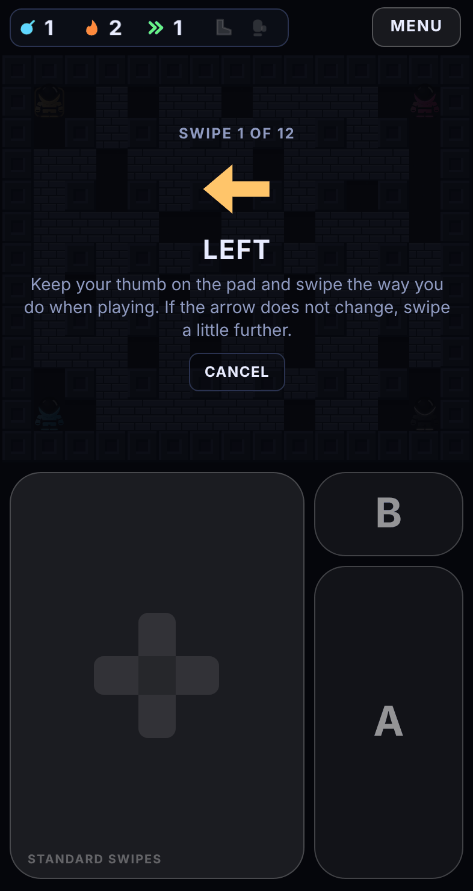
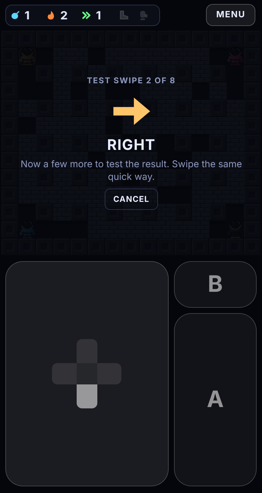
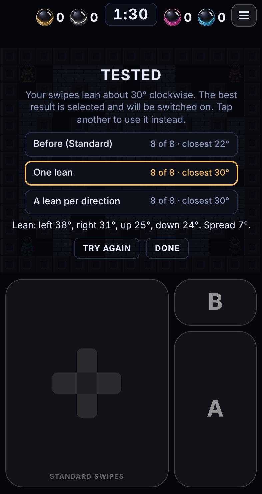
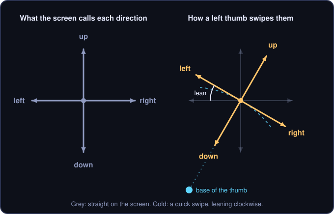
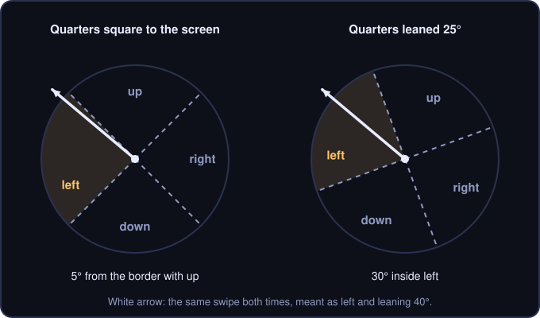

# Match my thumb

Match my thumb teaches the swipe pad how *your* swipes point. You make twelve swipes and it measures how far they lean away from straight. Then you make eight more, and it tests which setting reads those best: the one you had before, one lean for all four directions, or a lean for each direction. The winner is used from then on.

<p align="center">
  
  
  
</p>

This is version 2. Version 1 measured one lean and used it straight away, with no test. Version 1 is still described in [MATCH-MY-THUMB-V1.md](MATCH-MY-THUMB-V1.md), and its code is kept on the branch [`match-my-thumb-v1`](https://github.com/codybakerxx/BomberBot/tree/match-my-thumb-v1). The branch [`match-my-thumb-v2`](https://github.com/codybakerxx/BomberBot/tree/match-my-thumb-v2) keeps the game as it was when version 2 arrived.

## The problem it solves

The pad has to decide whether a swipe meant up, down, left or right. That is easy when swipes are straight. They are not.

A thumb is hinged at its base, down in the corner of the phone. When you flick it sideways, the tip travels round an arc, not along a level line. For a left thumb on the pad:

- a quick swipe **left** also drifts **up**
- a quick swipe **right** also drifts **down**
- a quick swipe **up** also drifts **right**
- a quick swipe **down** also drifts **left**

All four are turned the same way, clockwise. The amount they are turned is the **lean**.

<p align="center"></p>

Slow, careful swipes are nearly straight. Quick ones lean more, and how much depends on the hand and the grip. Suppose a swipe meant as "left" leans 40°. It is then almost exactly half way between left and up. If the pad divides the world into four quarters square to the screen, that swipe lands on the border and gets read as up about as often as left.

<p align="center"></p>

Leaning the pad's quarters the same way puts the swipe back in the middle of the quarter it was meant for.

How much a thumb leans depends on the hand, the size of the phone and the grip. It can also differ between directions: a thumb's sideways swipes often sweep a wider arc than its up and down ones. So the game measures it, and then checks that the measurement actually helps.

## Using it

1. Hold the phone the way you hold it when you play.
2. Open the menu and tap **Match my thumb** under *Swipe direction* in the Swipe pad box.
3. An arrow asks for a direction. Put your thumb on the pad and swipe that way, the same quick way you do in a game.
4. The arrow changes as soon as the swipe has been read. Keep going: twelve swipes, three in each direction.
5. **Test swipes** follow: eight more, two in each direction. Swipe them the same way.
6. The result shows three settings and how each one read your test swipes. The best is already selected. Tap **Done** to use it, or tap another setting first to use that instead.

It takes about 40 seconds.

Tips:

- Swipe naturally. If you draw careful straight lines here, the pad learns that your swipes are straight.
- You can keep your thumb on the pad throughout or lift it between swipes. Both work.
- If the arrow does not change, the swipe was too small to count. Swipe a little further. Swipes that small would not register in a game either; if that surprises you, set **Swipe length** to Short in the menu.
- If you swipe the wrong way by mistake, it says so and asks again. Nothing is recorded.
- **Cancel** at any point leaves your setting as it was.
- The result is saved on that phone, in that browser. Each friend matches their own thumb on their own phone.
- Do it again if you change how you hold the phone, for example from upright to sideways.

**Use standard**, next to the button in the menu, goes back to the standard lean.

Match my thumb only changes which way swipes count. It never changes **Swipe length**, and changing Swipe length never undoes a match.

## Reading the result

A result looks like this:

> **Tested.** Your swipes lean about 30° clockwise. The best result is selected. Tap another to use it instead.
>
> | | |
> |---|---|
> | Before (standard) | 8 of 8 · closest 22° |
> | **One lean** | **8 of 8 · closest 30°** |
> | A lean per direction | 8 of 8 · closest 30° |
>
> Lean: left 38°, right 31°, up 25°, down 24°. Spread 7°.

**The three settings**

| Setting | What it is |
|---|---|
| **Before** | Whatever the pad was using when you started: the standard 15° lean ("Before (standard)"), or your last match ("Before (last match)"). Listed so a new match has to prove it is better. |
| **One lean** | One lean for all four directions, worked out from all twelve swipes. This is what version 1 always used. |
| **A lean per direction** | Each direction gets its own lean, worked out from its own three swipes. Best when your directions lean differently. |

**The scores**

- **8 of 8** is how many test swipes the setting read as the direction that was asked for.
- **closest 22°** is the closest call: of the test swipes, the one nearest to a border still had 22° of room before it would have been read as a different direction. Bigger is safer. It is only shown when all eight were read right.

The winner is the setting that read the most test swipes right. If two read the same number, the one with the bigger closest call wins, compared in the whole degrees shown. If they are still level, the one higher in the list wins: a change only happens when it does better than what you had, and a lean per direction only when it does better than one lean.

**The other numbers**

| Number | Meaning |
|---|---|
| **lean about 30° clockwise** | The average lean of the twelve learning swipes. Clockwise is what a left thumb gives. Anticlockwise is possible too, for example with a right thumb. |
| **Lean: left, right, up, down** | The average lean of the three learning swipes in each direction. When these differ a lot, a lean per direction is more likely to win. |
| **Spread** | How much individual learning swipes varied round the average. Under 10° is very consistent. Up to 30° is accepted. |

If the twelve learning swipes pointed in too many different ways (a spread over 30°), the screen says **No match**, skips the test and changes nothing. Try again, a little more deliberately.

The menu shows which setting is in use under *Swipe direction*: standard, matched with one lean, or matched with a lean for each direction.

## How it works

### 1. Collecting the swipes

The directions are asked for in fixed, mixed-up orders:

- learning: left, up, right, down, right, left, down, up, left, down, up, right (`TEACH_ORDER` in [`src/teach.ts`](../src/teach.ts))
- testing: down, right, up, left, left, up, right, down (`TEST_ORDER`)

Each swipe is read by the same swipe pad the game uses, so it is measured exactly as it would be in play. The pad reports one **stroke** for each swipe that starts from a resting thumb or a fresh touch (`onStroke` in [`src/swipe.ts`](../src/swipe.ts)):

- as soon as the stroke is 36 px long, or
- when it ends, if it never gets that long.

Reading over 36 px matters. The first few pixels after a thumb touches down are unreliable, because the contact point shifts as the thumb settles onto the glass.

Two kinds of swipe are turned away and asked for again (`teachStroke` in [`src/main.ts`](../src/main.ts)):

- shorter than 20 px: "That one was very short"
- more than 80° away from the direction asked for: "That read as a different direction"

The test swipes are kept apart from the learning swipes. A setting is never scored on the swipes it was worked out from, because that would flatter it.

### 2. Measuring one swipe

Angles are measured on the screen, anticlockwise from "right": right is 0°, up is 90°, left is 180°, down is 270°.

The lean of one swipe is the angle asked for minus the angle swiped, so that clockwise comes out positive (`leanOf` in `src/teach.ts`).

**Example.** The game asks for *left* (180°). The thumb moves 34 px left and 21 px up. That stroke points at 148°, so its lean is 180° − 148° = **32° clockwise**.

### 3. Averaging

The leans are averaged with a *circular* mean, the correct way to average angles (`summarise` in `src/teach.ts`). Each lean is treated as a point on a circle, the points are averaged, and the angle of the average point is the answer:

```
mean lean = atan2( sum of sin(lean), sum of cos(lean) )
R         = length of the average point   (1 = all swipes identical, 0 = pointing everywhere)
spread    = sqrt( -2 × ln R )             (converted to degrees)
```

This is done for all twelve swipes together, and for each direction's three on their own. The result is used only if the overall spread is 30° or less.

### 4. From a lean to the pad's setting

The pad does not lean by the full amount measured. It uses **three quarters of it, and never more than 25° clockwise or 20° anticlockwise** (`tiltFor` in `src/teach.ts`).

| Measured lean | Pad lean |
|---|---|
| 0° | 0° |
| 10° | 8° |
| 20° | 15° |
| 30° | 23° |
| 40° | 25° (the limit) |
| −40° | −20° (the limit) |

The reason: matching measures your *quick* swipes. Your slow, deliberate swipes are much straighter. Both kinds have to land comfortably inside the right quarter. The limits also mean a perfectly straight swipe always stays at least 20° inside its own quarter, whatever the setting.

The two new candidates are built from this:

- **One lean** (`singleAims`): the pad lean for the overall average, the same for all four directions.
- **A lean per direction** (`perDirectionAims`): for each direction, the pad lean for the average of *its own lean and the overall lean*. Three swipes is a small sample, so each direction's own figure is pulled half way toward the overall one. That keeps most of a real difference between directions while damping a single stray swipe.

**Example**, using the result above (overall 30°; left 38°, right 31°, up 25°, down 24°):

| | Up | Down | Left | Right |
|---|---|---|---|---|
| One lean | 23° | 23° | 23° | 23° |
| A lean per direction | 21° (from 27.5°) | 20° (from 27°) | 25° (from 34°, at the limit) | 23° (from 30.5°) |

### 5. How the pad uses a setting

A setting is four **aims**: the screen angle each direction's swipes are expected to point at. With a lean of 23°, up is aimed at 67°, left at 157°, down at 247° and right at −23°.

A stroke counts as whichever direction it is aimed nearest to (`nearestDir` in `src/swipe.ts`). So the border between two directions sits half way between their aims. With one lean the four borders stay square to each other, just turned. With a lean per direction each border can sit at its own angle.

In practice the pad scores a stroke against each aim and takes the highest. For a stroke that moved `vx` px across and `vy` px down, and a direction aimed at angle `a`:

```
score = vx × cos(a) − vy × sin(a)
```

That is the stroke's length times the cosine of the angle between it and the aim, so the highest score belongs to the nearest aim (`aimScore` in `src/swipe.ts`).

**Example.** A 40 px swipe meant as *left* that leans 40°: `vx = −30.6`, `vy = −25.7`.

| Pad lean | left | up | Verdict |
|---|---|---|---|
| 0° (square to the screen) | 30.6 | 25.7 | Left, but only just. A little more wobble and it reads as up. |
| 25° | 38.6 | 10.4 | Left, clearly. |

The aims are used for every stroke the pad reads: the first one after touching down, a stroke from a resting thumb, and each new leg of a continuous swipe. They change only which direction a stroke counts as. The distances a thumb must travel stay the same.

### 6. The test

Each of the three settings reads the same eight test swipes (`judge` in `src/teach.ts`). For each one it records:

- how many it read as the direction asked for, and
- the **closest call**: the smallest distance between any test swipe and the border of its own quarter (`marginOf`). For a swipe at angle *s* meant as direction *d*, the distance to the border with a neighbouring direction *e* is half of (*s*'s angle to *e*'s aim minus its angle to *d*'s aim). It is negative if the swipe was misread.

The setting that read most swipes right wins. Ties go to the larger closest call, rounded to whole degrees as shown on screen, then to the earlier setting in the list (`pickBest`). The list runs before, one lean, a lean per direction, so the simpler setting wins a tie.

Why the closest call and not the average distance: moving the border between two directions only shifts room from one side's swipes to the other's, so the average hardly changes. The closest call shows whether a border sits uncomfortably near your swipes.

### 7. Where it is kept

The setting in use is saved in the browser's local storage under the key `controls2`, alongside the quiet-zone setting:

```json
{
  "zone": 100,
  "match": { "kind": "per", "lean": 30, "by": [0, 25, 24, 38, 31], "aims": [0, 69, 250, 155, -23] },
  "lean": 30
}
```

| Field | Meaning |
|---|---|
| `match` | `null` for the standard lean. Otherwise the setting chosen in the test. |
| `match.kind` | `single` for one lean, `per` for a lean per direction |
| `match.lean`, `match.by` | The measured leans, kept for display (`by` is indexed 1 up, 2 down, 3 left, 4 right) |
| `match.aims` | What the pad uses: the aim of each direction in screen degrees, same indexing |
| `lean` | The measured overall lean again, for a phone that still has version 1 of the game, which reads only this |

A setting saved by version 1 (just `{"zone": 100, "lean": 30}`) is read as *one lean*. Saved aims are checked when the game loads; any outside the limits are ignored and the standard lean is used instead.

Local storage belongs to one browser on one device. Clearing the browser's site data removes it, and it does not follow the game to another phone.

## The standard lean

Until someone runs Match my thumb, the pad leans **15° clockwise** in all four directions (`DEFAULT_TILT` in `src/swipe.ts`).

That figure is a middle course for a left thumb on the pad. It costs almost nothing for a player whose swipes are straight, and it takes most of the errors away for one whose swipes lean.

## What it cannot do

- It measures calm swipes. Swipes made in a panic may lean a little differently.
- The test is eight swipes. That is enough to catch a setting that clearly reads you badly, but two settings that both read all eight right are separated only by their closest call, which can come down to one swipe. The differences it decides between are small either way.
- Three learning swipes per direction is a small sample, which is why each direction's lean is pulled half way toward the overall one. A direction whose swipes vary a lot is measured less precisely than the overall lean.
- It assumes you keep holding the phone the same way.
- It corrects *which way* a swipe is read. It does not change how far you have to swipe; that is **Swipe length**, the other setting in the menu's Swipe pad box.

## How well it works

Version 1 was play-tested on a phone and worked well there. Version 2 has not been play-tested yet.

Simulations in [`experiments/`](../experiments/README.md) use a made-up thumb, so they are a guide and not a measurement of anyone's hand.

For single strokes made by a thumb resting on the pad, leaning helps a lot (from `stroke-reading.ts`):

| The thumb leans | Read wrong with no lean | Read wrong with the standard 15° lean |
|---|---|---|
| 0° | 0.0% | 0.6% |
| 15° | 0.4% | 0.0% |
| 30° | 10.1% | 0.6% |
| 40° | 34.5% | 5.1% |

Version 2's changes help much less, because by then most of the gain has been had (from `match-v2.ts`, five model thumbs, swipes scattering about 16°, share of play swipes read wrong):

| Model thumb | Standard | One lean always (version 1) | A lean per direction always | Test picks (version 2) |
|---|---|---|---|---|
| Straight | 3.00% | 0.44% | 0.49% | 0.75% |
| Even, 30° all round | 2.25% | 1.35% | 1.39% | 1.39% |
| Sideways lean more | 2.64% | 2.56% | 2.65% | 2.48% |
| Uneven (left 40°, down 10°) | 2.91% | 2.54% | 2.00% | 2.16% |
| Mixed (left 35°, up −5°) | 3.41% | 3.86% | 3.95% | 3.54% |
| **Average** | 2.84% | 2.15% | 2.10% | **2.06%** |

What this says:

- A lean per direction on its own is not a clear improvement. It helps a thumb whose directions lean very differently and slightly hurts the others, because three swipes per direction is a noisier measurement.
- Letting the test choose gives the best average, by a small margin. Its real value is protection: for the "mixed" thumb, where any matched setting reads worse than the standard one, the test mostly keeps the standard one.
- For a perfectly straight thumb the test sometimes keeps the standard lean when a match would have been slightly better (0.75% against 0.44%). That is the price of requiring a change to prove itself on eight swipes.

The result screen shows how it went for *your* thumb, which no simulation can.

## For developers

| Part | Where |
|---|---|
| The maths: `leanOf`, `summarise`, `tiltFor`, `singleAims`, `perDirectionAims`, `marginOf`, `judge`, `pickBest`, `TEACH_ORDER`, `TEST_ORDER` | [`src/teach.ts`](../src/teach.ts) |
| Aims: `STRAIGHT`, `uniformAims`, `aimScore`, `nearestDir`, and the pad's `aims` | [`src/swipe.ts`](../src/swipe.ts) |
| Reporting strokes (`onStroke`) | [`src/swipe.ts`](../src/swipe.ts) |
| The screen: `startTeach`, `teachPrompt`, `teachStroke`, `finishLearning`, `finishTesting`, `closeTeach`; saving and loading (`settings.match`, `validAims`, `applySettings`) | [`src/main.ts`](../src/main.ts) |
| The panel's markup and styles (`#teach`, `#teachChoices`, `.choice`, and the `.match` row in the menu) | [`src/page.html`](../src/page.html) |
| Checks of the maths, including that a straight swipe always keeps 20° of room | [`tests/teach.test.ts`](../tests/teach.test.ts) |
| Checks that the pad reads leaning swipes correctly and honours per-direction aims | [`tests/swipe.test.ts`](../tests/swipe.test.ts) |
| The simulation behind the design | [`experiments/match-v2.ts`](../experiments/match-v2.ts) |

The panel is laid over the arena only, so the pad stays usable while matching. While the panel is open the game is paused (`mode` is `'teach'`), so swipes do not move the robot.

Things you might want to change:

| To change | Edit |
|---|---|
| How many swipes are asked for, or their order | `TEACH_ORDER` and `TEST_ORDER` in `src/teach.ts` |
| The shortest swipe accepted (20 px) or the widest miss accepted (80°) | `teachStroke` in `src/main.ts` |
| How consistent the swipes must be (spread of 30°) | `summarise` in `src/teach.ts` |
| The three-quarters rule and the limits | `tiltFor` in `src/teach.ts` |
| How far each direction is pulled toward the overall lean (half way) | `perDirectionAims` in `src/teach.ts` |
| How the winner is chosen | `pickBest` in `src/teach.ts` |
| The lean used before matching | `DEFAULT_TILT` in `src/swipe.ts` |
