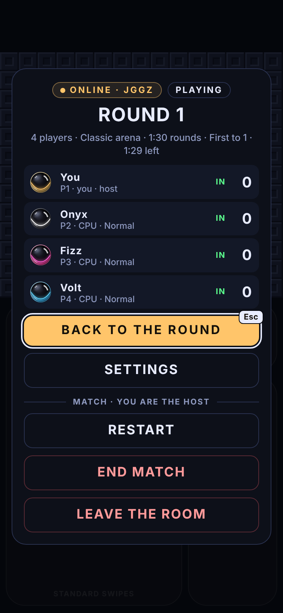

# Online play

BomberBot is online at **https://bomberbot.bomberbot.workers.dev**, on Cloudflare (chosen in November 2026).
The same address serves the game page and runs online rooms.

## How it plays

- **Title › Online** opens a small panel: **Make a room** or type a friend's four-letter code and **Join**.
  A link with `?room=CODE` opens the panel with the code filled in. The lobby's share button (top right) sends
  that link through the phone's share sheet, or copies it.
- **The lobby** is the same lobby as on a phone, with everyone in the room as player cards (P1 is whoever made
  the room, then people in the order they joined, then the CPU players). Each person picks a robot and presses
  Ready on their own screen. Robots stay different. Taking a CPU player's robot swaps with it, as on a phone.
- **The host** (whoever made the room) sets the match: the CPU players and every rule. The others can see the
  Match page but cannot change it. Only the host can start. If someone is not ready, the host is asked first.
  A room needs someone to play against: a CPU player or another person. Up to eight players in all; a person who
  joins a full room takes the last CPU player's place.
- **A round** cannot be paused. Anyone can open the menu, and the round carries on behind it (the owner's
  choice). Only the host has **Restart** (the whole match again, for everyone) and **End match** (everyone back
  to the lobby). Everyone has **Leave the room**.
- **Rounds are played out.** Nobody gets a round at random, as in solo play. When a round is decided, only the
  host has **Next round** (or **Rematch** and **Lobby** once the match is won). The others see who starts it.
- **Dropped connections**: the page tries again for a minute, with a "Reconnecting…" line at the top. The
  robot stands still meanwhile and comes back where it is. Reloading the page goes straight back into the room.
  A host gone for 12 seconds hands the room to the next person still in it.
- **Someone joining during a match** waits in the lobby (read-only) and plays from the next match.
- The page opened as a file (as when it is sent to a phone) still plays online: it connects to the address above.

| Making or joining a room | The menu in an online match (the round goes on) |
|---|---|
|  |  |

A friend's lobby on a computer: the host's rules shown read-only, no Start.

## How it works

One Durable Object per room code (`RoomDO` in `src/worker.ts`) keeps the room (`src/room.ts`) in memory while
anyone is in it. Rooms are not saved anywhere; when everyone has gone, the room goes.

**The server runs the round.** It steps `sim.ts` 60 times a second and asks `bot.ts` for the CPU players' moves,
exactly as a phone does. Each tick it sends every page what every player pressed on that tick, one character each
(`tickText` in `src/net.ts`). Each page steps its own copy of the world with those inputs (`playout` in
`src/online.ts`), and because the rules give the same match for the same seed and inputs, every copy stays the
same. Pages never run the CPU players. This is why the pure modules must stay pure.

- **Checksums.** Every 30 ticks the server adds a checksum of its world (`worldHash`). A page whose world differs
  asks for the whole world (`sync`, answered by `snap`) and carries on from it. Two browsers playing each other
  have never differed in testing.
- **Smoothness.** A page keeps two ticks in hand before stepping, steps one extra a frame when it falls more than
  five behind, and jumps to the latest when far behind (back from the background).
- **Inputs.** A page sends what you press when it changes. A press of A or B is kept for the next tick even if it
  is let go before then, so a quick tap is never lost.
- **Delay.** There is no prediction yet: your robot moves when the server's tick comes back, so it lags by the
  round trip to the server (about 30 to 100 ms between nearby players; more across a continent). If it feels
  slow, the fix is to step your own robot ahead of the server and correct it (`cloneWorld` makes that possible).
- **Who is who.** The server sends each round's `seats` (a person or a CPU player in each place). `main.ts` uses
  your place (`meIdx`) wherever it used to assume player 0 is you.

### The messages (`src/net.ts`)

| From the page | |
|---|---|
| `hello` | first: the page's own id (kept in sessionStorage, so a reload is the same person), name, robot, dance, and whether it is making the room |
| `me` | your robot, Ready, dance and name in the lobby |
| `setup` | the host's setup |
| `start`, `next`, `restart`, `lobby` | the host's buttons |
| `in` | what you are pressing (five bits) |
| `sync`, `ping`, `bye` | out of step; keeping the connection alive (every 15 s); leaving |

| From the server | |
|---|---|
| `room` | who is in the room, the host, the setup, whether a match is on |
| `round` | a new round: its world config, the seats, the score |
| `ticks` | inputs for a run of ticks, and sometimes a checksum |
| `snap` | the whole world, the seats and the score |
| `error` | something went wrong (`fatal`: the connection is closing: no such room, room full) |

## Costs

Everything fits Cloudflare's **free plan** for play among friends: Durable Objects with SQLite storage are
included, sending messages out costs nothing, and messages in count as one request per twenty. A room is
billed by the time someone is connected (about 28 hours of rooms a day are free). The Workers Paid plan
($5 a month) is the step up if it is ever needed.

## Putting it online

Every push to `main` runs `.github/workflows/deploy.yml` on GitHub: it installs, runs `npm run check` and
uploads with `wrangler deploy` (`wrangler.jsonc` says what to upload). Claude's sessions cannot reach Cloudflare
directly, so GitHub does the upload.

**Trying it on a computer:** `npm run build`, then `npx wrangler dev`, and open http://127.0.0.1:8787 in two
browser windows. The server runs locally with the same code.

### One-time setup (done, November 2026)

1. In the Cloudflare dashboard, open **Workers & Pages** once, and pick the account's workers.dev subdomain.
2. Make a **user** API token at dash.cloudflare.com/profile/api-tokens with the **Edit Cloudflare Workers**
   template (not an Account API token, and not a "Read" template). In its Zone policy pick **All zones**.
3. On GitHub, **Settings › Secrets and variables › Actions › New repository secret**, twice:
   `CLOUDFLARE_API_TOKEN` with the token, `CLOUDFLARE_ACCOUNT_ID` with the Account ID.
4. **Actions › Deploy to Cloudflare › Run workflow** (or push anything to `main`).

Never paste the token into a chat, a file or a commit: it goes only into GitHub's secrets.
