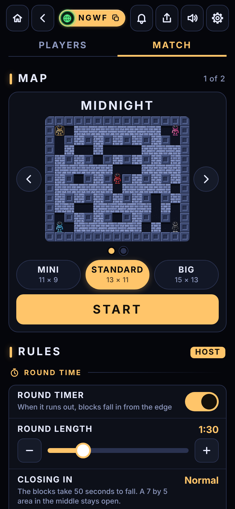
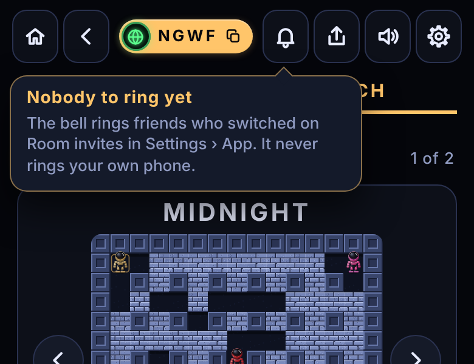
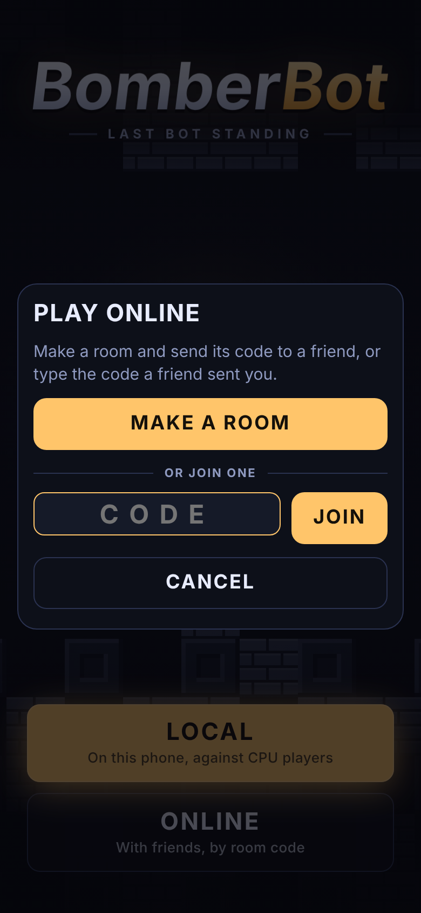
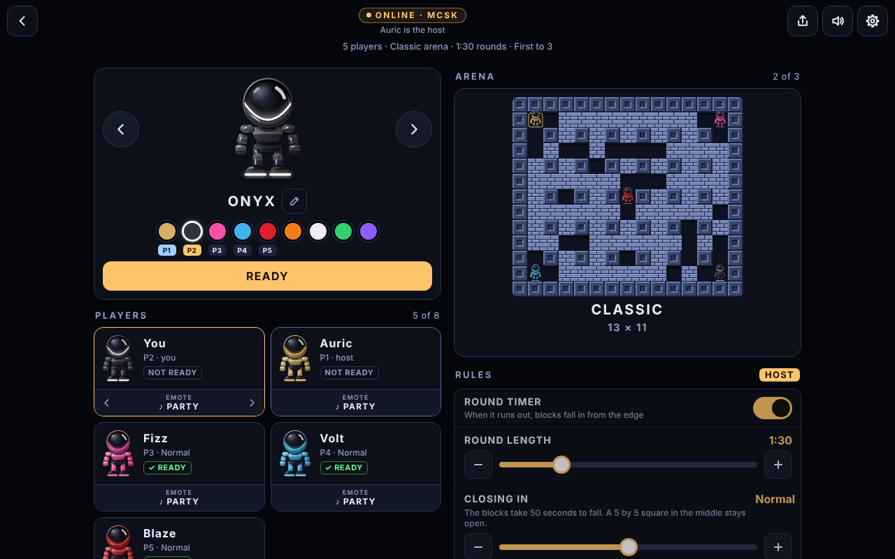

# Online play

BomberBot is online at **https://bomberbot.bomberbot.workers.dev**, on Cloudflare (chosen in November 2026).
The same address serves the game page and runs online rooms.

## Notifications (Tell friends)

In an online lobby the host has a bell beside the share button. It sends a notification to every phone that turned on Settings › App › Room invites (not the host's own): "Cody wants to play · Room BKTW is open. Tap to join." Tapping it opens the game at that room's join panel. The room's server object passes it to `Friends` (`worker.ts`), one object for the whole game, which keeps the list of phones and its own signing key on its disk, and sends through each phone's push service (Apple's or Google's) with `push.ts`. Limits: once a minute per room, 30 an hour in all, the newest 45 phones. On an iPhone, notifications only work in the home-screen app (iOS 16.4 and newer).

The bell swings when tapped and answers in a bubble under it: who was rung, or why nobody was (`BellAnswer` in `net.ts`: `sent`, `none`, `wait`, `busy`, `fail`; the server always answers). Since it never rings the phone it is tapped on, it cannot be tried alone on one phone: switch Room invites on in the home-screen app on a phone, then host a room from a computer (or another phone) and ring.

| The host's lobby: the room's code, the bell, share | Ringing with nobody else signed up |
|---|---|
|  |  |

## Even frames

The picture's tick is read off a clock (`frame` in `predict.ts`). Frames come one tick apart on most screens, each at the same point in its tick; if that point is right where one tick turns into the next, the smallest wobble in a frame's time shows one tick twice and then skips one. A phone gives frame times in whole milliseconds, which is wobble enough. So a frame that falls within `EDGE` of that edge has the reading leaned to the middle of a tick, once (`lean`: always forwards, under a tick, so a press is never stamped later). Measured with `WHOLE_MS=1 tools/online-feel.py 35,25`: the host's own robot went from up to 5% of frames uneven to about 1% or less, with the delay from press to move unchanged (22 to 28 ms).

## How it plays

- **Title › Online** opens a small panel: **Make a room** or type a friend's four-letter code and **Join**.
  A link with `?room=CODE` opens the panel with the code filled in. The lobby's share button (top right) sends
  that link through the phone's share sheet, or copies it.
- **The lobby** is the same lobby as on a phone, with everyone in the room as player cards (P1 is whoever made
  the room, then people in the order they joined, then the CPU players). Each person picks a robot and presses
  Ready on their own screen. Robots stay different. Taking a CPU player's robot swaps with it, as on a phone.
- **The host** (whoever made the room) sets the match: the CPU players and every rule. The others can see the
  Match page but cannot change it. Only the host can start. If someone is not ready, the host is asked first.
  A room needs someone to play against: a CPU player or another person. Up to eight players in all; a person who
  joins a full room takes the last CPU player's place.
- **A round** cannot be paused. Anyone can open the menu, and the round carries on behind it (the owner's
  choice). Only the host has **Restart** (the whole match again, for everyone) and **End match** (everyone back
  to the lobby). Everyone has **Leave the room**.
- **Rounds are played out.** Nobody gets a round at random, as in solo play. When a round is decided, only the
  host has **Next round** (or **Rematch** and **Lobby** once the match is won). The others see who starts it.
- **Dropped connections**: the page tries again for a minute, with a "Reconnecting…" line at the top. The
  robot stands still meanwhile and comes back where it is. Reloading the page goes straight back into the room.
  A host gone for 12 seconds hands the room to the next person still in it.
- **Someone joining during a match** waits in the lobby (read-only) and plays from the next match.
- The page opened as a file (as when it is sent to a phone) still plays online: it connects to the address above.

| Making or joining a room | The menu in an online match (the round goes on) |
|---|---|
|  |  |

A friend's lobby on a computer: the host's rules shown read-only, no Start.

## How it works

One Durable Object per room code (`RoomDO` in `src/worker.ts`) keeps the room (`src/room.ts`) in memory while
anyone is in it. Rooms are not saved anywhere; when everyone has gone, the room goes.

**The server runs the round.** It steps `sim.ts` 60 times a second and asks `bot.ts` for the CPU players' moves,
exactly as a phone does. Each tick it sends every page what every player pressed on that tick, one character each
(`tickText` in `src/net.ts`), or two for a player steering a plane (a laptop's: the second says which of 64 ways). Each page steps its own copy of the server's world with those inputs the moment
they arrive, and because the rules give the same match for the same seed and inputs, every copy stays the same.
Pages never run the CPU players. This is why the pure modules must stay pure.

- **Checksums.** Every 30 ticks the server adds a checksum of its world (`worldHash`). A page whose world differs
  asks for the whole world (`sync`, answered by `snap`) and carries on from it. Two browsers playing each other
  have never differed in testing.
- **Who is who.** The server sends each round's `seats` (a person or a CPU player in each place). `main.ts` uses
  your place (`meIdx`) wherever it used to assume player 0 is you.

### Why it feels like playing on one screen (`src/predict.ts`)

The server's world on a page is always right but a little in the past: by the time a tick arrives, the server
is already further on, and a press takes a trip there and back before it shows. Drawing that world as it
arrives is what the first version did, and it felt slow and jerky (the owner's report; the numbers are below).
So the page does not draw it. It draws a **picture** run on from it:

- **Your robot moves at once.** Every frame the page copies the server's world and plays it on to *now*, with
  what you have pressed since. Your robot, your bombs, and everything that follows from bombs already down
  (fuses, blasts, falling blocks, the timer) are drawn where they will be when the server gets there. The copy
  is thrown away and made again whenever the server says more, so it cannot drift. It costs about 0.02 ms on a laptop.
- **Presses say which tick they are for.** The server keeps a press until its tick (`InputQueue` in `net.ts`,
  the same lines on both sides). So when that tick comes back from the server it is the tick the picture
  already showed, and nothing moves on the screen. A press that reaches the server after its tick is taken in
  on the next one; the server's acks tell the page, the picture is made again from that, and your robot shifts
  by a tick's walk, about a pixel. A quick tap of A or B, let go before the next tick, still counts.
- **A clock that runs just far enough ahead.** For a press to arrive before its tick, the picture runs ahead of
  the server by the trip there and back. Pings measure it twice a second (five quick ones as a round starts):
  each pong says where the round's clock stood when the ping arrived. The page runs at the slowest of the last
  ten, one freak aside, plus two ticks (`MARGIN`), and moves there gently: up to a quarter faster or a twentieth
  slower for a moment, never backwards. If the connection stalls, the picture waits after 40 ticks.
- **The other robots are not guessed at.** Guessing where someone else will walk makes them snap back at every
  turn. In the picture they are drawn where the server last said they were, a few ticks back, read from a short
  history, so they walk evenly however unevenly the ticks arrive. How far back follows the connection: as far
  as the ticks have lately been late, easing forward a tick a second. The cost: you see the others a fraction
  of a second behind your own robot (about the ping plus that cushion).
- **Sounds** your own actions make, and blasts, are played from the picture, on time, and not again when the
  server confirms them (`heard`). Knock-outs and everything about the others sound on the server's word.
- **Scores, results and who is out** come only from the server's world.

**Measured** in two browsers playing each other through a made-up connection (`tools/online-feel.py`), as seen
on one of them. "Uneven" is the share of frames, while walking, in which a robot stood still or leapt.

| Connection each way | First version: press to move | uneven: yours / theirs | Now: press to move | uneven: yours / theirs |
|---|---|---|---|---|
| 5 to 7 ms (wired) | 95 ms | 38% / 36% | 20 ms | 3% / 1% |
| 35 to 60 ms, with spikes | 181 ms | 38% / 39% | 23 ms | 0% / 3% |
| 70 to 120 ms, with spikes | 352 ms | 75% / 71% | 27 ms | 1% / 1% |
| Playing on one screen, for comparison | | | 26 ms | 4 to 9% |

About 20 to 27 ms is one frame, the least the test can see. The first version was uneven even on a perfect
connection: it held ticks back to step them evenly and kept running dry. `tests/predict.test.ts` checks the same
things without a browser, at 60 and 120 frames a second, on connections up to 150 ms each way.

What nobody can measure here is the real connection between a phone and Cloudflare, or the feel under a thumb.
The menu during an online match shows the ping, to tell a slow connection from a fault.

### The messages (`src/net.ts`)

| From the page | |
|---|---|
| `hello` | first: the page's own id (kept in sessionStorage, so a reload is the same person), name, robot, dance, whether it is making the room, and the version of these messages (`PROTOCOL`: a page left open from before an update is turned away and told to reload) |
| `me` | your robot, Ready, dance and name in the lobby |
| `setup` | the host's setup |
| `start`, `next`, `restart`, `lobby` | the host's buttons |
| `in` | what you are pressing (five bits, and the way you steer, `IN_AIM`, while you fly a laptop's plane), the tick it is for (`k`), its number (`n`) and the round's (`e`) |
| `ping` | every 15 s to keep the connection open; twice a second in a round, for the clock |

`PROTOCOL` is 3 since the laptop (18 November 2026): a tick's text is one character a player (`DIGITS`), or two for one steering a plane (one from `STEER`, which holds its five bits, then one from `AIMS`, the way: 64 of them). A page only sends its steering while its plane is up (`flyingAim` in main.ts), so the usual tick text is as short as ever. Another player's plane is drawn where the server last said, like their robot (`predict.ts` does not guess their steering).
| `sync`, `bye` | out of step; leaving |

| From the server | |
|---|---|
| `room` | who is in the room, the host, the setup, whether a match is on |
| `round` | a new round: its world config, the seats, the score, and the number to send with its presses (`ep`) |
| `ticks` | inputs for a run of ticks; sometimes a checksum; how far each person's presses have been taken in (`a`), when that changes |
| `snap` | the whole world, the seats and the score, and a new `ep` |
| `pong` | the ping's own number back; in a round, where the round's clock stood when it arrived (`d`) |
| `error` | something went wrong (`fatal`: the connection is closing: no such room, room full) |

## Costs

Everything fits Cloudflare's **free plan** for play among friends: Durable Objects with SQLite storage are
included, sending messages out costs nothing, and messages in count as one request per twenty. A room is
billed by the time someone is connected (about 28 hours of rooms a day are free). The Workers Paid plan
($5 a month) is the step up if it is ever needed.

## Putting it online

Every push to `main` runs `.github/workflows/deploy.yml` on GitHub: it installs, runs `npm run check` and
uploads with `wrangler deploy` (`wrangler.jsonc` says what to upload). Claude's sessions cannot reach Cloudflare
directly, so GitHub does the upload.

**Trying it on a computer:** `npm run build`, then `npx wrangler dev`, and open http://127.0.0.1:8787 in two
browser windows. The server runs locally with the same code. `tools/online-feel.py` then measures how it feels
over a slow connection (above); run it before and after any change to `predict.ts`, `online.ts` or `room.ts`.

### One-time setup (done, November 2026)

1. In the Cloudflare dashboard, open **Workers & Pages** once, and pick the account's workers.dev subdomain.
2. Make a **user** API token at dash.cloudflare.com/profile/api-tokens with the **Edit Cloudflare Workers**
   template (not an Account API token, and not a "Read" template). In its Zone policy pick **All zones**.
3. On GitHub, **Settings › Secrets and variables › Actions › New repository secret**, twice:
   `CLOUDFLARE_API_TOKEN` with the token, `CLOUDFLARE_ACCOUNT_ID` with the Account ID.
4. **Actions › Deploy to Cloudflare › Run workflow** (or push anything to `main`).

Never paste the token into a chat, a file or a commit: it goes only into GitHub's secrets.
